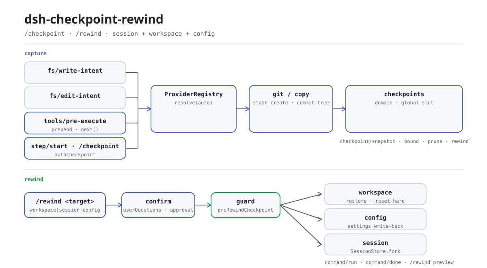

<div align="center">

<picture>
  <source media="(prefers-color-scheme: dark)" srcset="docs/assets/dsh-checkpoint-rewind-flow-dark.svg">
  
</picture>

# dsh-checkpoint-rewind

**Turn “back to step N” into one command — three-state workspace, config, and session checkpoints, rolled back in one approved transaction.**

A rewind capability-seam plugin for DeepSeek Harness: capture the workspace with side-effect-free git primitives before every mutation, then guard, restore files, restore config, and fork the session — the original session history is never truncated.

[Install](#three-step-setup) · [Configuration](#configuration) · [FAQ](#faq) · [简体中文](README.md) · [English](README.en.md) · [Español](README.es.md) · [Português](README.pt.md) · [हिन्दी](README.hi.md)

[](LICENSE)
[](#compatibility)
[](https://www.npmjs.com/package/dsh-checkpoint-rewind)
[](https://github.com/PerryLink/dsh-checkpoint-rewind/actions/workflows/ci.yml)
[](#compatibility)

[](https://github.com/PerryLink/dsh-checkpoint-rewind/stargazers)
[](https://www.npmjs.com/package/dsh-checkpoint-rewind)
[](https://dshfind.com/plugins/PerryLink/dsh-checkpoint-rewind?ref=badge)
[](https://securityscorecards.dev/viewer/?uri=github.com/PerryLink/dsh-checkpoint-rewind)
[](https://dsh.market/)
[](https://gitee.com/perrylink/dsh-checkpoint-rewind)

```sh
dsh plugin --profile <name> add dsh-checkpoint-rewind
```

</div>

<sub>Community plugin, not affiliated with DeepSeek. Canonical repository: <https://github.com/PerryLink/dsh-checkpoint-rewind> (Gitee is a mirror).</sub>

## What it is

`dsh-checkpoint-rewind` captures a **three-state unified checkpoint** — workspace, session cursor, and plugin config — and restores one or all three with a single approved command. Workspace snapshots prefer side-effect-free git primitives (`stash create` / `commit-tree`); non-git directories (and repos with an unborn HEAD) degrade to incremental `copy` snapshots with hardlink reuse. Session rollback never truncates the original session: it forks a new child session at the checkpoint boundary, leaving the original history intact. Checkpoints are captured before mutating tools, on an automatic interval, manually via `/checkpoint`, and as a guard before every rewind; the Settings page adds a checkpoint timeline with pairwise line-level diffs.

## Three-step setup

1. **Install** (pick one channel):

   ```sh
   # git channel (latest main; equivalent to git+https://github.com/PerryLink/dsh-checkpoint-rewind.git)
   dsh plugin --profile web add github:PerryLink/dsh-checkpoint-rewind
   # npm channel (published releases)
   dsh plugin --profile web add dsh-checkpoint-rewind
   # tarball channel: npm pack in this repo, then
   dsh plugin --profile web add ./dsh-checkpoint-rewind-<version>.tgz
   ```

   Pure ESM, no build step — `index.mjs` and `lib/` are the shipped artifacts.

2. **Minimal config**: compose the storage stack (required for checkpoint persistence) and mount the plugin row. Without the storage stack the plugin still mounts and never blocks profile startup; checkpoint/rewind commands return a structured error naming the exact rows to add:

   ```yaml
   - insert:
       - id: checkpoint-rewind-storage
         name: '@deepseek-ai/dsh-storage'
       - id: checkpoint-rewind-storage-json
         name: '@deepseek-ai/dsh-storage-json'
         config:
           root: !!js dshHomePath('checkpoint-rewind/storage')
       - id: checkpoint-rewind-storage-domain
         name: '@deepseek-ai/dsh-storage-domain'
         config:
           backend: json
       - id: checkpoint-rewind
         name: dsh-checkpoint-rewind
         config:
           provider: auto
           confirmVia: auto
   ```

3. **Verify it mounts**:

   ```sh
   dsh --profile web --dump-config | grep -A4 'id: checkpoint-rewind'
   ```

   Then list checkpoints; workspace mutations create them automatically:

   ```text
   > /rewind list brief
   rewind: 3 checkpoints (newest last):
   #a1b2c3d4 · (git) · turn 2 step 1 · 2026-08-14 12:00:01 (3 min ago) · trigger: bash · 4 files · 1.2 MiB
   #b2c3d4e5 · (git) · turn 2 step 3 · 2026-08-14 12:00:41 · trigger: str_replace_editor · 2 files · 310 KiB
   #c3d4e5f6 · (copy) · turn 3 step 1 · 2026-08-14 12:01:10 · trigger: write · 1 file · 90 KiB
   run "/rewind <id>" to restore files and fork the session from that checkpoint
   ```

**Uninstall**: `dsh plugin --profile web remove dsh-checkpoint-rewind` — snapshot files stay until you delete `$DSH_HOME/dsh-checkpoint-rewind`; git objects are garbage-collected.

> Checkpoints persist through the `storageDomain` service. Profiles that already compose the stack work out of the box; a bare profile still mounts and can capture manually, but commands fail loudly when the domain cannot open — they never silently degrade to “no checkpoints”.

## Core capabilities

`dsh-checkpoint-rewind` leaves a restorable three-state record before every mutation and turns restore into a fixed-order transaction:

1. **Three-state record** — every checkpoint stores the workspace state (git tree SHA, or a copy manifest), the session event cursor (`seq` + turn boundary), and a config snapshot, tagged by source (`manual` / `auto` / `guard` / `mutation`).
2. **Four capture triggers** — before every mutating tool (`fs/write-intent`, `fs/edit-intent`, `tools/pre-execute`), on automatic interval (`autoCheckpoint`, default every step), manually (`/checkpoint` and the `checkpoint` tool), and as a guard before every rewind.
3. **git-first provider** — `git stash create` / `commit-tree` produce unreferenced snapshot objects that never touch your worktree, index, or history; restore is worktree-only and path-explicit. Non-git directories (and unborn-HEAD repos) degrade to an incremental `copy` provider with hardlink reuse.
4. **One-shot rollback** — `/rewind workspace|session|config|all <target>` restores the selected states; `preview` is a read-only impact report, `diff <a> <b>` compares two checkpoints, `clear` deletes them (this session; `clear --all` spans all sessions and workspaces).
5. **Fork-based session rollback** — session rollback replays events up to the checkpoint boundary through the official `SessionStore.fork` primitive into a new child session (falling back to the seeded `sessions.create` path when the host has no fork or the checkpoint has no boundary); the original session keeps its full history.
6. **Settings page timeline** — the `Plugins → Checkpoints` tab renders the session's checkpoints with pairwise line-level diffs (`diffRenderer`) and per-file selective restore (`selectiveRestore`).

### Commands & tools surface

| Surface | Kind | Notes |
|---|---|---|
| `/rewind` | command | `[workspace\|session\|config\|all] <number\|id-prefix\|step <N>\|latest>` · `list [brief]` · `diff <a> <b>` · `preview <target>` · `clear [--all]` |
| `/checkpoint` | command | `[note <text>\|list\|diff <a> <b>]` — capture a manual checkpoint |
| `checkpoint` | tool | Capture a manual checkpoint with an optional note |
| `fs/write-intent` · `fs/edit-intent` · `tools/pre-execute` | listeners | Pre-mutation capture (prepend pass-through; never steals the policy slot) |
| `session/event` | listener | Turn/step tracking, auto interval, boundary backfill, turn-end pruning |
| `checkpoints` projection | session projection | Timeline strip folded from the session log |
| Settings page timeline | client | `Plugins → Checkpoints` tab with pairwise diffs and per-file selective restore |

### Examples

These are the plugin's real entry points; install once, then call one.

**Detailed example** — command `/rewind preview cp-9`, output:

~~~text
rewind preview: checkpoint #cp-9 (provider git, turn 2 step 3)
restoring it would overwrite 2 file(s):
  a.txt
  b.txt
5 file(s) already match the checkpoint (not touched).
no files are deleted: 1 file(s) created after the checkpoint would be left in place:
  new.txt
run "/rewind <id>" to confirm and apply (a guard checkpoint is captured first)
~~~

*Observed from `test/checkpoints.test.mjs:289-301; lib/checkpoints.mjs:484-500`*

**Failure branch** — input `/rewind nope`, output:

~~~text
rewind: unknown checkpoint id "nope" (run /rewind to list)
~~~

*Observed from `plugins/dsh-checkpoint-rewind/lib/errors.mjs:72; plugins/dsh-checkpoint-rewind/index.mjs:1223; plugins/dsh-checkpoint-rewind/test/index.test.mjs:346-350`*

**Brief examples**: `/checkpoint` · `/rewind preview`

### Session numbers

- **Every checkpoint gets a number when it is created**, starting at `1`. `/rewind 3` resolves that number **exactly** — digits are never treated as an id prefix, so `/rewind 3` can never land on the checkpoint whose UUID happens to start with `3`.
- **Scope: per session** (`sessionId`). Each session numbers its own checkpoints; a number is unique inside its session, and `/rewind <number>` resolves against the checkpoints of the current session (and workspace) only.
- **Monotonic and never reused.** Quota pruning (`maxSnapshots`) and `/rewind clear` / `/rewind clear --all` delete records but never free a number: after a clear the next checkpoint continues from the previous high-water mark (so after `#1 #2 #3` and a `clear`, the next one is `#4`, not `#1`). The number is stored on the record itself and the counter lives in the domain's global slot, so deleting records cannot reset it.
- **Older checkpoints are numbered on first sight.** Records written before this feature (no number field) are numbered in creation order the first time the session is listed or rewound, and that numbering is persisted; brand-new checkpoints continue after it. Nothing is skipped or reassigned, and id-prefix addressing keeps working for them.
- `/rewind list` (the detailed list) is unchanged: it still prints the 8-char id per line and its last line points at `/rewind list brief` for the numbers.

`preview` resolves through the same addressing and prints the impact without asking for confirmation or writing anything. `--files` restores only the named files through the same approval-gated transaction (unknown paths fail closed; it is incompatible with `workspaceRestore: reset-hard` and disabled when `selectiveRestore: false`).

### Why another rewind plugin?

| Plugin | What it sells | Restores files? | Rewinds the session? |
|---|---|---|---|
| **dsh-checkpoint-rewind** (this) | git-object snapshots + three-state rollback + one-shot restore | ✅ full workspace state | ✅ seed-replay child session |
| [Anionex/dsh-turn-rewind](https://github.com/Anionex/dsh-turn-rewind) | persistent Change Ledger of per-mutation deltas | ✅ by replaying inverse deltas | ✅ its own ledger model |
| [LingLambda/dsh-undo](https://github.com/LingLambda/dsh-undo) | pure context rollback to the last completed step | ❌ | ✅ context only |
| [Mongfayi/dsh-recall](https://github.com/Mongfayi/dsh-recall) | message recall (remove a turn and everything after) | ❌ (explicitly) | ✅ turn removal |

The difference in one sentence: **dsh-checkpoint-rewind captures the *workspace state* with side-effect-free git primitives before each mutation, and makes “back to step N” one approved command — guard checkpoint first, files restored second, config restored third, session replayed fourth, each phase logged.** No delta bookkeeping to drift, no message-level editing (that belongs to a different plugin), no cross-device sync.

### How it works

```text
capture ── fs/write-intent · fs/edit-intent · tools/pre-execute (prepend, pass-through)
        ── step/start auto interval ── /checkpoint · checkpoint tool ── pre-rewind guard
             │
             ▼  ProviderRegistry.resolve(auto)  →  git: stash create / commit-tree
             │                                     copy: incremental dir + hardlinks
             ▼
        checkpoints storage domain (SQLite rows / JSON file)  +  checkpoint/* event (adaptive gate)

/rewind <target> ── confirm (userQuestions / approval, fail-closed) ──▶ guard checkpoint
             ├─ workspace: provider.restore(ref)  (restore | reset-hard)
             ├─ config:   settings write-back (persisted on the profile patch)
             └─ session:  SessionStore.fork(source, boundary) → new child session (original untouched)
```

Full decision record, event vocabulary, and the provider seam contract: [ARCHITECTURE.md](ARCHITECTURE.md).

### Session events (rc.2 note)

The plugin declares `checkpoint/snapshot`, `checkpoint/bound`, `checkpoint/prune`, and `checkpoint/rewind` as log-only `SessionEventMap` members. Harness rc.2 has **no plugin event-registration surface** and `Session.append` does not stamp the `ignorable` envelope (its third argument is surface intent, not options), so appending unknown types would make the session unreadable on reload. The plugin therefore appends through an **adaptive gate**: a runtime probe (on a detached, never-persisted session store) detects whether the host's `append` stamps the `ignorable` envelope — on rc.2 the gate stays closed; on hosts that support it, `checkpoint/*` events are appended with `ignorable: true` automatically. Until then the authoritative audit chain is `command/run` + `command/done` (harness-known) plus the durable `checkpoints` storage domain.

### Web UI anchor

The plugin returns the new session id in the command result (`session: <id>`) and the Web shell can navigate there. The **session-projection unit `checkpoints` is shipped**: whenever `ctx.sessionProjections` exists, the plugin registers the unit via `ctx.inject` (folds `checkpoint/snapshot|bound|prune|rewind` into a whole-value list) — it stays an empty list on rc.2 hosts until a harness build ships the `checkpoint/*` vocabulary or the `ignorable` envelope, then fills in with zero plugin changes.

### Integration verification

A real assembled-headless integration run (`npm run test:integration`) drives the full flow: the agent modifies files across two turns, then `/rewind preview` inspects the impact read-only (no confirmation gate, no writes) and `/rewind <id>` restores the files and replays the session into a new child session. The run asserts the file contents, the replayed child context, the guard checkpoint, and that files created after the checkpoint survive — for both the copy and git provider flows (the git flow also asserts `HEAD` and the reflog are untouched). The driver lives in `test/integration/rewind-headless.mjs`.

## Configuration

All tunables are Schemastery `Config` fields (changeable from cordis.yml); nothing is hardcoded. Provider options (`gitBin`, `snapshotDir`, `excludeGlobs`, `verifyByHash`) are read from the live config at use time, so cordis.yml changes apply without a restart. An id-targeted override replaces the whole row — restate every key you need.

Most-used keys:

| Key | Default | Meaning |
|---|---|---|
| `enabled` | `true` | Master switch; `false` removes the commands, listeners, and providers entirely |
| `provider` | `auto` | Snapshot provider: `auto` (git if available, else copy) · `git` · `copy` |
| `maxSnapshots` | `50` | Checkpoints kept per session (oldest pruned first) |
| `maxSnapshotBytes` | `536870912` (512 MiB) | Global incremental-byte soft quota (newest per live session always retained) |
| `confirmVia` | `auto` | Confirmation channel: `auto` (userQuestions first) · `userQuestions` · `approval` |
| `preRewindCheckpoint` | `warn` | Guard checkpoint before restore: `warn` · `require` · `off` |
| `workspaceRestore` | `restore` | Workspace rollback: `restore` (safe overwrite) · `reset-hard` (CC-style, opt-in) |
| `autoCheckpoint.enabled` | `true` | Automatic interval snapshots on `step/start` |

<details>
<summary>Full configuration table (20 keys)</summary>

| Key | Default | Meaning |
|---|---|---|
| `enabled` | `true` | Master switch; `false` removes the commands, listeners, and providers entirely |
| `provider` | `auto` | Snapshot provider: `auto` (git if available, else copy) · `git` · `copy` |
| `gitBin` | `git` | Git executable path |
| `snapshotDir` | `$DSH_HOME/dsh-checkpoint-rewind` (fallback `~/.dsh/dsh-checkpoint-rewind` when `$DSH_HOME` is unset) | Root for copy-provider snapshots |
| `maxSnapshots` | `50` | Checkpoints kept per session (oldest pruned first) |
| `maxSnapshotBytes` | `536870912` (512 MiB) | Global incremental-byte soft quota (newest per live session always retained) |
| `pruneOnTurnEnd` | `true` | Run quota pruning when a turn ends |
| `mutationTools` | `['bash','write','edit','str_replace_editor','pwsh','terminal_send']` | Tools treated as mutating at `tools/pre-execute` |
| `excludeGlobs` | `['node_modules','.git','.dsh','dist','build']` | Glob patterns skipped by the copy provider |
| `confirmVia` | `auto` | Confirmation channel: `auto` (userQuestions first) · `userQuestions` · `approval` |
| `listLimit` | `10` | Checkpoints shown by bare `/rewind` |
| `preRewindCheckpoint` | `warn` | Guard checkpoint before restore: `warn` · `require` · `off` |
| `verifyByHash` | `false` | Copy-provider content-hash comparison and restore verification |
| `autoCheckpoint.enabled` | `true` | Automatic interval snapshots on `step/start` |
| `autoCheckpoint.intervalMinutes` | `0` | Interval; `0` = every step |
| `workspaceRestore` | `restore` | Workspace rollback: `restore` (safe overwrite) · `reset-hard` (CC-style, opt-in) |
| `diffRenderer` | `pairwise` | Settings-page diff renderer: `pairwise` (line-level text) · `side-by-side` (per-file two-column) |
| `selectiveRestore` | `true` | Per-file selective restore (`/rewind … --files`) and the panel's per-file checkbox + size total |
| `promptSection` | `true` | Inject a short role-statement prompt section |
| `checkpointTool` | `true` | Register the `checkpoint` model tool |

</details>

Example override in your profile patch:

```yaml
- insert:
    - id: checkpoint-rewind
      name: dsh-checkpoint-rewind
      config:
        provider: auto
        maxSnapshots: 50
        maxSnapshotBytes: 536870912
        pruneOnTurnEnd: true
        confirmVia: auto
        preRewindCheckpoint: warn
```

## FAQ

<details>
<summary>Does this replace git?</summary>

No — it *uses* git where available. In a git repo you get byte-perfect, deduplicated snapshot objects without touching history; in any other directory the copy provider does the same with plain files. Regular commits remain your long-term history.

</details>

<details>
<summary>Why not `git reset --hard` by default?</summary>

Because destroying state is not the job of a safety net. The plugin only creates unreferenced objects and performs worktree-only, path-explicit restores by default, so a bad rewind can never lose history, the index, or files created after the checkpoint. `reset-hard` is available behind `workspaceRestore: 'reset-hard'` for users who explicitly want CC parity.

</details>

<details>
<summary>How long is a checkpoint restorable?</summary>

No ref is held on git-provider snapshots. They're unreferenced `stash create`/`commit-tree` objects by design, and `discard` deletes only the record, leaving the object itself for `git gc`. Two independent things bound how long a checkpoint actually stays restorable: the plugin's own quota pruning (`maxSnapshots`, default 50 kept per session; `maxSnapshotBytes`, a default 512 MiB global soft quota enforced via `pruneAll()` on capture and swept on turn ends), and the host repo's git gc. With git's defaults, unreferenced objects survive until an auto-gc runs, and even then only objects older than `gc.pruneExpire` (2 weeks by default) get pruned. A manual `git gc --prune=now`, an aggressive repack, `filter-repo`, or a fresh clone can drop them immediately. Pruned objects are now detected up front: the git provider probes the snapshot object before restore (`git cat-file -e`) and fails loudly when it is missing instead of silently restoring nothing, and a doctor pass walks every checkpoint record to probe object existence and badge unrestorable ones (`[UNRESTORABLE: object missing]` in the list). The doctor pass is implemented and tested but not yet wired into the restore path (restore does not yet consult the `unrestorable` marking; tracked in discussion #13).

</details>

<details>
<summary>Can I rewind to a step in the middle of a turn?</summary>

File restoration is step-precise (`/rewind step <N>` = nearest snapshot ≤ N). The session replay, however, respects the harness's replay granularity: the child session is seeded up to the checkpoint's turn boundary.

</details>

<details>
<summary>What happens if nobody can answer the confirmation?</summary>

Nothing is touched — the plugin fails closed (`unavailable`/`rejected`), keeps the checkpoint, and returns an explanatory error. With `confirmVia: approval` on rc.2 the message says to mount userQuestions, because approval requires an open turn and commands run between turns.

</details>

<details>
<summary>Can I undo a rewind?</summary>

Yes — every approved rewind captures a guard checkpoint of the pre-rewind state first; the result prints `rewind guard: <id>`, and `/rewind <guard-id>` restores that state.

</details>

<details>
<summary>How do I address checkpoints?</summary>

The **session number** (`/rewind 3` — see `/rewind list brief`; per session, monotonic, never reused), the unique id prefix (the 8-char short id in the list still works), `/rewind step <N>`, and `/rewind latest`. `/rewind clear` deletes this session's checkpoints, and `/rewind clear --all` deletes checkpoints across all sessions and workspaces (files untouched) — neither one resets the numbering. `/rewind preview <target>` uses the same addressing to show the impact without changing anything.

</details>

<details>
<summary>Why does the number keep counting up after a clear?</summary>

Because a number is an address, not a position: reusing `#1` for a different checkpoint after a clear would silently repoint anything that mentioned `#1`. The counter is persisted in the `checkpoints` domain (global slot) and each record stores its own number, so pruning and clearing delete snapshots without recycling ids.

</details>

<details>
<summary>What does `preview` do — and not do?</summary>

It resolves the checkpoint, then runs a read-only comparison: which files would be overwritten (or recreated), which already match, and which files created after the checkpoint would be left in place. It never prompts, never writes, never forks, and records no `checkpoint/rewind` event — the approval gate only runs on a real `/rewind <id>`.

</details>

### Troubleshooting

| Symptom | Cause / fix |
|---|---|
| `/rewind <id>` says `rewind cancelled: no confirmation answerer` | No userQuestions/approval channel is mounted — the plugin fails closed. Run in the Web UI (or mount a question provider); `confirmVia` selects the channel. |
| `/rewind <id>` says `approval requires an open turn …` | Commands run between turns and approval needs a turn — mount userQuestions or set `confirmVia: userQuestions`. |
| `rewind: checkpoint registry unavailable` | The `checkpoints` storage domain could not open. Either the `storageDomain` service is not composed (add the storage stack rows from Three-step setup: `@deepseek-ai/dsh-storage` + `@deepseek-ai/dsh-storage-json` with config `root` + `@deepseek-ai/dsh-storage-domain` with config `backend: json`) or the backend is erroring; check the harness logs. |
| A checkpoint lists as `fork: pending (turn not closed)` | Its turn has no `turn/end` yet; files can still be restored, but the session replay waits for the turn to close. |
| `files restored … but the session was NOT replayed` | The transaction's session phase failed (no closed boundary, or replay rejected). Files stay restored; use the printed `rewind guard: <id>` to undo. |
| `rewind: aborted — the pre-rewind guard checkpoint could not be captured` | `preRewindCheckpoint: require` refused the rewind because the guard capture failed; fix the storage (or set `warn`/`off`). |
| A checkpoint lists as `(copy)` even though the directory is a repo | Unborn HEAD (no initial commit): git snapshot primitives require HEAD, so the plugin degrades to `copy` until the first commit. |
| `MISSING_CREDENTIAL` in headless runs | Unrelated to this plugin: no `DEEPSEEK_API_KEY` is configured for the model provider. |
| Snapshot storage grows | Pruning runs after every snapshot and at `turn/end` (`pruneOnTurnEnd`); lower `maxSnapshots` / `maxSnapshotBytes`, run `/rewind clear`, or delete `$DSH_HOME/dsh-checkpoint-rewind` after uninstalling. |

## Security boundaries

- **Git history is untouchable.** The git provider runs only whitelisted side-effect-free primitives — `stash create`, `commit-tree`, `restore --worktree`, `ls-tree`, `diff-tree`, `ls-files`, `status`, `rev-parse`, `cat-file -e` — enforced by a runtime assertion, and object refs are validated as hex ids before being passed to git (a tampered record cannot inject git options). **No `reset --hard` by default, no `clean`, no index/history mutation, ever** (see `workspaceRestore` below).
- **Overwrite rollback, never deletion.** Restore only overwrites captured files, and the git provider restores **explicit paths** (`git restore … -- .` would delete files `git add`-ed after the checkpoint). Files created after the checkpoint (untracked **or** staged) are *reported* and left in place.
- **No writes through links, no path traversal.** The copy provider validates checkpoint refs before joining them into snapshot-directory paths, and refuses to restore through a destination (or ancestor) that has become a symbolic link — so a restore can never follow a link out of the workspace.
- **Restore requires approval.** Overwriting user files always goes through the confirmation seam with `ask` semantics; a missing, throwing, or answering-no answerer **fails closed**. `/rewind preview` is the read-only way to inspect the impact first.
- **Rewind is reversible.** Before restoring, a guard checkpoint captures the current state; restoring the guard undoes the rewind. `preRewindCheckpoint: require` aborts the rewind when the guard cannot be captured.
- **Fixed-order transaction.** Guard first, workspace second, config third, session replay fourth; every phase is logged; a failed restore leaves files, checkpoints, and session untouched.
- **`workspaceRestore: 'reset-hard'` is CC-equivalent and opt-in.** It runs `git reset --hard <snapshot commit>` (branch head moves to the snapshot commit; pre-snapshot history stays recoverable via reflog; untracked files untouched). It is off by default.
- **Model-visible ⟺ logged.** Everything a user or model sees reconstructs from `command/run` + `command/done` (and, once the host knows them, `checkpoint/*` events) plus the durable `checkpoints` domain.
- **Failures are loud.** Invalid config throws at load; an unavailable domain, a failed restore, and a failed fork all return structured error text — nothing is silently swallowed or truncated.

## Permissions & data

- **Permissions**: the workshop manifest declares `workspace:read`, `workspace:write`, `git:read`, `git:write`, `snapshot-storage:write`, `session-log:read`, `settings:write`, and `network:none`.
- **Data**: checkpoint records live in the `checkpoints` storage domain (SQLite rows or a JSON file); copy snapshots live under `snapshotDir`. The domain's **global slot** holds the per-session short-number counters, which is why deleting records (`prune`, `clear`, `clear --all`) can never recycle a number. Fully local — no network, no credentials. The domain is opened dual-version: 0.4.x-era media (domain v1) are opened in a compatibility mode that keeps old records readable and stores new captures in the v2 shape, so upgrading the plugin never orphans an existing medium.
- **Session log**: `checkpoint/*` events are appended through the adaptive gate; the authoritative audit chain is `command/run` + `command/done` plus the durable domain.

## Known limitations

- On rc.2, `checkpoint/*` session events are suppressed by the adaptive gate; the audit chain rides `command/run` + `command/done` plus the storage domain until a host ships the vocabulary or the `ignorable` envelope.
- `confirmVia: approval` needs an open turn, and commands run between turns — mount userQuestions (or set `confirmVia: userQuestions`) on rc.2.
- Session rollback **forks a new child session** at the checkpoint boundary; it never rewrites or truncates the original session.
- `workspaceRestore: 'reset-hard'` moves the branch head to the snapshot commit; it is off by default.
- A checkpoint captured before any closed turn has no replay boundary — session rollback then creates a fresh child session with empty context.

## Interoperability with other DSH plugins

Verified against **DSH `0.2.0-rc.2`** (the runtime this README ships for) and the high-star plugin set surveyed on 2026-10-05.

This plugin **does not interfere** with other plugins, including the widely installed high-star ones:

- **No tool-name collision.** Every tool is namespaced; no bare name owned by a shipped tool or another plugin is registered.
- **No service-key collision.** It provides no service key at all, so it cannot collide on one.
- **No slot collision.** It registers no client slot key, so it cannot contend for a `shadows-shipped-ui` seat.
- **No HTTP route collision.** It registers no `webServer` prefix.
- **No patch-layer collision.** The bundle patch only `insert`s its own row; it never overrides a built-in row's `config`.
- **No global mutation.** It does not patch prototypes, rewrite `process.env`, or replace the global fetch dispatcher.

**Shared event listeners are non-interfering by construction.** It observes the ordering-sensitive events `fs/edit-intent`, `fs/write-intent`, `tools/pre-execute` with `ctx.on()` — Cordis's broadcast registration, where every listener runs and none can starve another. **Every listener here delegates through `next()`**, so the chain is never short-circuited, and a mutation is applied to the value `next()` produced rather than returned in its place:

- `tools/pre-execute` — also used by `cc-safety-net` (1576★).

Static evidence: `dsh-plugin-doctor` K10–K13 report `pass` for every check on this repository.

## Compatibility

| Surface | Status |
|---|---|
| Harness | DeepSeek Harness `dsh-v0.2.1-alpha.1` (GitHub tag, verified 2026-09-25; npm pin `0.1.7-rc.2`, peers `>=0.1.6-0 <0.2.0 \|\| >=0.1.7-0 <0.2.0`) (adapted 2026-10-04): the host removed `@deepseek-ai/dsh-settings-file` and replaced the `ctx.settings` namespace-registration surface with `SettingsForms`, which projects each Loader entry's `Config` into the Settings form and persists edits on the profile patch — plugin config fields are now declared `volatile()` and read live, strict typert codecs carry only their `create()` factory, and the rewind notice declares its own message-source `kind`. The legacy `settings.register` path is kept for `0.1.5-rc.2`/`0.1.6-alpha.2` hosts. Verified 2026-09-22 against the `dsh-v0.1.7-alpha.1` checkout (typecheck against the alpha.1 type surface + full unit suite + assembled-headless integration). |
| Node | `^22.19.0 \|\| >=24.0.0` |
| Platforms | All (host commands + listeners; optional Settings page timeline via the settings capability) |
| Model | Any (no model calls — snapshots and restores are deterministic) |

## Ecosystem & quality

- [Gitee mirror](https://gitee.com/perrylink/dsh-checkpoint-rewind) (sync mirror; GitHub is canonical)
- [dshfind plugin page](https://dshfind.com/plugins/PerryLink/dsh-checkpoint-rewind) (installs and ranking)
- [OpenSSF Scorecard report](https://securityscorecards.dev/viewer/?uri=github.com/PerryLink/dsh-checkpoint-rewind) (driven by [.github/workflows/scorecard.yml](.github/workflows/scorecard.yml))
- [dsh-plugin-doctor verification report](https://github.com/PerryLink/dsh-plugin-doctor#verified-徽章) (K10–K13 all `pass`)
- [DSH Market](https://dsh.market/) (listed)
- **1024 store channel**: `npm i -g dsh1024` once, then `dsh1024 plugin --profile web add dsh-checkpoint-rewind` (counts toward the [deepseek1024.com](https://deepseek1024.com) install ranking)
- [Ecosystem knowledge base](https://perrylink.github.io/dsh-plugin-guide/) — measured data, not marketing: plugin development guide · plugin-selection data · maintenance criteria

## Development

```sh
npm install                # node ^22.19 || >=24; peers pinned 0.2.1-rc.2
npm test                   # node --test test/**/*.test.mjs (provider suites incl.)
npm run test:integration   # assembled-headless verification (test/integration/)
npm run check:readmes      # five-language README consistency gate
npm run verify:self-contained  # dependency specs resolve from the registry
npm run verify:artifacts   # shipped files present + index.mjs importable
npm run lint               # oxlint
```

No build step: pure ESM — `index.mjs`/`lib/` are the published artifacts. The README images are generated programmatically by [`scripts/gen-readme-assets.py`](scripts/gen-readme-assets.py) (Python + Pillow, two light/dark flow SVGs) and are safe to re-run.

<details>
<summary>Repository layout</summary>

| Path | Purpose |
|---|---|
| `index.mjs` | Plugin entry (the only host-face file): provider registration, event listeners, the `/rewind` command |
| `lib/` | Zero-DSH-dependency pure functions and providers (`lib/providers/`); `lib/domain.mjs` is the only module allowed zod/DSH packages |
| `client/` | Settings-page timeline (browser half) |
| `cordis.patch.yml` | Bundle declaration: `insert` the checkpoint-rewind row |
| `test/` | Unit tests + `test/integration/` assembled-headless verification |
| `docs/assets/` | README images (light/dark SVG pair) |
| `scripts/` | Mechanical gates + the README asset generator |
| `ARCHITECTURE.md` | Three-role seam architecture and the full decision record |

</details>

Topics: `deepseek-harness`, `dsh`, `dsh-plugin`, `rewind`, `checkpoint`, `snapshot`, `session-replay`, `session-fork`, `config-restore`, `workspace-safety`, `undo`, `cordis-plugin`

## Family & thanks

This project is part of the DeepSeek Harness plugin family from [PerryLink](https://github.com/PerryLink) (all Apache-2.0). If it is useful, **a star helps the next person find it** — nothing is gated behind it.

- [@mahirhir](https://github.com/mahirhir) — object-existence doctor probe (#16), liveConfig for `snapshotDir`/`excludeGlobs`/`verifyByHash` (#17), live-session prune scoping (#18), missing-snapshot quota cleanup (#19), dynamic copy-provider config (#20).
- [@PerryLink](https://github.com/PerryLink) — creator and maintainer: the three-state checkpoint model, the git/copy provider seam, the three-phase rewind transaction, the Settings page timeline, docs, CI/CD and releases.
- [@tmpdot](https://github.com/tmpdot) (rmUnlucky) — v1-medium dual-version compatibility (#8), lazy `storageDomain` resolution (#9), checkpoint dedup reply hints (#10), and the `$DSH_HOME`-unset snapshot-dir bug report (#4).
- [@shipinliang](https://github.com/shipinliang) — checkpoint panel wire-contract reports: the missing `acceptsUndefined` on the `limit` parameter (#5) and the `#deps` private-field proxy failure (#6).
- [@hwz1456](https://github.com/hwz1456) — web-profile checkpoint-capture report (#3).
- [@Andiii208](https://github.com/Andiii208) — `plugin_check` publishing-spec report (#2).
- [@alexchenzl](https://github.com/alexchenzl) (Ashu) — DSH Directory listing invitation (#7).

<details>
<summary>Expand all plugins</summary>

| Plugin | Status |
|---|---|
| **[dsh-aqua-input-check](https://github.com/PerryLink/dsh-aqua-input-check)** |  |
| **[dsh-archive-check](https://github.com/PerryLink/dsh-archive-check)** |  |
| **[dsh-auto-review](https://github.com/PerryLink/dsh-auto-review)** |  |
| **[dsh-autotier](https://github.com/PerryLink/dsh-autotier)** | 🧊 FROZEN — see the repo README |
| **[dsh-bid-ca-precheck](https://github.com/PerryLink/dsh-bid-ca-precheck)** |  |
| **[dsh-bid-qual-check](https://github.com/PerryLink/dsh-bid-qual-check)** |  |
| **[dsh-cert-mcp](https://github.com/PerryLink/dsh-cert-mcp)** | 🧊 FROZEN — see the repo README |
| **[dsh-checkpoint-rewind](https://github.com/PerryLink/dsh-checkpoint-rewind)** |  |
| **[dsh-click](https://github.com/PerryLink/dsh-click)** |  |
| **[dsh-composer-history](https://github.com/PerryLink/dsh-composer-history)** |  |
| **[dsh-contract-stance](https://github.com/PerryLink/dsh-contract-stance)** |  |
| **[dsh-customs-doc-check](https://github.com/PerryLink/dsh-customs-doc-check)** |  |
| **[dsh-data-quality](https://github.com/PerryLink/dsh-data-quality)** | 🧊 FROZEN — see the repo README |
| **[dsh-demurrage-ledger](https://github.com/PerryLink/dsh-demurrage-ledger)** |  |
| **[dsh-doublecheck](https://github.com/PerryLink/dsh-doublecheck)** |  |
| **[dsh-drill-script-check](https://github.com/PerryLink/dsh-drill-script-check)** |  |
| **[dsh-eia-guide-check](https://github.com/PerryLink/dsh-eia-guide-check)** |  |
| **[dsh-emergency-plan](https://github.com/PerryLink/dsh-emergency-plan)** |  |
| **[dsh-essay-rubric-check](https://github.com/PerryLink/dsh-essay-rubric-check)** |  |
| **[dsh-evidence-check](https://github.com/PerryLink/dsh-evidence-check)** |  |
| **[dsh-export-ctl-check](https://github.com/PerryLink/dsh-export-ctl-check)** |  |
| **[dsh-fast](https://github.com/PerryLink/dsh-fast)** |  |
| **[dsh-fmea-table-check](https://github.com/PerryLink/dsh-fmea-table-check)** |  |
| **[dsh-forecast-penalty](https://github.com/PerryLink/dsh-forecast-penalty)** |  |
| **[dsh-fund-research](https://github.com/PerryLink/dsh-fund-research)** |  |
| **[dsh-github](https://github.com/PerryLink/dsh-github)** |  |
| **[dsh-gongwen-flow-check](https://github.com/PerryLink/dsh-gongwen-flow-check)** |  |
| **[dsh-gongwen-word-check](https://github.com/PerryLink/dsh-gongwen-word-check)** |  |
| **[dsh-guard-plan-qc](https://github.com/PerryLink/dsh-guard-plan-qc)** |  |
| **[dsh-hazchem-check](https://github.com/PerryLink/dsh-hazchem-check)** |  |
| **[dsh-hazplan-check](https://github.com/PerryLink/dsh-hazplan-check)** |  |
| **[dsh-hidden-risk-map](https://github.com/PerryLink/dsh-hidden-risk-map)** |  |
| **[dsh-hs-classify](https://github.com/PerryLink/dsh-hs-classify)** |  |
| **[dsh-icd-rule-check](https://github.com/PerryLink/dsh-icd-rule-check)** |  |
| **[dsh-industry-research](https://github.com/PerryLink/dsh-industry-research)** |  |
| **[dsh-lawcite-adapter](https://github.com/PerryLink/dsh-lawcite-adapter)** |  |
| **[dsh-laya](https://github.com/PerryLink/dsh-laya)** |  |
| **[dsh-lc-doc-check](https://github.com/PerryLink/dsh-lc-doc-check)** |  |
| **[dsh-learning-gap-check](https://github.com/PerryLink/dsh-learning-gap-check)** |  |
| **[dsh-library](https://github.com/PerryLink/dsh-library)** |  |
| **[dsh-local-ai](https://github.com/PerryLink/dsh-local-ai)** |  |
| **[dsh-lsp-actions](https://github.com/PerryLink/dsh-lsp-actions)** |  |
| **[dsh-mask](https://github.com/PerryLink/dsh-mask)** |  |
| **[dsh-mcp-panel](https://github.com/PerryLink/dsh-mcp-panel)** |  |
| **[dsh-medrec-qc](https://github.com/PerryLink/dsh-medrec-qc)** |  |
| **[dsh-memento](https://github.com/PerryLink/dsh-memento)** | 🧊 FROZEN — see the repo README |
| **[dsh-nsfc-form-check](https://github.com/PerryLink/dsh-nsfc-form-check)** |  |
| **[dsh-nurse-record-check](https://github.com/PerryLink/dsh-nurse-record-check)** |  |
| **[dsh-observe](https://github.com/PerryLink/dsh-observe)** |  |
| **[dsh-origin-rvc-check](https://github.com/PerryLink/dsh-origin-rvc-check)** |  |
| **[dsh-ota-review-check](https://github.com/PerryLink/dsh-ota-review-check)** |  |
| **[dsh-output-styles](https://github.com/PerryLink/dsh-output-styles)** |  |
| **[dsh-paper-doc-adapter](https://github.com/PerryLink/dsh-paper-doc-adapter)** |  |
| **[dsh-permission-rules](https://github.com/PerryLink/dsh-permission-rules)** |  |
| **[dsh-permit-report-check](https://github.com/PerryLink/dsh-permit-report-check)** |  |
| **[dsh-pipeline-check](https://github.com/PerryLink/dsh-pipeline-check)** |  |
| **[dsh-pleading-draft](https://github.com/PerryLink/dsh-pleading-draft)** |  |
| **[dsh-plugin-doctor](https://github.com/PerryLink/dsh-plugin-doctor)** | 🚫 RETIRED (repo archived) |
| **[dsh-plugin-guide](https://github.com/PerryLink/dsh-plugin-guide)** |  |
| **[dsh-plugin-kit](https://github.com/PerryLink/dsh-plugin-kit)** | 🚫 RETIRED (repo archived) |
| **[dsh-plugin-upgrade](https://github.com/PerryLink/dsh-plugin-upgrade)** | 🚫 RETIRED (repo archived) |
| **[dsh-policy-brief-draft](https://github.com/PerryLink/dsh-policy-brief-draft)** |  |
| **[dsh-power-loss-split](https://github.com/PerryLink/dsh-power-loss-split)** |  |
| **[dsh-power-ticket-check](https://github.com/PerryLink/dsh-power-ticket-check)** |  |
| **[dsh-ppap-check](https://github.com/PerryLink/dsh-ppap-check)** |  |
| **[dsh-protest-deadline](https://github.com/PerryLink/dsh-protest-deadline)** |  |
| **[dsh-railway-window](https://github.com/PerryLink/dsh-railway-window)** |  |
| **[dsh-repair-order-qc](https://github.com/PerryLink/dsh-repair-order-qc)** |  |
| **[dsh-research-report](https://github.com/PerryLink/dsh-research-report)** |  |
| **[dsh-review-reply-check](https://github.com/PerryLink/dsh-review-reply-check)** |  |
| **[dsh-rulefile-check](https://github.com/PerryLink/dsh-rulefile-check)** |  |
| **[dsh-safety-brief-check](https://github.com/PerryLink/dsh-safety-brief-check)** |  |
| **[dsh-score](https://github.com/PerryLink/dsh-score)** | 🧊 FROZEN — see the repo README |
| **[dsh-session-sync](https://github.com/PerryLink/dsh-session-sync)** |  |
| **[dsh-site-log-check](https://github.com/PerryLink/dsh-site-log-check)** |  |
| **[dsh-skill-pack-security](https://github.com/PerryLink/dsh-skill-pack-security)** |  |
| **[dsh-soe-decision-check](https://github.com/PerryLink/dsh-soe-decision-check)** |  |
| **[dsh-soilwater-check](https://github.com/PerryLink/dsh-soilwater-check)** |  |
| **[dsh-sop-sync-check](https://github.com/PerryLink/dsh-sop-sync-check)** |  |
| **[dsh-spc-gbt-adapter](https://github.com/PerryLink/dsh-spc-gbt-adapter)** |  |
| **[dsh-talk](https://github.com/PerryLink/dsh-talk)** |  |
| **[dsh-tender-extract](https://github.com/PerryLink/dsh-tender-extract)** |  |
| **[dsh-tender-matrix](https://github.com/PerryLink/dsh-tender-matrix)** |  |
| **[dsh-test-drive](https://github.com/PerryLink/dsh-test-drive)** |  |
| **[dsh-ticktick](https://github.com/PerryLink/dsh-ticktick)** | 🚫 RETIRED (repo archived) |
| **[dsh-translate](https://github.com/PerryLink/dsh-translate)** |  |
| **[dsh-warranty-calc](https://github.com/PerryLink/dsh-warranty-calc)** |  |
| **[dsh-budget](https://github.com/PerryLink/dsh-budget)** | 🧊 FROZEN — see the repo README |
| **[dsh-claude-move](https://github.com/PerryLink/dsh-claude-move)** | 🧊 FROZEN — see the repo README |
| **[dsh-defend](https://github.com/PerryLink/dsh-defend)** | 🧊 FROZEN — see the repo README |
| **[dsh-draw](https://github.com/PerryLink/dsh-draw)** | 🧊 FROZEN — see the repo README |
| **[dsh-reach](https://github.com/PerryLink/dsh-reach)** | 🧊 FROZEN — see the repo README |
| **[dsh-background-agents](https://github.com/PerryLink/dsh-background-agents)** | 🚫 RETIRED (repo archived) |
| **[dsh-session-pin](https://github.com/PerryLink/dsh-session-pin)** | 🚫 RETIRED (repo archived) |
| **[dsh-team-rooms](https://github.com/PerryLink/dsh-team-rooms)** | 🚫 RETIRED (repo archived) |

</details>

## License

[Apache License 2.0](LICENSE) © 2026 dsh-checkpoint-rewind contributors

<p align="center"><sub>Apache-2.0 · Community plugin, not affiliated with DeepSeek.</sub></p>
