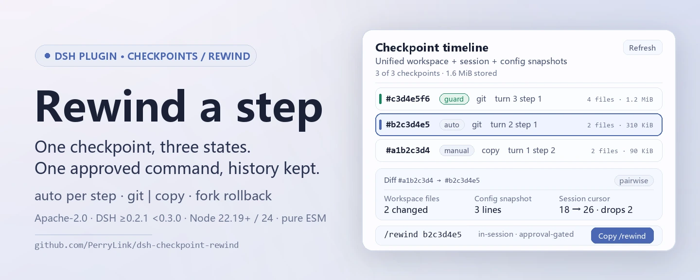
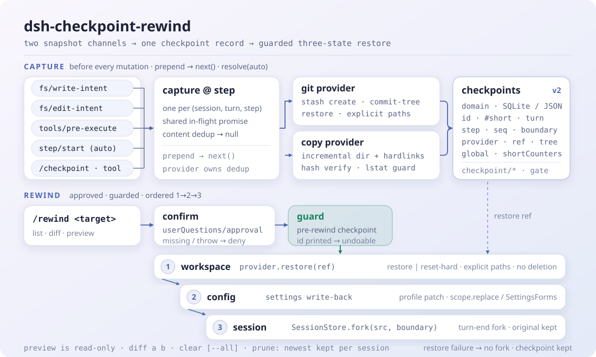

<div align="center">

<picture>
  <source media="(prefers-color-scheme: dark)" srcset="docs/assets/dsh-checkpoint-rewind-hero-en-dark.webp">
  
</picture>

# dsh-checkpoint-rewind

**Convierte «volver al paso N» en un solo comando: checkpoints de tres estados —espacio de trabajo, configuración y sesión— restaurados en una transacción aprobada.**

Un plugin de costura de capacidad (capability-seam) para DeepSeek Harness: captura el espacio de trabajo con primitivas git sin efectos secundarios antes de cada mutación y, al rebobinar, primero guarda, luego restaura archivos, luego la configuración y por último bifurca la sesión — el historial de la sesión original nunca se trunca.

[Instalar](#instalación-en-tres-pasos) · [Configuración](#configuración) · [FAQ](#faq) · [简体中文](README.md) · [English](README.en.md) · [Español](README.es.md) · [Português](README.pt.md) · [हिन्दी](README.hi.md)

[](LICENSE)
[](#compatibilidad)
[](https://www.npmjs.com/package/dsh-checkpoint-rewind)
[](https://github.com/PerryLink/dsh-checkpoint-rewind/actions/workflows/ci.yml)
[](#compatibilidad)

[](https://github.com/PerryLink/dsh-checkpoint-rewind/stargazers)
[](https://www.npmjs.com/package/dsh-checkpoint-rewind)
[](https://dshfind.com/plugins/PerryLink/dsh-checkpoint-rewind?ref=badge)
[](https://securityscorecards.dev/viewer/?uri=github.com/PerryLink/dsh-checkpoint-rewind)
[](https://dsh.market/)
[](https://gitee.com/perrylink/dsh-checkpoint-rewind)

```sh
dsh plugin --profile <name> add dsh-checkpoint-rewind
```

</div>

<sub>Plugin de la comunidad, no afiliado a DeepSeek. Repositorio canónico: <https://github.com/PerryLink/dsh-checkpoint-rewind> (Gitee es un espejo).</sub>

## Qué es

`dsh-checkpoint-rewind` captura un **checkpoint unificado de tres estados** —espacio de trabajo, cursor de sesión y configuración del plugin— y restaura uno o los tres con un solo comando aprobado. Las instantáneas del espacio de trabajo prefieren primitivas git sin efectos secundarios (`stash create` / `commit-tree`); los directorios que no son repositorios git (y los repos con HEAD nonato) degradan a instantáneas `copy` incrementales con reutilización por hardlinks. La reversión de sesión nunca trunca la sesión original: bifurca una sesión hija nueva en el límite del checkpoint, de modo que el historial original queda intacto. Se captura antes de las herramientas mutantes, en un intervalo automático, manualmente con `/checkpoint` y como guardián antes de cada reversión; la página de configuración añade una línea de tiempo de checkpoints con diffs línea a línea por pares.

<picture>
  <source media="(prefers-color-scheme: dark)" srcset="docs/assets/dsh-checkpoint-rewind-flow-v5-dark.svg">
  
</picture>

## Instalación en tres pasos

1. **Instala** (elige un canal):

   ```sh
   # canal git (último main; equivale a git+https://github.com/PerryLink/dsh-checkpoint-rewind.git)
   dsh plugin --profile web add github:PerryLink/dsh-checkpoint-rewind
   # canal npm (versiones publicadas)
   dsh plugin --profile web add dsh-checkpoint-rewind
   # canal tarball: npm pack en este repo y luego
   dsh plugin --profile web add ./dsh-checkpoint-rewind-<version>.tgz
   ```

   ESM puro, sin paso de build: `index.mjs` y `lib/` son los artefactos enviados.

2. **Configuración mínima**: compón la pila de almacenamiento (necesaria para persistir checkpoints) y monta la fila del plugin. Sin la pila de almacenamiento el plugin se monta igualmente y nunca bloquea el arranque del perfil; los comandos de checkpoint/rewind devuelven un error estructurado que nombra las filas exactas que faltan:

   ```yaml
   - insert:
       - id: checkpoint-rewind-storage
         name: '@deepseek-ai/dsh-storage'
       - id: checkpoint-rewind-storage-json
         name: '@deepseek-ai/dsh-storage-json'
         config:
           root: !!js dshHomePath('checkpoint-rewind/storage')
       - id: checkpoint-rewind-storage-domain
         name: '@deepseek-ai/dsh-storage-domain'
         config:
           backend: json
       - id: checkpoint-rewind
         name: dsh-checkpoint-rewind
         config:
           provider: auto
           confirmVia: auto
   ```

3. **Verifica que se monta**:

   ```sh
   dsh --profile web --dump-config | grep -A4 'id: checkpoint-rewind'
   ```

   Luego lista los checkpoints; las mutaciones del espacio de trabajo los crean automáticamente:

   ```text
   > /rewind list brief
   rewind: 3 checkpoints (newest last):
   #a1b2c3d4 · (git) · turn 2 step 1 · 2026-08-14 12:00:01 (3 min ago) · trigger: bash · 4 files · 1.2 MiB
   #b2c3d4e5 · (git) · turn 2 step 3 · 2026-08-14 12:00:41 · trigger: str_replace_editor · 2 files · 310 KiB
   #c3d4e5f6 · (copy) · turn 3 step 1 · 2026-08-14 12:01:10 · trigger: write · 1 file · 90 KiB
   run "/rewind <id>" to restore files and fork the session from that checkpoint
   ```

**Desinstalar**: `dsh plugin --profile web remove dsh-checkpoint-rewind` — los archivos de instantánea permanecen hasta que borres `$DSH_HOME/dsh-checkpoint-rewind`; los objetos git se recogen con la basura.

> Los checkpoints persisten a través del servicio `storageDomain`. Los perfiles que ya componen la pila funcionan de serie; un perfil básico sigue montando y puede capturar manualmente, pero los comandos fallan en voz alta cuando el dominio no puede abrirse — nunca degradan en silencio a «no hay checkpoints».

## Capacidades clave

`dsh-checkpoint-rewind` deja un registro restaurable de tres estados antes de cada mutación y convierte la restauración en una transacción de orden fijo:

1. **Registro de tres estados** — cada checkpoint guarda el estado del espacio de trabajo (SHA del árbol git, o un manifiesto de copia), el cursor de eventos de sesión (`seq` + límite de turno) y una instantánea de configuración, etiquetados por origen (`manual` / `auto` / `guard` / `mutation`).
2. **Cuatro disparadores de captura** — antes de cada herramienta mutante (`fs/write-intent`, `fs/edit-intent`, `tools/pre-execute`), en intervalo automático (`autoCheckpoint`, por defecto cada paso), manualmente (`/checkpoint` y la herramienta `checkpoint`) y como guardián antes de cada reversión.
3. **Proveedor con git primero** — `git stash create` / `commit-tree` producen objetos de instantánea sin referencia que nunca tocan tu árbol de trabajo, índice ni historial; la restauración es solo del árbol de trabajo y explícita por rutas. Los directorios sin git (y los repos con HEAD nonato) degradan a un proveedor `copy` incremental con reutilización por hardlinks.
4. **Reversión en un solo paso** — `/rewind workspace|session|config|all <target>` restaura los estados elegidos; `preview` es un informe de impacto de solo lectura, `diff <a> <b>` compara dos checkpoints y `clear` los elimina (esta sesión; `clear --all` abarca todas las sesiones y espacios de trabajo).
5. **Reversión de sesión por fork** — la reversión de sesión reproduce los eventos hasta el límite del checkpoint mediante la primitiva oficial `SessionStore.fork` en una sesión hija nueva (con repliegue a la ruta semilla `sessions.create` cuando el host no tiene fork o el checkpoint no tiene límite); la sesión original conserva todo su historial.
6. **Línea de tiempo en la página de configuración** — la pestaña `Plugins → Checkpoints` muestra los checkpoints de la sesión con diffs línea a línea por pares (`diffRenderer`) y restauración selectiva por archivo (`selectiveRestore`).

### Superficie de comandos y herramientas

| Superficie | Tipo | Notas |
|---|---|---|
| `/rewind` | comando | `[workspace\|session\|config\|all] <number\|id-prefix\|step <N>\|latest>` · `list [brief]` · `diff <a> <b>` · `preview <target>` · `clear [--all]` |
| `/checkpoint` | comando | `[note <text>\|list\|diff <a> <b>]` — captura un checkpoint manual |
| `checkpoint` | herramienta | Captura un checkpoint manual con una nota opcional |
| `fs/write-intent` · `fs/edit-intent` · `tools/pre-execute` | listeners | Captura previa a la mutación (prepend pass-through; nunca roba la ranura de política) |
| `session/event` | listener | Seguimiento de turnos/pasos, intervalo automático, relleno de límites, poda al final del turno |
| proyección `checkpoints` | proyección de sesión | Franja de línea de tiempo plegada desde el registro de sesión |
| línea de tiempo de la página de configuración | cliente | Pestaña `Plugins → Checkpoints` con diffs por pares y restauración selectiva por archivo |

### Ejemplos

Son los puntos de entrada reales del plugin; instala una vez y llama a uno.

**Ejemplo detallado** — comando `/rewind preview cp-9`, salida:

~~~text
rewind preview: checkpoint #cp-9 (provider git, turn 2 step 3)
restoring it would overwrite 2 file(s):
  a.txt
  b.txt
5 file(s) already match the checkpoint (not touched).
no files are deleted: 1 file(s) created after the checkpoint would be left in place:
  new.txt
run "/rewind <id>" to confirm and apply (a guard checkpoint is captured first)
~~~

*Observed from `test/checkpoints.test.mjs:289-301; lib/checkpoints.mjs:484-500`*

**Rama de fallo** — entrada `/rewind nope`, salida:

~~~text
rewind: unknown checkpoint id "nope" (run /rewind to list)
~~~

*Observed from `plugins/dsh-checkpoint-rewind/lib/errors.mjs:72; plugins/dsh-checkpoint-rewind/index.mjs:1223; plugins/dsh-checkpoint-rewind/test/index.test.mjs:346-350`*

**Ejemplos breves**: `/checkpoint` · `/rewind preview`

### Números de sesión

- **Cada checkpoint recibe un número al crearse**, empezando en `1`. `/rewind 3` resuelve ese número **exactamente** — los dígitos nunca se tratan como prefijo de id, así que `/rewind 3` jamás puede caer en el checkpoint cuyo UUID empiece por `3`.
- **Ámbito: por sesión** (`sessionId`). Cada sesión numera sus propios checkpoints; un número es único dentro de su sesión, y `/rewind <number>` resuelve solo contra los checkpoints de la sesión (y el espacio de trabajo) actuales.
- **Monótono y nunca reutilizado.** La poda por cuota (`maxSnapshots`) y `/rewind clear` / `/rewind clear --all` borran registros pero nunca liberan un número: tras un clear el siguiente checkpoint continúa desde la marca de agua anterior (así, tras `#1 #2 #3` y un `clear`, el siguiente es `#4`, no `#1`). El número se guarda en el propio registro y el contador vive en la ranura global del dominio, de modo que borrar registros no puede reiniciarlo.
- **Los checkpoints antiguos se numeran la primera vez que se ven.** Los registros escritos antes de esta función (sin campo de número) se numeran por orden de creación la primera vez que la sesión se lista o se rebobina, y esa numeración se persiste; los checkpoints nuevos continúan después. No se salta ni se reasigna nada, y el direccionamiento por prefijo de id sigue funcionando para ellos.
- `/rewind list` (la lista detallada) no cambia: sigue imprimiendo el id de 8 caracteres por línea y su última línea apunta a `/rewind list brief` para ver los números.

`preview` resuelve con el mismo direccionamiento e imprime el impacto sin pedir confirmación ni escribir nada. `--files` restaura solo los archivos indicados mediante la misma transacción con aprobación (las rutas desconocidas fallan en cerrado; es incompatible con `workspaceRestore: reset-hard` y se desactiva con `selectiveRestore: false`).

### ¿Por qué otro plugin de rewind?

| Plugin | Qué vende | ¿Restaura archivos? | ¿Rebobina la sesión? |
|---|---|---|---|
| **dsh-checkpoint-rewind** (este) | instantáneas de objetos git + reversión de tres estados + restauración en un paso | ✅ estado completo del espacio de trabajo | ✅ sesión hija con reproducción semilla |
| [Anionex/dsh-turn-rewind](https://github.com/Anionex/dsh-turn-rewind) | Change Ledger persistente de deltas por mutación | ✅ reproduciendo deltas inversos | ✅ su propio modelo de ledger |
| [LingLambda/dsh-undo](https://github.com/LingLambda/dsh-undo) | reversión pura de contexto al último paso completado | ❌ | ✅ solo contexto |
| [Mongfayi/dsh-recall](https://github.com/Mongfayi/dsh-recall) | retirada de mensajes (quitar un turno y todo lo posterior) | ❌ (explícitamente) | ✅ retirada de turno |

La diferencia en una frase: **dsh-checkpoint-rewind captura el *estado del espacio de trabajo* con primitivas git sin efectos secundarios antes de cada mutación, y convierte «volver al paso N» en un comando aprobado: primero el checkpoint guardián, segundo los archivos restaurados, tercero la configuración, cuarto la sesión reproducida, con cada fase registrada.** Sin contabilidad de deltas que se desvíe, sin edición a nivel de mensaje (eso es otro plugin), sin sincronización entre dispositivos.

### Cómo funciona

```text
capture ── fs/write-intent · fs/edit-intent · tools/pre-execute (prepend, pass-through)
        ── step/start auto interval ── /checkpoint · checkpoint tool ── pre-rewind guard
             │
             ▼  ProviderRegistry.resolve(auto)  →  git: stash create / commit-tree
             │                                     copy: incremental dir + hardlinks
             ▼
        checkpoints storage domain (SQLite rows / JSON file)  +  checkpoint/* event (adaptive gate)

/rewind <target> ── confirm (userQuestions / approval, fail-closed) ──▶ guard checkpoint
             ├─ workspace: provider.restore(ref)  (restore | reset-hard)
             ├─ config:   settings write-back (persisted on the profile patch)
             └─ session:  SessionStore.fork(source, boundary) → new child session (original untouched)
```

Registro completo de decisiones, vocabulario de eventos y contrato de la costura de proveedores: [ARCHITECTURE.md](ARCHITECTURE.md).

### Eventos de sesión (nota rc.2)

El plugin declara `checkpoint/snapshot`, `checkpoint/bound`, `checkpoint/prune` y `checkpoint/rewind` como miembros `SessionEventMap` solo de registro. Harness rc.2 **no tiene superficie de registro de eventos de plugin** y `Session.append` no estampa el sobre `ignorable` (su tercer argumento es intención de superficie, no opciones), así que añadir tipos desconocidos dejaría la sesión ilegible al recargar. Por eso el plugin añade mediante una **puerta adaptativa**: una sonda en tiempo de ejecución (en un almacén de sesión separado y nunca persistido) detecta si el `append` del host estampa el sobre `ignorable` — en rc.2 la puerta permanece cerrada; en hosts que lo soportan, los eventos `checkpoint/*` se añaden automáticamente con `ignorable: true`. Hasta entonces, la cadena de auditoría autoritativa es `command/run` + `command/done` (conocidos por el host) más el dominio de almacenamiento `checkpoints` duradero.

### Ancla de la Web UI

El plugin devuelve el id de la sesión nueva en el resultado del comando (`session: <id>`) y el shell web puede navegar allí. La **unidad de proyección de sesión `checkpoints` está incluida**: siempre que existe `ctx.sessionProjections`, el plugin registra la unidad vía `ctx.inject` (pliega `checkpoint/snapshot|bound|prune|rewind` en una lista de valor completo) — en hosts rc.2 permanece vacía hasta que una build del harness incluya el vocabulario `checkpoint/*` o el sobre `ignorable`, y entonces se llena sin cambios en el plugin.

### Verificación de integración

Una ejecución real de integración headless ensamblada (`npm run test:integration`) recorre el flujo completo: el agente modifica archivos en dos turnos, luego `/rewind preview` inspecciona el impacto en solo lectura (sin puerta de confirmación, sin escrituras) y `/rewind <id>` restaura los archivos y reproduce la sesión en una sesión hija nueva. La ejecución verifica el contenido de los archivos, el contexto hijo reproducido, el checkpoint guardián y que los archivos creados después del checkpoint sobrevivan — para los flujos de los proveedores copy y git (el flujo git también verifica que `HEAD` y el reflog no se toquen). El driver vive en `test/integration/rewind-headless.mjs`.

## Configuración

Todas las opciones son campos Schemastery `Config` (modificables desde cordis.yml); nada está codificado. Las opciones del proveedor (`gitBin`, `snapshotDir`, `excludeGlobs`, `verifyByHash`) se leen de la configuración viva en el momento de uso, así que los cambios de cordis.yml se aplican sin reinicio. Una sobrescritura por id reemplaza la fila entera: repite cada clave que necesites.

Claves más usadas:

| Clave | Predeterminado | Significado |
|---|---|---|
| `enabled` | `true` | Interruptor maestro; `false` elimina por completo comandos, listeners y proveedores |
| `provider` | `auto` | Proveedor de instantáneas: `auto` (git si está disponible, si no copy) · `git` · `copy` |
| `maxSnapshots` | `50` | Checkpoints conservados por sesión (los más antiguos se podan primero) |
| `maxSnapshotBytes` | `536870912` (512 MiB) | Cuota blanda global de bytes incrementales (el más reciente por sesión viva siempre se conserva) |
| `confirmVia` | `auto` | Canal de confirmación: `auto` (userQuestions primero) · `userQuestions` · `approval` |
| `preRewindCheckpoint` | `warn` | Checkpoint guardián antes de restaurar: `warn` · `require` · `off` |
| `workspaceRestore` | `restore` | Reversión del espacio de trabajo: `restore` (sobrescritura segura) · `reset-hard` (estilo CC, opt-in) |
| `autoCheckpoint.enabled` | `true` | Instantáneas automáticas por intervalo en `step/start` |

<details>
<summary>Tabla de configuración completa (20 claves)</summary>

| Clave | Predeterminado | Significado |
|---|---|---|
| `enabled` | `true` | Interruptor maestro; `false` elimina por completo comandos, listeners y proveedores |
| `provider` | `auto` | Proveedor de instantáneas: `auto` (git si está disponible, si no copy) · `git` · `copy` |
| `gitBin` | `git` | Ruta del ejecutable git |
| `snapshotDir` | `$DSH_HOME/dsh-checkpoint-rewind` (repliegue a `~/.dsh/dsh-checkpoint-rewind` si `$DSH_HOME` no está definido) | Raíz de las instantáneas del proveedor copy |
| `maxSnapshots` | `50` | Checkpoints conservados por sesión (los más antiguos se podan primero) |
| `maxSnapshotBytes` | `536870912` (512 MiB) | Cuota blanda global de bytes incrementales (el más reciente por sesión viva siempre se conserva) |
| `pruneOnTurnEnd` | `true` | Ejecuta la poda por cuota al terminar un turno |
| `mutationTools` | `['bash','write','edit','str_replace_editor','pwsh','terminal_send']` | Herramientas tratadas como mutantes en `tools/pre-execute` |
| `excludeGlobs` | `['node_modules','.git','.dsh','dist','build']` | Patrones glob que omite el proveedor copy |
| `confirmVia` | `auto` | Canal de confirmación: `auto` (userQuestions primero) · `userQuestions` · `approval` |
| `listLimit` | `10` | Checkpoints mostrados por `/rewind` sin argumentos |
| `preRewindCheckpoint` | `warn` | Checkpoint guardián antes de restaurar: `warn` · `require` · `off` |
| `verifyByHash` | `false` | Comparación por hash de contenido y verificación de restauración del proveedor copy |
| `autoCheckpoint.enabled` | `true` | Instantáneas automáticas por intervalo en `step/start` |
| `autoCheckpoint.intervalMinutes` | `0` | Intervalo; `0` = cada paso |
| `workspaceRestore` | `restore` | Reversión del espacio de trabajo: `restore` (sobrescritura segura) · `reset-hard` (estilo CC, opt-in) |
| `diffRenderer` | `pairwise` | Renderizador de diffs de la página de configuración: `pairwise` (texto línea a línea) · `side-by-side` (dos columnas por archivo) |
| `selectiveRestore` | `true` | Restauración selectiva por archivo (`/rewind … --files`) y casilla por archivo + total de tamaño del panel |
| `promptSection` | `true` | Inyecta una sección breve de prompt con declaración de rol |
| `checkpointTool` | `true` | Registra la herramienta de modelo `checkpoint` |

</details>

Ejemplo de sobrescritura en el patch de tu perfil:

```yaml
- insert:
    - id: checkpoint-rewind
      name: dsh-checkpoint-rewind
      config:
        provider: auto
        maxSnapshots: 50
        maxSnapshotBytes: 536870912
        pruneOnTurnEnd: true
        confirmVia: auto
        preRewindCheckpoint: warn
```

## FAQ

<details>
<summary>¿Esto reemplaza a git?</summary>

No — *usa* git cuando está disponible. En un repositorio git obtienes objetos de instantánea byte a byte exactos y deduplicados sin tocar el historial; en cualquier otro directorio el proveedor copy hace lo mismo con archivos normales. Los commits regulares siguen siendo tu historial a largo plazo.

</details>

<details>
<summary>¿Por qué no `git reset --hard` por defecto?</summary>

Porque destruir estado no es trabajo de una red de seguridad. Por defecto el plugin solo crea objetos sin referencia y hace restauraciones solo del árbol de trabajo y explícitas por ruta, así que un rewind erróneo nunca puede perder historial, el índice ni archivos creados después del checkpoint. `reset-hard` está disponible tras `workspaceRestore: 'reset-hard'` para quien quiera explícitamente la paridad con CC.

</details>

<details>
<summary>¿Cuánto tiempo se puede restaurar un checkpoint?</summary>

Ninguna referencia se mantiene sobre las instantáneas del proveedor git. Por diseño son objetos `stash create`/`commit-tree` sin referencia, y `discard` solo borra el registro, dejando el objeto para `git gc`. Dos cosas independientes acotan cuánto tiempo sigue siendo restaurable un checkpoint: la poda por cuota del propio plugin (`maxSnapshots`, 50 por sesión por defecto; `maxSnapshotBytes`, una cuota blanda global de 512 MiB por defecto aplicada vía `pruneAll()` al capturar y barrida al final de los turnos) y el git gc del repositorio anfitrión. Con los valores por defecto de git, los objetos sin referencia sobreviven hasta que se ejecuta un auto-gc, y aun entonces solo se podan los objetos más antiguos que `gc.pruneExpire` (2 semanas por defecto). Un `git gc --prune=now` manual, un repack agresivo, `filter-repo` o un clon nuevo pueden eliminarlos de inmediato. Los objetos podados ahora se detectan de antemano: el proveedor git sondea el objeto de instantánea antes de restaurar (`git cat-file -e`) y falla en voz alta cuando falta en lugar de restaurar nada en silencio, y un pase de doctor recorre cada registro de checkpoint para sondear la existencia del objeto y marcar los no restaurables (`[UNRESTORABLE: object missing]` en la lista). El pase de doctor está implementado y probado, pero aún no está cableado en la ruta de restauración (restore todavía no consulta la marca `unrestorable`; seguimiento en la discusión #13).

</details>

<details>
<summary>¿Puedo rebobinar a un paso en medio de un turno?</summary>

La restauración de archivos es precisa por paso (`/rewind step <N>` = instantánea más cercana ≤ N). Sin embargo, la reproducción de sesión respeta la granularidad de reproducción del harness: la sesión hija se siembra hasta el límite de turno del checkpoint.

</details>

<details>
<summary>¿Qué pasa si nadie puede responder la confirmación?</summary>

No se toca nada — el plugin falla en cerrado (`unavailable`/`rejected`), conserva el checkpoint y devuelve un error explicativo. Con `confirmVia: approval` en rc.2 el mensaje indica que hay que montar userQuestions, porque approval requiere un turno abierto y los comandos se ejecutan entre turnos.

</details>

<details>
<summary>¿Puedo deshacer un rewind?</summary>

Sí — cada rewind aprobado captura primero un checkpoint guardián del estado previo; el resultado imprime `rewind guard: <id>`, y `/rewind <guard-id>` restaura ese estado.

</details>

<details>
<summary>¿Cómo direcciono los checkpoints?</summary>

Con el **número de sesión** (`/rewind 3` — ver `/rewind list brief`; por sesión, monótono, nunca reutilizado), el prefijo de id único (el id corto de 8 caracteres de la lista sigue funcionando), `/rewind step <N>` y `/rewind latest`. `/rewind clear` borra los checkpoints de esta sesión, y `/rewind clear --all` borra los de todas las sesiones y espacios de trabajo (archivos intactos) — ninguno reinicia la numeración. `/rewind preview <target>` usa el mismo direccionamiento para mostrar el impacto sin cambiar nada.

</details>

<details>
<summary>¿Por qué el número sigue subiendo tras un clear?</summary>

Porque un número es una dirección, no una posición: reutilizar `#1` para otro checkpoint tras un clear repuntaría en silencio cualquier cosa que mencionara `#1`. El contador se persiste en el dominio `checkpoints` (ranura global) y cada registro guarda su propio número, así que podar y limpiar borran instantáneas sin reciclar ids.

</details>

<details>
<summary>¿Qué hace `preview` — y qué no hace?</summary>

Resuelve el checkpoint y luego ejecuta una comparación de solo lectura: qué archivos se sobrescribirían (o recrearían), cuáles ya coinciden y qué archivos creados después del checkpoint se dejarían en su sitio. Nunca pregunta, nunca escribe, nunca bifurca y no registra ningún evento `checkpoint/rewind` — la puerta de aprobación solo se ejecuta en un `/rewind <id>` real.

</details>

### Solución de problemas

| Síntoma | Causa / solución |
|---|---|
| `/rewind <id>` dice `rewind cancelled: no confirmation answerer` | No hay canal userQuestions/approval montado — el plugin falla en cerrado. Ejecuta en la Web UI (o monta un proveedor de preguntas); `confirmVia` elige el canal. |
| `/rewind <id>` dice `approval requires an open turn …` | Los comandos se ejecutan entre turnos y approval necesita un turno — monta userQuestions o pon `confirmVia: userQuestions`. |
| `rewind: checkpoint registry unavailable` | El dominio de almacenamiento `checkpoints` no pudo abrirse. O el servicio `storageDomain` no está compuesto (añade las filas de la pila de almacenamiento de Instalación en tres pasos: `@deepseek-ai/dsh-storage` + `@deepseek-ai/dsh-storage-json` con config `root` + `@deepseek-ai/dsh-storage-domain` con config `backend: json`) o el backend está fallando; revisa los logs del harness. |
| Un checkpoint aparece como `fork: pending (turn not closed)` | Su turno aún no tiene `turn/end`; los archivos se pueden restaurar, pero la reproducción de sesión espera a que el turno se cierre. |
| `files restored … but the session was NOT replayed` | Falló la fase de sesión de la transacción (sin límite cerrado, o reproducción rechazada). Los archivos quedan restaurados; usa el `rewind guard: <id>` impreso para deshacer. |
| `rewind: aborted — the pre-rewind guard checkpoint could not be captured` | `preRewindCheckpoint: require` rechazó el rewind porque la captura del guardián falló; arregla el almacenamiento (o pon `warn`/`off`). |
| Un checkpoint aparece como `(copy)` aunque el directorio es un repo | HEAD nonato (sin commit inicial): las primitivas de instantánea git requieren HEAD, así que el plugin degrada a `copy` hasta el primer commit. |
| `MISSING_CREDENTIAL` en ejecuciones headless | No tiene relación con este plugin: no hay `DEEPSEEK_API_KEY` configurada para el proveedor de modelo. |
| El almacenamiento de instantáneas crece | La poda se ejecuta tras cada instantánea y en `turn/end` (`pruneOnTurnEnd`); baja `maxSnapshots` / `maxSnapshotBytes`, ejecuta `/rewind clear` o borra `$DSH_HOME/dsh-checkpoint-rewind` tras desinstalar. |

## Límites de seguridad

- **El historial git es intocable.** El proveedor git solo ejecuta primitivas de lista blanca sin efectos secundarios — `stash create`, `commit-tree`, `restore --worktree`, `ls-tree`, `diff-tree`, `ls-files`, `status`, `rev-parse`, `cat-file -e` — forzadas por una aserción en tiempo de ejecución, y las referencias de objeto se validan como ids hexadecimales antes de pasarlas a git (un registro manipulado no puede inyectar opciones git). **Nunca `reset --hard` por defecto, nunca `clean`, nunca mutación del índice o del historial** (ver `workspaceRestore` abajo).
- **Reversión por sobrescritura, nunca borrado.** La restauración solo sobrescribe los archivos capturados, y el proveedor git restaura **rutas explícitas** (`git restore … -- .` borraría archivos añadidos con `git add` después del checkpoint). Los archivos creados después del checkpoint (sin seguimiento **o** en el índice) se *reportan* y se dejan en su sitio.
- **Sin escrituras a través de enlaces, sin traversal de rutas.** El proveedor copy valida las referencias de checkpoint antes de unirlas a rutas de directorio de instantáneas, y se niega a restaurar a través de un destino (o ancestro) que se haya convertido en enlace simbólico — así una restauración nunca sigue un enlace fuera del espacio de trabajo.
- **La restauración requiere aprobación.** Sobrescribir archivos del usuario siempre pasa por la costura de confirmación con semántica `ask`; un respondedor ausente, que lanza o que dice que no **falla en cerrado**. `/rewind preview` es la forma de solo lectura de inspeccionar el impacto primero.
- **El rewind es reversible.** Antes de restaurar, un checkpoint guardián captura el estado actual; restaurar el guardián deshace el rewind. `preRewindCheckpoint: require` aborta el rewind cuando no se puede capturar el guardián.
- **Transacción de orden fijo.** Primero guardián, segundo espacio de trabajo, tercero configuración, cuarto reproducción de sesión; cada fase se registra; una restauración fallida deja archivos, checkpoints y sesión intactos.
- **`workspaceRestore: 'reset-hard'` es equivalente a CC y opt-in.** Ejecuta `git reset --hard <snapshot commit>` (la cabeza de rama se mueve al commit de instantánea; el historial previo sigue recuperable vía reflog; los archivos sin seguimiento no se tocan). Está desactivado por defecto.
- **Visible para el modelo ⟺ registrado.** Todo lo que ve un usuario o el modelo se reconstruye desde `command/run` + `command/done` (y, cuando el host los conoce, los eventos `checkpoint/*`) más el dominio `checkpoints` duradero.
- **Los fallos son ruidosos.** Una configuración inválida lanza al cargar; un dominio no disponible, una restauración fallida y un fork fallido devuelven texto de error estructurado — nada se traga ni se trunca en silencio.

## Permisos y datos

- **Permisos**: el manifiesto workshop declara `workspace:read`, `workspace:write`, `git:read`, `git:write`, `snapshot-storage:write`, `session-log:read`, `settings:write` y `network:none`.
- **Datos**: los registros de checkpoint viven en el dominio de almacenamiento `checkpoints` (filas SQLite o un archivo JSON); las instantáneas copy viven bajo `snapshotDir`. La **ranura global** del dominio guarda los contadores de números cortos por sesión, por eso borrar registros (`prune`, `clear`, `clear --all`) nunca puede reciclar un número. Completamente local — sin red, sin credenciales. El dominio se abre en doble versión: los medios de la era 0.4.x (dominio v1) se abren en un modo de compatibilidad que mantiene legibles los registros antiguos y guarda las capturas nuevas con la forma v2, así que actualizar el plugin nunca deja huérfano un medio existente.
- **Registro de sesión**: los eventos `checkpoint/*` se añaden a través de la puerta adaptativa; la cadena de auditoría autoritativa es `command/run` + `command/done` más el dominio duradero.

## Limitaciones conocidas

- En rc.2, los eventos de sesión `checkpoint/*` quedan suprimidos por la puerta adaptativa; la cadena de auditoría depende de `command/run` + `command/done` más el dominio de almacenamiento hasta que un host incluya el vocabulario o el sobre `ignorable`.
- `confirmVia: approval` necesita un turno abierto, y los comandos se ejecutan entre turnos — monta userQuestions (o pon `confirmVia: userQuestions`) en rc.2.
- La reversión de sesión **bifurca una sesión hija nueva** en el límite del checkpoint; nunca reescribe ni trunca la sesión original.
- `workspaceRestore: 'reset-hard'` mueve la cabeza de rama al commit de instantánea; está desactivado por defecto.
- Un checkpoint capturado antes de cualquier turno cerrado no tiene límite de reproducción — la reversión de sesión crea entonces una sesión hija nueva con contexto vacío.

## Interoperabilidad con otros plugins DSH

Verificado contra **DSH `0.2.0-rc.2`** (el runtime al que apunta este README) y el conjunto de plugins de muchas estrellas sondeado el 2026-10-05.

Este plugin **no interfiere** con otros plugins, incluidos los de muchas estrellas ampliamente instalados:

- **Sin colisión de nombres de herramienta.** Cada herramienta está en un espacio de nombres; no se registra ningún nombre desnudo que pertenezca a una herramienta incluida u otro plugin.
- **Sin colisión de claves de servicio.** No provee ninguna clave de servicio, así que no puede colisionar en una.
- **Sin colisión de ranuras.** No registra ninguna clave de ranura de cliente, así que no compite por un asiento `shadows-shipped-ui`.
- **Sin colisión de rutas HTTP.** No registra ningún prefijo `webServer`.
- **Sin colisión de capas de patch.** El patch del bundle solo `insert` su propia fila; nunca sobrescribe la `config` de una fila integrada.
- **Sin mutación global.** No parchea prototipos, no reescribe `process.env` ni reemplaza el dispatcher global de fetch.

**Los listeners de eventos compartidos no interfieren por construcción.** Observa los eventos sensibles al orden `fs/edit-intent`, `fs/write-intent`, `tools/pre-execute` con `ctx.on()` — el registro de difusión de Cordis, donde cada listener se ejecuta y ninguno puede matar de hambre a otro. **Cada listener aquí delega a través de `next()`**, así que la cadena nunca se cortocircuita, y una mutación se aplica al valor que produjo `next()` en lugar de devolverse en su lugar:

- `tools/pre-execute` — also used by `cc-safety-net` (1576★).

Evidencia estática: `dsh-plugin-doctor` K10–K13 informan `pass` en todas las comprobaciones de este repositorio.

## Compatibilidad

| Superficie | Estado |
|---|---|
| Harness | DeepSeek Harness `dsh-v0.2.1-alpha.1` (tag de GitHub, verificado 2026-09-25; pin npm `0.1.7-rc.2`, peers `>=0.1.6-0 <0.2.0 \|\| >=0.1.7-0 <0.2.0`) (adaptado 2026-10-04): el host eliminó `@deepseek-ai/dsh-settings-file` y sustituyó la superficie de registro por espacio de nombres de `ctx.settings` por `SettingsForms`, que proyecta el `Config` de cada entrada del Loader en el formulario de configuración y persiste las ediciones en el patch del perfil — los campos de configuración del plugin ahora se declaran `volatile()` y se leen en vivo, los codecs estrictos de typert solo llevan su fábrica `create()`, y el aviso de rewind declara su propio `kind` de fuente de mensaje. La ruta legacy `settings.register` se mantiene para hosts `0.1.5-rc.2`/`0.1.6-alpha.2`. Verificado el 2026-09-22 contra el checkout `dsh-v0.1.7-alpha.1` (typecheck contra la superficie de tipos alpha.1 + suite unitaria completa + integración headless ensamblada). |
| Node | `^22.19.0 \|\| >=24.0.0` |
| Plataformas | Todas (comandos y listeners del host; línea de tiempo opcional en la página de configuración vía la capacidad settings) |
| Modelo | Cualquiera (sin llamadas a modelos — las instantáneas y restauraciones son deterministas) |

## Ecosistema y calidad

- [Espejo Gitee](https://gitee.com/perrylink/dsh-checkpoint-rewind) (espejo de sincronización; GitHub es canónico)
- [Página del plugin en dshfind](https://dshfind.com/plugins/PerryLink/dsh-checkpoint-rewind) (instalaciones y ranking)
- [Informe OpenSSF Scorecard](https://securityscorecards.dev/viewer/?uri=github.com/PerryLink/dsh-checkpoint-rewind) (impulsado por [.github/workflows/scorecard.yml](.github/workflows/scorecard.yml))
- [Informe de verificación de dsh-plugin-doctor](https://github.com/PerryLink/dsh-plugin-doctor#verified-徽章) (K10–K13 todos `pass`)
- [DSH Market](https://dsh.market/) (listado)
- **Canal de la tienda 1024**: `npm i -g dsh1024` una vez y luego `dsh1024 plugin --profile web add dsh-checkpoint-rewind` (cuenta para el ranking de instalaciones de [deepseek1024.com](https://deepseek1024.com))
- [Base de conocimiento del ecosistema](https://perrylink.github.io/dsh-plugin-guide/) — datos medidos, no marketing: guía de desarrollo de plugins · datos de selección de plugins · criterios de mantenimiento

## Desarrollo

```sh
npm install                # node ^22.19 || >=24; peers fijados 0.2.1-rc.2
npm test                   # node --test test/**/*.test.mjs (incluye suites de provider)
npm run test:integration   # verificación headless ensamblada (test/integration/)
npm run check:readmes      # puerta de consistencia de los cinco README
npm run verify:self-contained  # los specs de dependencias resuelven desde el registry
npm run verify:artifacts   # archivos enviados presentes + index.mjs importable
npm run lint               # oxlint
```

Sin paso de build: ESM puro — `index.mjs`/`lib/` son los artefactos publicados. Las imágenes del README las genera programáticamente [`scripts/gen-readme-assets.py`](scripts/gen-readme-assets.py) (Python + Pillow, dos SVG de flujo claro/oscuro) y se pueden volver a ejecutar sin riesgo.

<details>
<summary>Estructura del repositorio</summary>

| Ruta | Propósito |
|---|---|
| `index.mjs` | Entrada del plugin (el único archivo de cara host): registro de proveedores, listeners de eventos, el comando `/rewind` |
| `lib/` | Funciones puras y proveedores sin dependencias de DSH (`lib/providers/`); `lib/domain.mjs` es el único módulo que puede usar zod/paquetes DSH |
| `client/` | Línea de tiempo de la página de configuración (mitad de navegador) |
| `cordis.patch.yml` | Declaración del bundle: `insert` de la fila checkpoint-rewind |
| `test/` | Pruebas unitarias + verificación headless ensamblada en `test/integration/` |
| `docs/assets/` | Imágenes del README (banner hero + diagrama de estructura claro/oscuro) |
| `scripts/` | Puertas mecánicas + el generador de assets del README |
| `ARCHITECTURE.md` | Arquitectura de costuras de tres roles y el registro completo de decisiones |

</details>

Topics: `deepseek-harness`, `dsh`, `dsh-plugin`, `rewind`, `checkpoint`, `snapshot`, `session-replay`, `session-fork`, `config-restore`, `workspace-safety`, `undo`, `cordis-plugin`

## Familia y agradecimientos

Este proyecto forma parte de la familia de plugins de DeepSeek Harness de [PerryLink](https://github.com/PerryLink) (todos Apache-2.0). Si te resulta útil, **una estrella ayuda a que la siguiente persona lo encuentre** — no hay nada bloqueado tras ella.

- [@mahirhir](https://github.com/mahirhir) — sonda doctor de existencia de objetos (#16), liveConfig para `snapshotDir`/`excludeGlobs`/`verifyByHash` (#17), alcance de poda por sesión viva (#18), limpieza de cuota por instantánea faltante (#19), configuración dinámica del proveedor copy (#20).
- [@PerryLink](https://github.com/PerryLink) — creador y mantenedor: el modelo de checkpoint de tres estados, la costura de proveedores git/copy, la transacción de rewind en tres fases, la línea de tiempo de la página de configuración, docs, CI/CD y releases.
- [@tmpdot](https://github.com/tmpdot) (rmUnlucky) — compatibilidad de doble versión del medio v1 (#8), resolución perezosa de `storageDomain` (#9), pistas de respuesta de deduplicación de checkpoints (#10) y el informe del bug del directorio de instantáneas sin `$DSH_HOME` (#4).
- [@shipinliang](https://github.com/shipinliang) — informes del contrato wire del panel de checkpoints: el `acceptsUndefined` ausente en el parámetro `limit` (#5) y el fallo del proxy de campo privado `#deps` (#6).
- [@hwz1456](https://github.com/hwz1456) — informe de captura de checkpoints en el perfil web (#3).
- [@Andiii208](https://github.com/Andiii208) — informe de especificación de publicación de `plugin_check` (#2).
- [@alexchenzl](https://github.com/alexchenzl) (Ashu) — invitación al listado de DSH Directory (#7).

<details>
<summary>Expandir todos los plugins</summary>

| Plugin | Estado |
|---|---|
| **[dsh-aqua-input-check](https://github.com/PerryLink/dsh-aqua-input-check)** |  |
| **[dsh-archive-check](https://github.com/PerryLink/dsh-archive-check)** |  |
| **[dsh-auto-review](https://github.com/PerryLink/dsh-auto-review)** |  |
| **[dsh-autotier](https://github.com/PerryLink/dsh-autotier)** | 🧊 CONGELADO — ver el README del repo |
| **[dsh-bid-ca-precheck](https://github.com/PerryLink/dsh-bid-ca-precheck)** |  |
| **[dsh-bid-qual-check](https://github.com/PerryLink/dsh-bid-qual-check)** |  |
| **[dsh-cert-mcp](https://github.com/PerryLink/dsh-cert-mcp)** | 🧊 CONGELADO — ver el README del repo |
| **[dsh-checkpoint-rewind](https://github.com/PerryLink/dsh-checkpoint-rewind)** |  |
| **[dsh-click](https://github.com/PerryLink/dsh-click)** |  |
| **[dsh-composer-history](https://github.com/PerryLink/dsh-composer-history)** |  |
| **[dsh-contract-stance](https://github.com/PerryLink/dsh-contract-stance)** |  |
| **[dsh-customs-doc-check](https://github.com/PerryLink/dsh-customs-doc-check)** |  |
| **[dsh-data-quality](https://github.com/PerryLink/dsh-data-quality)** | 🧊 CONGELADO — ver el README del repo |
| **[dsh-demurrage-ledger](https://github.com/PerryLink/dsh-demurrage-ledger)** |  |
| **[dsh-doublecheck](https://github.com/PerryLink/dsh-doublecheck)** |  |
| **[dsh-drill-script-check](https://github.com/PerryLink/dsh-drill-script-check)** |  |
| **[dsh-eia-guide-check](https://github.com/PerryLink/dsh-eia-guide-check)** |  |
| **[dsh-emergency-plan](https://github.com/PerryLink/dsh-emergency-plan)** |  |
| **[dsh-essay-rubric-check](https://github.com/PerryLink/dsh-essay-rubric-check)** |  |
| **[dsh-evidence-check](https://github.com/PerryLink/dsh-evidence-check)** |  |
| **[dsh-export-ctl-check](https://github.com/PerryLink/dsh-export-ctl-check)** |  |
| **[dsh-fast](https://github.com/PerryLink/dsh-fast)** |  |
| **[dsh-fmea-table-check](https://github.com/PerryLink/dsh-fmea-table-check)** |  |
| **[dsh-forecast-penalty](https://github.com/PerryLink/dsh-forecast-penalty)** |  |
| **[dsh-fund-research](https://github.com/PerryLink/dsh-fund-research)** |  |
| **[dsh-github](https://github.com/PerryLink/dsh-github)** |  |
| **[dsh-gongwen-flow-check](https://github.com/PerryLink/dsh-gongwen-flow-check)** |  |
| **[dsh-gongwen-word-check](https://github.com/PerryLink/dsh-gongwen-word-check)** |  |
| **[dsh-guard-plan-qc](https://github.com/PerryLink/dsh-guard-plan-qc)** |  |
| **[dsh-hazchem-check](https://github.com/PerryLink/dsh-hazchem-check)** |  |
| **[dsh-hazplan-check](https://github.com/PerryLink/dsh-hazplan-check)** |  |
| **[dsh-hidden-risk-map](https://github.com/PerryLink/dsh-hidden-risk-map)** |  |
| **[dsh-hs-classify](https://github.com/PerryLink/dsh-hs-classify)** |  |
| **[dsh-icd-rule-check](https://github.com/PerryLink/dsh-icd-rule-check)** |  |
| **[dsh-industry-research](https://github.com/PerryLink/dsh-industry-research)** |  |
| **[dsh-lawcite-adapter](https://github.com/PerryLink/dsh-lawcite-adapter)** |  |
| **[dsh-laya](https://github.com/PerryLink/dsh-laya)** |  |
| **[dsh-lc-doc-check](https://github.com/PerryLink/dsh-lc-doc-check)** |  |
| **[dsh-learning-gap-check](https://github.com/PerryLink/dsh-learning-gap-check)** |  |
| **[dsh-library](https://github.com/PerryLink/dsh-library)** |  |
| **[dsh-local-ai](https://github.com/PerryLink/dsh-local-ai)** |  |
| **[dsh-lsp-actions](https://github.com/PerryLink/dsh-lsp-actions)** |  |
| **[dsh-mask](https://github.com/PerryLink/dsh-mask)** |  |
| **[dsh-mcp-panel](https://github.com/PerryLink/dsh-mcp-panel)** |  |
| **[dsh-medrec-qc](https://github.com/PerryLink/dsh-medrec-qc)** |  |
| **[dsh-memento](https://github.com/PerryLink/dsh-memento)** | 🧊 CONGELADO — ver el README del repo |
| **[dsh-nsfc-form-check](https://github.com/PerryLink/dsh-nsfc-form-check)** |  |
| **[dsh-nurse-record-check](https://github.com/PerryLink/dsh-nurse-record-check)** |  |
| **[dsh-observe](https://github.com/PerryLink/dsh-observe)** |  |
| **[dsh-origin-rvc-check](https://github.com/PerryLink/dsh-origin-rvc-check)** |  |
| **[dsh-ota-review-check](https://github.com/PerryLink/dsh-ota-review-check)** |  |
| **[dsh-output-styles](https://github.com/PerryLink/dsh-output-styles)** |  |
| **[dsh-paper-doc-adapter](https://github.com/PerryLink/dsh-paper-doc-adapter)** |  |
| **[dsh-permission-rules](https://github.com/PerryLink/dsh-permission-rules)** |  |
| **[dsh-permit-report-check](https://github.com/PerryLink/dsh-permit-report-check)** |  |
| **[dsh-pipeline-check](https://github.com/PerryLink/dsh-pipeline-check)** |  |
| **[dsh-pleading-draft](https://github.com/PerryLink/dsh-pleading-draft)** |  |
| **[dsh-plugin-doctor](https://github.com/PerryLink/dsh-plugin-doctor)** | 🚫 RETIRADO (repo archivado) |
| **[dsh-plugin-guide](https://github.com/PerryLink/dsh-plugin-guide)** |  |
| **[dsh-plugin-kit](https://github.com/PerryLink/dsh-plugin-kit)** | 🚫 RETIRADO (repo archivado) |
| **[dsh-plugin-upgrade](https://github.com/PerryLink/dsh-plugin-upgrade)** | 🚫 RETIRADO (repo archivado) |
| **[dsh-policy-brief-draft](https://github.com/PerryLink/dsh-policy-brief-draft)** |  |
| **[dsh-power-loss-split](https://github.com/PerryLink/dsh-power-loss-split)** |  |
| **[dsh-power-ticket-check](https://github.com/PerryLink/dsh-power-ticket-check)** |  |
| **[dsh-ppap-check](https://github.com/PerryLink/dsh-ppap-check)** |  |
| **[dsh-protest-deadline](https://github.com/PerryLink/dsh-protest-deadline)** |  |
| **[dsh-railway-window](https://github.com/PerryLink/dsh-railway-window)** |  |
| **[dsh-repair-order-qc](https://github.com/PerryLink/dsh-repair-order-qc)** |  |
| **[dsh-research-report](https://github.com/PerryLink/dsh-research-report)** |  |
| **[dsh-review-reply-check](https://github.com/PerryLink/dsh-review-reply-check)** |  |
| **[dsh-rulefile-check](https://github.com/PerryLink/dsh-rulefile-check)** |  |
| **[dsh-safety-brief-check](https://github.com/PerryLink/dsh-safety-brief-check)** |  |
| **[dsh-score](https://github.com/PerryLink/dsh-score)** | 🧊 CONGELADO — ver el README del repo |
| **[dsh-session-sync](https://github.com/PerryLink/dsh-session-sync)** |  |
| **[dsh-site-log-check](https://github.com/PerryLink/dsh-site-log-check)** |  |
| **[dsh-skill-pack-security](https://github.com/PerryLink/dsh-skill-pack-security)** |  |
| **[dsh-soe-decision-check](https://github.com/PerryLink/dsh-soe-decision-check)** |  |
| **[dsh-soilwater-check](https://github.com/PerryLink/dsh-soilwater-check)** |  |
| **[dsh-sop-sync-check](https://github.com/PerryLink/dsh-sop-sync-check)** |  |
| **[dsh-spc-gbt-adapter](https://github.com/PerryLink/dsh-spc-gbt-adapter)** |  |
| **[dsh-talk](https://github.com/PerryLink/dsh-talk)** |  |
| **[dsh-tender-extract](https://github.com/PerryLink/dsh-tender-extract)** |  |
| **[dsh-tender-matrix](https://github.com/PerryLink/dsh-tender-matrix)** |  |
| **[dsh-test-drive](https://github.com/PerryLink/dsh-test-drive)** |  |
| **[dsh-ticktick](https://github.com/PerryLink/dsh-ticktick)** | 🚫 RETIRADO (repo archivado) |
| **[dsh-translate](https://github.com/PerryLink/dsh-translate)** |  |
| **[dsh-warranty-calc](https://github.com/PerryLink/dsh-warranty-calc)** |  |
| **[dsh-budget](https://github.com/PerryLink/dsh-budget)** | 🧊 CONGELADO — ver el README del repo |
| **[dsh-claude-move](https://github.com/PerryLink/dsh-claude-move)** | 🧊 CONGELADO — ver el README del repo |
| **[dsh-defend](https://github.com/PerryLink/dsh-defend)** | 🧊 CONGELADO — ver el README del repo |
| **[dsh-draw](https://github.com/PerryLink/dsh-draw)** | 🧊 CONGELADO — ver el README del repo |
| **[dsh-reach](https://github.com/PerryLink/dsh-reach)** | 🧊 CONGELADO — ver el README del repo |
| **[dsh-background-agents](https://github.com/PerryLink/dsh-background-agents)** | 🚫 RETIRADO (repo archivado) |
| **[dsh-session-pin](https://github.com/PerryLink/dsh-session-pin)** | 🚫 RETIRADO (repo archivado) |
| **[dsh-team-rooms](https://github.com/PerryLink/dsh-team-rooms)** | 🚫 RETIRADO (repo archivado) |

</details>

## Licencia

[Apache License 2.0](LICENSE) © 2026 dsh-checkpoint-rewind contributors

<p align="center"><sub>Apache-2.0 · Plugin de la comunidad, no afiliado a DeepSeek.</sub></p>
