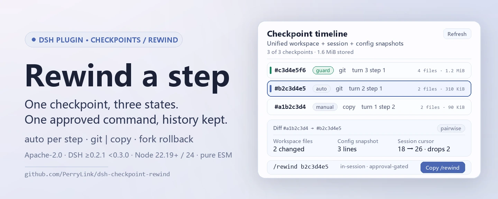
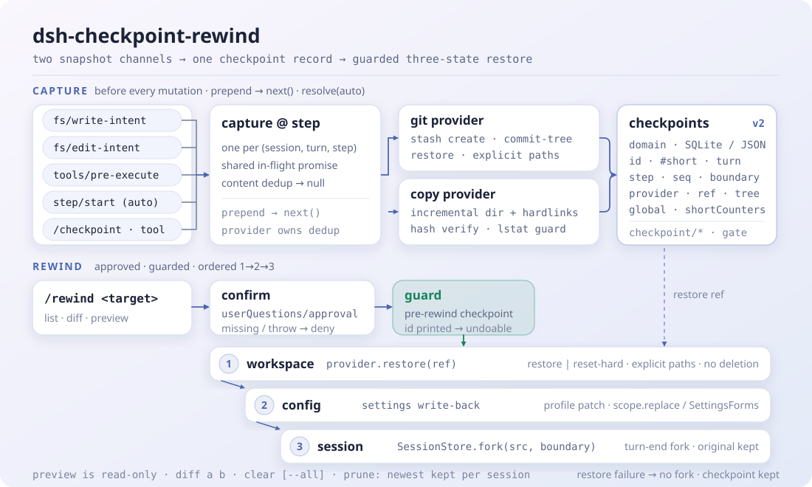

<div align="center">

<picture>
  <source media="(prefers-color-scheme: dark)" srcset="docs/assets/dsh-checkpoint-rewind-hero-en-dark.webp">
  
</picture>

# dsh-checkpoint-rewind

**「चरण N पर वापस」को एक कमांड बनाएँ — वर्कस्पेस, कॉन्फ़िग और सत्र के तीन-अवस्था चेकपॉइंट, एक स्वीकृत ट्रांज़ैक्शन में वापस।**

DeepSeek Harness के लिए rewind capability-seam प्लगइन: हर बदलाव से पहले बिना दुष्प्रभाव वाले git primitives से वर्कस्पेस कैप्चर करें, और वापसी पर पहले गार्ड, फिर फ़ाइलें, फिर कॉन्फ़िग, और अंत में सत्र fork करें — मूल सत्र का इतिहास कभी नहीं कटता।

[इंस्टॉल](#तीन-चरणों-में-शुरुआत) · [कॉन्फ़िगरेशन](#कॉन्फ़िगरेशन) · [FAQ](#faq) · [简体中文](README.md) · [English](README.en.md) · [Español](README.es.md) · [Português](README.pt.md) · [हिन्दी](README.hi.md)

[](LICENSE)
[](#संगतता)
[](https://www.npmjs.com/package/dsh-checkpoint-rewind)
[](https://github.com/PerryLink/dsh-checkpoint-rewind/actions/workflows/ci.yml)
[](#संगतता)

[](https://github.com/PerryLink/dsh-checkpoint-rewind/stargazers)
[](https://www.npmjs.com/package/dsh-checkpoint-rewind)
[](https://dshfind.com/plugins/PerryLink/dsh-checkpoint-rewind?ref=badge)
[](https://securityscorecards.dev/viewer/?uri=github.com/PerryLink/dsh-checkpoint-rewind)
[](https://dsh.market/)
[](https://gitee.com/perrylink/dsh-checkpoint-rewind)

```sh
dsh plugin --profile <name> add dsh-checkpoint-rewind
```

</div>

<sub>सामुदायिक प्लगइन, DeepSeek से असंबद्ध। कैनोनिकल रिपॉज़िटरी: <https://github.com/PerryLink/dsh-checkpoint-rewind> (Gitee एक मिरर है)।</sub>

## यह क्या है

`dsh-checkpoint-rewind` एक **तीन-अवस्था एकीकृत चेकपॉइंट** कैप्चर करता है — वर्कस्पेस, सत्र कर्सर और प्लगइन कॉन्फ़िग — और एक स्वीकृत कमांड से इनमें से एक या तीनों बहाल करता है। वर्कस्पेस स्नैपशॉट पहले बिना दुष्प्रभाव वाले git primitives (`stash create` / `commit-tree`) पर जाते हैं; गैर-git डायरेक्टरी (और जिन रेपो में HEAD पैदा नहीं हुआ) hardlink पुन:उपयोग वाले इंक्रीमेंटल `copy` स्नैपशॉट पर उतर आते हैं। सत्र वापसी मूल सत्र को कभी नहीं काटती: यह चेकपॉइंट सीमा पर एक नया चाइल्ड सत्र fork करती है, और मूल इतिहास ज्यों का त्यों रहता है। हर बदलाव वाली टूल से पहले, स्वचालित अंतराल पर, मैन्युअल `/checkpoint` से, और हर rewind से पहले गार्ड के रूप में कैप्चर होता है; सेटिंग्स पेज में pairwise line-level diff वाली चेकपॉइंट टाइमलाइन भी है।

<picture>
  <source media="(prefers-color-scheme: dark)" srcset="docs/assets/dsh-checkpoint-rewind-flow-v5-dark.svg">
  
</picture>

## तीन चरणों में शुरुआत

1. **इंस्टॉल करें** (एक चैनल चुनें):

   ```sh
   # git चैनल (नवीनतम main; git+https://github.com/PerryLink/dsh-checkpoint-rewind.git के बराबर)
   dsh plugin --profile web add github:PerryLink/dsh-checkpoint-rewind
   # npm चैनल (प्रकाशित रिलीज़)
   dsh plugin --profile web add dsh-checkpoint-rewind
   # tarball चैनल: इस रेपो में npm pack करके
   dsh plugin --profile web add ./dsh-checkpoint-rewind-<version>.tgz
   ```

   शुद्ध ESM, कोई build चरण नहीं — `index.mjs` और `lib/` ही भेजे गए आर्टिफ़ैक्ट हैं।

2. **न्यूनतम कॉन्फ़िग**: storage स्टैक रचें (चेकपॉइंट persistence के लिए आवश्यक) और प्लगइन पंक्ति माउंट करें। storage स्टैक बिना भी प्लगइन माउंट होता है और profile स्टार्टअप कभी नहीं रोकता; checkpoint/rewind कमांड संरचित त्रुटि लौटाते हैं जो जोड़ने वाली सटीक पंक्तियाँ बताती है:

   ```yaml
   - insert:
       - id: checkpoint-rewind-storage
         name: '@deepseek-ai/dsh-storage'
       - id: checkpoint-rewind-storage-json
         name: '@deepseek-ai/dsh-storage-json'
         config:
           root: !!js dshHomePath('checkpoint-rewind/storage')
       - id: checkpoint-rewind-storage-domain
         name: '@deepseek-ai/dsh-storage-domain'
         config:
           backend: json
       - id: checkpoint-rewind
         name: dsh-checkpoint-rewind
         config:
           provider: auto
           confirmVia: auto
   ```

3. **माउंट सत्यापित करें**:

   ```sh
   dsh --profile web --dump-config | grep -A4 'id: checkpoint-rewind'
   ```

   फिर चेकपॉइंट सूचीबद्ध करें; वर्कस्पेस बदलाव उन्हें स्वचालित रूप से बनाते हैं:

   ```text
   > /rewind list brief
   rewind: 3 checkpoints (newest last):
   #a1b2c3d4 · (git) · turn 2 step 1 · 2026-08-14 12:00:01 (3 min ago) · trigger: bash · 4 files · 1.2 MiB
   #b2c3d4e5 · (git) · turn 2 step 3 · 2026-08-14 12:00:41 · trigger: str_replace_editor · 2 files · 310 KiB
   #c3d4e5f6 · (copy) · turn 3 step 1 · 2026-08-14 12:01:10 · trigger: write · 1 file · 90 KiB
   run "/rewind <id>" to restore files and fork the session from that checkpoint
   ```

**अनइंस्टॉल**: `dsh plugin --profile web remove dsh-checkpoint-rewind` — स्नैपशॉट फ़ाइलें तब तक रहती हैं जब तक आप `$DSH_HOME/dsh-checkpoint-rewind` न हटाएँ; git ऑब्जेक्ट garbage-collect हो जाते हैं।

> चेकपॉइंट `storageDomain` सेवा से persist होते हैं। जो profile पहले से storage स्टैक रचती हैं वे सीधे काम करती हैं; bare profile फिर भी माउंट होती है और मैन्युअल कैप्चर कर सकती है, पर डोमेन खुलने में विफल होने पर कमांड ज़ोर से विफल होते हैं — चुपचाप “कोई चेकपॉइंट नहीं” में नहीं उतरते।

## मुख्य क्षमताएँ

`dsh-checkpoint-rewind` हर बदलाव से पहले बहाल करने योग्य तीन-अवस्था रिकॉर्ड छोड़ता है और बहाली को एक निश्चित-क्रम ट्रांज़ैक्शन बनाता है:

1. **तीन-अवस्था रिकॉर्ड** — हर चेकपॉइंट वर्कस्पेस स्थिति (git tree SHA, या copy manifest), सत्र इवेंट कर्सर (`seq` + turn सीमा) और कॉन्फ़िग स्नैपशॉट रखता है, और स्रोत से चिह्नित होता है (`manual` / `auto` / `guard` / `mutation`)।
2. **चार कैप्चर ट्रिगर** — हर बदलाव वाली टूल से पहले (`fs/write-intent`, `fs/edit-intent`, `tools/pre-execute`), स्वचालित अंतराल पर (`autoCheckpoint`, डिफ़ॉल्ट हर चरण), मैन्युअल (`/checkpoint` और `checkpoint` टूल), और हर rewind से पहले गार्ड चेकपॉइंट।
3. **git-प्रथम provider** — `git stash create` / `commit-tree` बिना ref वाले स्नैपशॉट ऑब्जेक्ट बनाते हैं जो आपके worktree, index या history को कभी नहीं छूते; बहाली केवल worktree तक और स्पष्ट पथों तक सीमित है। गैर-git डायरेक्टरी (और HEAD-रहित रेपो) hardlink पुन:उपयोग वाले इंक्रीमेंटल `copy` provider पर उतर आते हैं।
4. **एक-कदम वापसी** — `/rewind workspace|session|config|all <target>` चुनी हुई अवस्थाएँ बहाल करता है; `preview` केवल-पढ़ने वाली प्रभाव रिपोर्ट है, `diff <a> <b>` दो चेकपॉइंट की तुलना करता है, `clear` उन्हें हटाता है (यह सत्र; `clear --all` सभी सत्रों और वर्कस्पेस पर)।
5. **fork-आधारित सत्र वापसी** — सत्र वापसी आधिकारिक `SessionStore.fork` primitive से घटनाओं को चेकपॉइंट सीमा तक नए चाइल्ड सत्र में दोहराती है (जब host में fork न हो या चेकपॉइंट की सीमा न हो तो seeded `sessions.create` पथ पर); मूल सत्र अपना पूरा इतिहास रखता है।
6. **सेटिंग्स पेज टाइमलाइन** — `Plugins → Checkpoints` टैब सत्र के चेकपॉइंट pairwise line-level diff (`diffRenderer`) और प्रति-फ़ाइल चयनित बहाली (`selectiveRestore`) के साथ दिखाता है।

### कमांड और टूल सतह

| सतह | प्रकार | नोट्स |
|---|---|---|
| `/rewind` | कमांड | `[workspace\|session\|config\|all] <number\|id-prefix\|step <N>\|latest>` · `list [brief]` · `diff <a> <b>` · `preview <target>` · `clear [--all]` |
| `/checkpoint` | कमांड | `[note <text>\|list\|diff <a> <b>]` — मैन्युअल चेकपॉइंट कैप्चर करें |
| `checkpoint` | टूल | वैकल्पिक नोट के साथ मैन्युअल चेकपॉइंट कैप्चर करें |
| `fs/write-intent` · `fs/edit-intent` · `tools/pre-execute` | listeners | बदलाव से पहले कैप्चर (prepend pass-through; policy slot कभी नहीं छीनता) |
| `session/event` | listener | turn/step ट्रैकिंग, स्वचालित अंतराल, सीमा backfill, turn-end pruning |
| `checkpoints` प्रोजेक्शन | सत्र प्रोजेक्शन | सत्र लॉग से मोड़ी गई टाइमलाइन पट्टी |
| सेटिंग्स पेज टाइमलाइन | क्लाइंट | `Plugins → Checkpoints` टैब, pairwise diff और प्रति-फ़ाइल चयनित बहाली के साथ |

### उदाहरण

ये प्लगइन के वास्तविक प्रवेश बिंदु हैं; एक बार इंस्टॉल करके एक चलाएँ।

**विस्तृत उदाहरण** — कमांड `/rewind preview cp-9`, आउटपुट:

~~~text
rewind preview: checkpoint #cp-9 (provider git, turn 2 step 3)
restoring it would overwrite 2 file(s):
  a.txt
  b.txt
5 file(s) already match the checkpoint (not touched).
no files are deleted: 1 file(s) created after the checkpoint would be left in place:
  new.txt
run "/rewind <id>" to confirm and apply (a guard checkpoint is captured first)
~~~

*Observed from `test/checkpoints.test.mjs:289-301; lib/checkpoints.mjs:484-500`*

**विफलता शाखा** — इनपुट `/rewind nope`, आउटपुट:

~~~text
rewind: unknown checkpoint id "nope" (run /rewind to list)
~~~

*Observed from `plugins/dsh-checkpoint-rewind/lib/errors.mjs:72; plugins/dsh-checkpoint-rewind/index.mjs:1223; plugins/dsh-checkpoint-rewind/test/index.test.mjs:346-350`*

**संक्षिप्त उदाहरण**: `/checkpoint` · `/rewind preview`

### सत्र संख्याएँ

- **हर चेकपॉइंट को बनते समय एक संख्या मिलती है**, `1` से शुरू। `/rewind 3` उस संख्या को **ठीक-ठीक** हल करता है — अंकों को कभी id prefix नहीं माना जाता, इसलिए `/rewind 3` कभी उस चेकपॉइंट पर नहीं पहुँच सकता जिसका UUID `3` से शुरू होता है।
- **दायरा: प्रति सत्र** (`sessionId`)। हर सत्र अपने चेकपॉइंट को स्वयं क्रमांकित करता है; संख्या अपने सत्र में अद्वितीय है, और `/rewind <number>` केवल वर्तमान सत्र (और वर्कस्पेस) के चेकपॉइंट पर हल होता है।
- **एकदिश और कभी पुन:उपयोग नहीं।** कोटा pruning (`maxSnapshots`) और `/rewind clear` / `/rewind clear --all` रिकॉर्ड हटाते हैं पर संख्या कभी मुक्त नहीं करते: clear के बाद अगला चेकपॉइंट पिछले high-water mark से आगे बढ़ता है (यानी `#1 #2 #3` और एक `clear` के बाद अगला `#4` है, `#1` नहीं)। संख्या रिकॉर्ड पर ही लिखी है और काउंटर डोमेन के global slot में रहता है, इसलिए रिकॉर्ड हटाने से वह शून्य नहीं हो सकता।
- **पुराने चेकपॉइंट पहली बार देखे जाने पर क्रमांकित होते हैं।** इस सुविधा से पहले लिखे रिकॉर्ड (बिना संख्या फ़ील्ड) उस सत्र के पहली बार सूचीबद्ध या rewind होने पर निर्माण क्रम में क्रमांकित होते हैं, और वह क्रमांकन persist होता है; नए चेकपॉइंट उसके बाद चलते हैं। कुछ छूटता या बदलता नहीं, और id-prefix addressing उनके लिए भी काम करता रहता है।
- `/rewind list` (विस्तृत सूची) अपरिवर्तित है: वह अब भी प्रति पंक्ति 8-अक्षर id छापती है और उसकी अंतिम पंक्ति संख्याओं के लिए `/rewind list brief` की ओर इशारा करती है।

`preview` उसी addressing से हल करके प्रभाव छापता है, बिना पुष्टि माँगे या कुछ लिखे। `--files` उसी स्वीकृति-द्वार वाले ट्रांज़ैक्शन से केवल नामित फ़ाइलें बहाल करता है (अज्ञात पथ fail-closed; यह `workspaceRestore: reset-hard` के साथ असंगत है और `selectiveRestore: false` होने पर बंद रहता है)।

### दूसरा rewind प्लगइन क्यों?

| प्लगइन | क्या बेचता है | फ़ाइलें बहाल? | सत्र rewind? |
|---|---|---|---|
| **dsh-checkpoint-rewind** (यह) | git-ऑब्जेक्ट स्नैपशॉट + तीन-अवस्था वापसी + एक-कदम बहाली | ✅ पूरी वर्कस्पेस स्थिति | ✅ seed-replay चाइल्ड सत्र |
| [Anionex/dsh-turn-rewind](https://github.com/Anionex/dsh-turn-rewind) | प्रति-बदलाव delta का स्थायी Change Ledger | ✅ उलटे delta दोहराकर | ✅ अपना ledger मॉडल |
| [LingLambda/dsh-undo](https://github.com/LingLambda/dsh-undo) | अंतिम पूर्ण चरण तक शुद्ध कॉन्टेक्स्ट वापसी | ❌ | ✅ केवल कॉन्टेक्स्ट |
| [Mongfayi/dsh-recall](https://github.com/Mongfayi/dsh-recall) | संदेश वापसी (एक turn और उसके बाद सब हटाना) | ❌ (स्पष्ट रूप से) | ✅ turn हटाना |

एक वाक्य में अंतर: **dsh-checkpoint-rewind हर बदलाव से पहले बिना दुष्प्रभाव वाले git primitives से *वर्कस्पेस स्थिति* कैप्चर करता है, और “चरण N पर वापस” को एक स्वीकृत कमांड बनाता है — पहले गार्ड चेकपॉइंट, दूसरे फ़ाइलें बहाल, तीसरे कॉन्फ़िग बहाल, चौथे सत्र replay, हर चरण लॉग।** कोई बहकने वाला delta हिसाब नहीं, कोई संदेश-स्तरीय संपादन नहीं (वह दूसरा प्लगइन है), कोई क्रॉस-डिवाइस सिंक नहीं।

### यह कैसे काम करता है

```text
capture ── fs/write-intent · fs/edit-intent · tools/pre-execute (prepend, pass-through)
        ── step/start auto interval ── /checkpoint · checkpoint tool ── pre-rewind guard
             │
             ▼  ProviderRegistry.resolve(auto)  →  git: stash create / commit-tree
             │                                     copy: incremental dir + hardlinks
             ▼
        checkpoints storage domain (SQLite rows / JSON file)  +  checkpoint/* event (adaptive gate)

/rewind <target> ── confirm (userQuestions / approval, fail-closed) ──▶ guard checkpoint
             ├─ workspace: provider.restore(ref)  (restore | reset-hard)
             ├─ config:   settings write-back (persisted on the profile patch)
             └─ session:  SessionStore.fork(source, boundary) → new child session (original untouched)
```

पूरा निर्णय रिकॉर्ड, इवेंट शब्दावली और provider seam अनुबंध: [ARCHITECTURE.md](ARCHITECTURE.md)।

### सत्र इवेंट (rc.2 नोट)

प्लगइन `checkpoint/snapshot`, `checkpoint/bound`, `checkpoint/prune` और `checkpoint/rewind` को केवल-लॉग `SessionEventMap` सदस्य घोषित करता है। Harness rc.2 में **प्लगइन इवेंट पंजीकरण सतह नहीं है** और `Session.append` `ignorable` envelope पर मुहर नहीं लगाता (उसका तीसरा तर्क surface intent है, विकल्प नहीं), इसलिए अज्ञात प्रकार जोड़ने से सत्र reload पर अपठनीय हो जाएगा। इसलिए प्लगइन **adaptive gate** से जोड़ता है: एक runtime probe (अलग, कभी persist न होने वाले सत्र स्टोर पर) जाँचता है कि host का `append` `ignorable` envelope पर मुहर लगाता है या नहीं — rc.2 पर gate बंद रहता है; जो host इसे सपोर्ट करते हैं वहाँ `checkpoint/*` इवेंट अपने आप `ignorable: true` के साथ जुड़ते हैं। तब तक आधिकारिक ऑडिट श्रृंखला `command/run` + `command/done` (host-ज्ञात) और स्थायी `checkpoints` स्टोरेज डोमेन है।

### Web UI एंकर

प्लगइन कमांड परिणाम में नया सत्र id लौटाता है (`session: <id>`) और Web shell वहाँ नेविगेट कर सकता है। **सत्र-प्रोजेक्शन इकाई `checkpoints` शामिल है**: जब भी `ctx.sessionProjections` मौजूद हो, प्लगइन उस इकाई को `ctx.inject` से पंजीकृत करता है (`checkpoint/snapshot|bound|prune|rewind` को पूर्ण-मान सूची में मोड़ता है) — rc.2 host पर यह खाली सूची रहती है जब तक कोई harness build `checkpoint/*` शब्दावली या `ignorable` envelope न भेजे, फिर बिना किसी प्लगइन बदलाव के भर जाती है।

### इंटीग्रेशन सत्यापन

एक वास्तविक assembled-headless integration रन (`npm run test:integration`) पूरा प्रवाह चलाता है: एजेंट दो turn में फ़ाइलें बदलता है, फिर `/rewind preview` केवल-पढ़ने में प्रभाव देखता है (कोई पुष्टि द्वार नहीं, कोई लेखन नहीं) और `/rewind <id>` फ़ाइलें बहाल करके सत्र को नए चाइल्ड सत्र में replay करता है। रन फ़ाइल सामग्री, replay किए गए चाइल्ड कॉन्टेक्स्ट, गार्ड चेकपॉइंट, और चेकपॉइंट के बाद बनी फ़ाइलों के बचे रहने की जाँच करता है — copy और git दोनों provider प्रवाहों के लिए (git प्रवाह यह भी जाँचता है कि `HEAD` और reflog नहीं छुए गए)। ड्राइवर `test/integration/rewind-headless.mjs` में है।

## कॉन्फ़िगरेशन

सभी ट्यूनिंग Schemastery `Config` फ़ील्ड हैं (cordis.yml से बदली जा सकती हैं); कुछ हार्डकोड नहीं है। provider विकल्प (`gitBin`, `snapshotDir`, `excludeGlobs`, `verifyByHash`) उपयोग के समय live config से पढ़े जाते हैं, इसलिए cordis.yml बदलाव बिना restart लागू होते हैं। id-लक्षित override पूरी पंक्ति बदल देता है — जिन भी कुंजियों की ज़रूरत हो, सब दोहराएँ।

सबसे अधिक उपयोग होने वाली कुंजियाँ:

| कुंजी | डिफ़ॉल्ट | अर्थ |
|---|---|---|
| `enabled` | `true` | मास्टर स्विच; `false` कमांड, listeners और providers पूरी तरह हटा देता है |
| `provider` | `auto` | स्नैपशॉट provider: `auto` (git उपलब्ध हो तो git, नहीं तो copy) · `git` · `copy` |
| `maxSnapshots` | `50` | प्रति सत्र रखे जाने वाले चेकपॉइंट (सबसे पुराने पहले prune) |
| `maxSnapshotBytes` | `536870912` (512 MiB) | वैश्विक इंक्रीमेंटल-बाइट soft कोटा (प्रति जीवित सत्र नवीनतम हमेशा रखा जाता है) |
| `confirmVia` | `auto` | पुष्टि चैनल: `auto` (पहले userQuestions) · `userQuestions` · `approval` |
| `preRewindCheckpoint` | `warn` | बहाली से पहले गार्ड चेकपॉइंट: `warn` · `require` · `off` |
| `workspaceRestore` | `restore` | वर्कस्पेस वापसी: `restore` (सुरक्षित overwrite) · `reset-hard` (CC शैली, opt-in) |
| `autoCheckpoint.enabled` | `true` | `step/start` पर स्वचालित अंतराल स्नैपशॉट |

<details>
<summary>पूरी कॉन्फ़िगरेशन तालिका (20 कुंजियाँ)</summary>

| कुंजी | डिफ़ॉल्ट | अर्थ |
|---|---|---|
| `enabled` | `true` | मास्टर स्विच; `false` कमांड, listeners और providers पूरी तरह हटा देता है |
| `provider` | `auto` | स्नैपशॉट provider: `auto` (git उपलब्ध हो तो git, नहीं तो copy) · `git` · `copy` |
| `gitBin` | `git` | Git executable का पथ |
| `snapshotDir` | `$DSH_HOME/dsh-checkpoint-rewind` (`$DSH_HOME` सेट न हो तो `~/.dsh/dsh-checkpoint-rewind`) | copy provider स्नैपशॉट का मूल |
| `maxSnapshots` | `50` | प्रति सत्र रखे जाने वाले चेकपॉइंट (सबसे पुराने पहले prune) |
| `maxSnapshotBytes` | `536870912` (512 MiB) | वैश्विक इंक्रीमेंटल-बाइट soft कोटा (प्रति जीवित सत्र नवीनतम हमेशा रखा जाता है) |
| `pruneOnTurnEnd` | `true` | turn समाप्त होने पर कोटा pruning चलाएँ |
| `mutationTools` | `['bash','write','edit','str_replace_editor','pwsh','terminal_send']` | `tools/pre-execute` पर बदलाव वाली मानी जाने वाली टूल |
| `excludeGlobs` | `['node_modules','.git','.dsh','dist','build']` | copy provider द्वारा छोड़े जाने वाले glob पैटर्न |
| `confirmVia` | `auto` | पुष्टि चैनल: `auto` (पहले userQuestions) · `userQuestions` · `approval` |
| `listLimit` | `10` | बिना तर्क वाले `/rewind` द्वारा दिखाए जाने वाले चेकपॉइंट |
| `preRewindCheckpoint` | `warn` | बहाली से पहले गार्ड चेकपॉइंट: `warn` · `require` · `off` |
| `verifyByHash` | `false` | copy provider का content-hash तुलना और बहाली सत्यापन |
| `autoCheckpoint.enabled` | `true` | `step/start` पर स्वचालित अंतराल स्नैपशॉट |
| `autoCheckpoint.intervalMinutes` | `0` | अंतराल; `0` = हर चरण |
| `workspaceRestore` | `restore` | वर्कस्पेस वापसी: `restore` (सुरक्षित overwrite) · `reset-hard` (CC शैली, opt-in) |
| `diffRenderer` | `pairwise` | सेटिंग्स पेज diff रेंडरर: `pairwise` (line-level पाठ) · `side-by-side` (प्रति-फ़ाइल दो कॉलम) |
| `selectiveRestore` | `true` | प्रति-फ़ाइल चयनित बहाली (`/rewind … --files`) और पैनल का प्रति-फ़ाइल चेकबॉक्स + आकार योग |
| `promptSection` | `true` | एक छोटा role-statement prompt अनुभाग इंजेक्ट करें |
| `checkpointTool` | `true` | `checkpoint` मॉडल टूल पंजीकृत करें |

</details>

अपने profile patch में override उदाहरण:

```yaml
- insert:
    - id: checkpoint-rewind
      name: dsh-checkpoint-rewind
      config:
        provider: auto
        maxSnapshots: 50
        maxSnapshotBytes: 536870912
        pruneOnTurnEnd: true
        confirmVia: auto
        preRewindCheckpoint: warn
```

## FAQ

<details>
<summary>क्या यह git की जगह लेता है?</summary>

नहीं — यह उपलब्ध होने पर git का *उपयोग* करता है। git रेपो में आपको byte-perfect, deduplicated स्नैपशॉट ऑब्जेक्ट मिलते हैं जो इतिहास को नहीं छूते; किसी अन्य डायरेक्टरी में copy provider सादी फ़ाइलों से वही करता है। नियमित commits आपका दीर्घकालिक इतिहास बने रहते हैं।

</details>

<details>
<summary>डिफ़ॉल्ट में `git reset --hard` क्यों नहीं?</summary>

क्योंकि स्थिति नष्ट करना किसी safety net का काम नहीं है। डिफ़ॉल्ट में प्लगइन केवल बिना ref वाले ऑब्जेक्ट बनाता है और केवल worktree तक, स्पष्ट पथों वाली बहाली करता है, इसलिए गलत rewind कभी इतिहास, index या चेकपॉइंट के बाद बनी फ़ाइलें नहीं खो सकता। जो स्पष्ट रूप से CC समानता चाहते हैं उनके लिए `workspaceRestore: 'reset-hard'` के पीछे `reset-hard` उपलब्ध है।

</details>

<details>
<summary>चेकपॉइंट कितने समय तक बहाल करने योग्य रहता है?</summary>

git-provider स्नैपशॉट पर कोई ref नहीं रखा जाता। वे रचना से बिना ref वाले `stash create`/`commit-tree` ऑब्जेक्ट हैं, और `discard` केवल रिकॉर्ड हटाता है, ऑब्जेक्ट `git gc` के लिए छोड़ देता है। दो स्वतंत्र चीज़ें तय करती हैं कि चेकपॉइंट वास्तव में कितने समय तक बहाल करने योग्य रहता है: प्लगइन की अपनी कोटा pruning (`maxSnapshots`, डिफ़ॉल्ट प्रति सत्र 50; `maxSnapshotBytes`, डिफ़ॉल्ट 512 MiB वैश्विक soft कोटा जो कैप्चर पर `pruneAll()` से लागू और turn के अंत में swept होता है), और host रेपो का git gc। git के डिफ़ॉल्ट के साथ बिना ref वाले ऑब्जेक्ट auto-gc चलने तक बचे रहते हैं, और तब भी केवल `gc.pruneExpire` (डिफ़ॉल्ट 2 सप्ताह) से पुराने ऑब्जेक्ट prune होते हैं। मैन्युअल `git gc --prune=now`, आक्रामक repack, `filter-repo` या नया clone उन्हें तुरंत हटा सकते हैं। prune हुए ऑब्जेक्ट अब पहले से पकड़े जाते हैं: git provider बहाली से पहले `git cat-file -e` से स्नैपशॉट ऑब्जेक्ट probe करता है और उसके गायब होने पर चुपचाप कुछ भी बहाल करने के बजाय ज़ोर से विफल होता है, और doctor pass हर चेकपॉइंट रिकॉर्ड पर ऑब्जेक्ट की मौजूदगी probe करके अन-बहाली-योग्य को चिह्नित करता है (सूची में `[UNRESTORABLE: object missing]`)। doctor pass लागू और परीक्षित है पर अभी बहाली पथ से जुड़ा नहीं है (restore अभी `unrestorable` चिह्न नहीं पढ़ता; discussion #13 में ट्रैक)। 

</details>

<details>
<summary>क्या मैं turn के बीच के किसी चरण पर rewind कर सकता हूँ?</summary>

फ़ाइल बहाली चरण-सटीक है (`/rewind step <N>` = ≤ N का निकटतम स्नैपशॉट)। सत्र replay हालाँकि harness की replay granularity का पालन करता है: चाइल्ड सत्र चेकपॉइंट की turn सीमा तक seeded होता है।

</details>

<details>
<summary>अगर पुष्टि का उत्तर कोई न दे सके तो क्या होगा?</summary>

कुछ नहीं छुआ जाता — प्लगइन fail-closed होता है (`unavailable`/`rejected`), चेकपॉइंट रखता है, और व्याख्यात्मक त्रुटि लौटाता है। rc.2 पर `confirmVia: approval` के साथ संदेश userQuestions माउंट करने को कहता है, क्योंकि approval को खुला turn चाहिए और कमांड turn के बीच चलते हैं।

</details>

<details>
<summary>क्या मैं rewind पूर्ववत कर सकता हूँ?</summary>

हाँ — हर स्वीकृत rewind पहले pre-rewind स्थिति का गार्ड चेकपॉइंट कैप्चर करता है; परिणाम `rewind guard: <id>` छापता है, और `/rewind <guard-id>` वह स्थिति बहाल करता है।

</details>

<details>
<summary>चेकपॉइंट को कैसे address करूँ?</summary>

**सत्र संख्या** से (`/rewind 3` — `/rewind list brief` देखें; प्रति सत्र, एकदिश, कभी पुन:उपयोग नहीं), अद्वितीय id prefix से (सूची का 8-अक्षर छोटा id अब भी काम करता है), `/rewind step <N>` से, और `/rewind latest` से। `/rewind clear` इस सत्र के चेकपॉइंट हटाता है, और `/rewind clear --all` सभी सत्रों और वर्कस्पेस के चेकपॉइंट हटाता है (फ़ाइलें अछूती) — दोनों में से कोई क्रमांकन रीसेट नहीं करता। `/rewind preview <target>` वही addressing उपयोग करके बिना कुछ बदले प्रभाव दिखाता है।

</details>

<details>
<summary>clear के बाद संख्या ऊपर क्यों बढ़ती रहती है?</summary>

क्योंकि संख्या एक पता है, स्थान नहीं: clear के बाद `#1` को दूसरे चेकपॉइंट को देने से जो कुछ भी `#1` का ज़िक्र करता था वह चुपचाप दूसरी ओर इशारा करने लगेगा। काउंटर `checkpoints` डोमेन (global slot) में persist होता है और हर रिकॉर्ड अपनी संख्या रखता है, इसलिए pruning और clearing स्नैपशॉट हटाते हैं पर id recycle नहीं करते।

</details>

<details>
<summary>`preview` क्या करता है — और क्या नहीं?</summary>

यह चेकपॉइंट हल करता है, फिर केवल-पढ़ने वाली तुलना चलाता है: कौन-सी फ़ाइलें overwrite (या फिर से बनाई) जाएँगी, कौन-सी पहले से मेल खाती हैं, और चेकपॉइंट के बाद बनी कौन-सी फ़ाइलें ज्यों की त्यों रहेंगी। यह कभी पूछता नहीं, कभी लिखता नहीं, कभी fork नहीं करता, और कोई `checkpoint/rewind` इवेंट दर्ज नहीं करता — स्वीकृति द्वार केवल असली `/rewind <id>` पर चलता है।

</details>

### समस्या निवारण

| लक्षण | कारण / समाधान |
|---|---|
| `/rewind <id>` कहता है `rewind cancelled: no confirmation answerer` | कोई userQuestions/approval चैनल माउंट नहीं है — प्लगइन fail-closed होता है। Web UI में चलाएँ (या question provider माउंट करें); `confirmVia` चैनल चुनता है। |
| `/rewind <id>` कहता है `approval requires an open turn …` | कमांड turn के बीच चलते हैं और approval को turn चाहिए — userQuestions माउंट करें या `confirmVia: userQuestions` रखें। |
| `rewind: checkpoint registry unavailable` | `checkpoints` स्टोरेज डोमेन नहीं खुला। या तो `storageDomain` सेवा composed नहीं है (तीन-चरण शुरुआत से storage स्टैक पंक्तियाँ जोड़ें: `@deepseek-ai/dsh-storage` + `@deepseek-ai/dsh-storage-json` config `root` के साथ + `@deepseek-ai/dsh-storage-domain` config `backend: json` के साथ) या backend में त्रुटि है; harness लॉग देखें। |
| कोई चेकपॉइंट `fork: pending (turn not closed)` दिखाता है | उसका turn अभी `turn/end` नहीं हुआ; फ़ाइलें फिर भी बहाल हो सकती हैं, पर सत्र replay turn बंद होने की प्रतीक्षा करता है। |
| `files restored … but the session was NOT replayed` | ट्रांज़ैक्शन का सत्र चरण विफल (कोई बंद सीमा नहीं, या replay अस्वीकृत)। फ़ाइलें बहाल रहती हैं; छपे `rewind guard: <id>` से पूर्ववत करें। |
| `rewind: aborted — the pre-rewind guard checkpoint could not be captured` | `preRewindCheckpoint: require` ने rewind अस्वीकार किया क्योंकि गार्ड कैप्चर विफल रहा; storage ठीक करें (या `warn`/`off` रखें)। |
| कोई चेकपॉइंट `(copy)` दिखाता है जबकि डायरेक्टरी रेपो है | HEAD पैदा नहीं हुआ (कोई प्रारंभिक commit नहीं): git स्नैपशॉट primitives को HEAD चाहिए, इसलिए पहले commit तक प्लगइन `copy` पर उतर आता है। |
| headless रन में `MISSING_CREDENTIAL` | इस प्लगइन से असंबंधित: मॉडल provider के लिए `DEEPSEEK_API_KEY` कॉन्फ़िगर नहीं है। |
| स्नैपशॉट स्टोरेज बढ़ता है | हर स्नैपशॉट के बाद और `turn/end` (`pruneOnTurnEnd`) पर pruning चलती है; `maxSnapshots` / `maxSnapshotBytes` घटाएँ, `/rewind clear` चलाएँ, या अनइंस्टॉल के बाद `$DSH_HOME/dsh-checkpoint-rewind` हटाएँ। |

## सुरक्षा सीमाएँ

- **Git इतिहास अछूत है।** git provider केवल allowlist वाले बिना दुष्प्रभाव वाले primitives चलाता है — `stash create`, `commit-tree`, `restore --worktree`, `ls-tree`, `diff-tree`, `ls-files`, `status`, `rev-parse`, `cat-file -e` — जिन्हें runtime assertion लागू करता है, और ऑब्जेक्ट refs git को देने से पहले hex id के रूप में जाँचे जाते हैं (छेड़ा गया रिकॉर्ड git विकल्प नहीं घुसा सकता)। **डिफ़ॉल्ट में कभी `reset --hard` नहीं, कभी `clean` नहीं, कभी index/history बदलाव नहीं** (नीचे `workspaceRestore` देखें)।
- **overwrite वापसी, कभी हटाना नहीं।** बहाली केवल कैप्चर की गई फ़ाइलें overwrite करती है, और git provider **स्पष्ट पथ** बहाल करता है (`git restore … -- .` चेकपॉइंट के बाद `git add` हुई फ़ाइलें हटा देगा)। चेकपॉइंट के बाद बनी फ़ाइलें (untracked **या** staged) *रिपोर्ट* होती हैं और ज्यों की त्यों रहती हैं।
- **लिंक से होकर कोई लेखन नहीं, कोई path traversal नहीं।** copy provider चेकपॉइंट refs को स्नैपशॉट-डायरेक्टरी पथों में जोड़ने से पहले जाँचता है, और ऐसे गंतव्य (या पूर्वज) से होकर बहाली से इनकार करता है जो symbolic link बन गया हो — इसलिए बहाली कभी लिंक के पीछे वर्कस्पेस से बाहर नहीं जाती।
- **बहाली के लिए स्वीकृति आवश्यक।** उपयोगकर्ता फ़ाइलें overwrite करना हमेशा `ask` अर्थ वाले पुष्टि seam से जाता है; अनुपस्थित, त्रुटि देने वाला या “नहीं” कहने वाला answerer **fail-closed** होता है। `/rewind preview` पहले प्रभाव देखने का केवल-पढ़ने वाला तरीका है।
- **rewind उलटा जा सकता है।** बहाली से पहले एक गार्ड चेकपॉइंट वर्तमान स्थिति कैप्चर करता है; गार्ड बहाल करने से यह rewind उलट जाता है। जब गार्ड कैप्चर न हो सके तो `preRewindCheckpoint: require` rewind रद्द कर देता है।
- **निश्चित-क्रम ट्रांज़ैक्शन।** पहले गार्ड, दूसरे वर्कस्पेस, तीसरे कॉन्फ़िग, चौथे सत्र replay; हर चरण लॉग होता है; विफल बहाली फ़ाइलें, चेकपॉइंट और सत्र अछूते छोड़ती है।
- **`workspaceRestore: 'reset-hard'` CC के बराबर और opt-in है।** यह `git reset --hard <snapshot commit>` चलाता है (branch head स्नैपशॉट commit पर जाता है; स्नैपशॉट-पूर्व इतिहास reflog से वापस पाया जा सकता है; untracked फ़ाइलें अछूती)। डिफ़ॉल्ट में बंद है।
- **मॉडल-दृश्य ⟺ लॉग।** उपयोगकर्ता या मॉडल जो कुछ देखता है वह `command/run` + `command/done` (और, जब host उन्हें जानता हो, `checkpoint/*` इवेंट) और स्थायी `checkpoints` डोमेन से पुनर्निर्मित हो सकता है।
- **विफलताएँ ज़ोर से।** अमान्य कॉन्फ़िग load पर throw करता है; अनुपलब्ध डोमेन, विफल बहाली और विफल fork संरचित त्रुटि पाठ लौटाते हैं — कुछ भी चुपचाप निगला या काटा नहीं जाता।

## अनुमतियाँ और डेटा

- **अनुमतियाँ**: workshop manifest `workspace:read`, `workspace:write`, `git:read`, `git:write`, `snapshot-storage:write`, `session-log:read`, `settings:write` और `network:none` घोषित करता है।
- **डेटा**: चेकपॉइंट रिकॉर्ड `checkpoints` स्टोरेज डोमेन में रहते हैं (SQLite पंक्तियाँ या JSON फ़ाइल); copy स्नैपशॉट `snapshotDir` के अंतर्गत रहते हैं। डोमेन का **global slot** प्रति-सत्र छोटी-संख्या काउंटर रखता है, इसलिए रिकॉर्ड हटाना (`prune`, `clear`, `clear --all`) संख्या कभी recycle नहीं कर सकता। पूरी तरह स्थानीय — कोई नेटवर्क नहीं, कोई क्रेडेंशियल नहीं। डोमेन दोहरी-संस्करण में खुलता है: 0.4.x युग की मीडिया (डोमेन v1) compatibility मोड में खुलती है जो पुराने रिकॉर्ड पठनीय रखती है और नए कैप्चर v2 आकार में रखती है, इसलिए प्लगइन अपग्रेड मौजूदा मीडिया को कभी अनाथ नहीं करता।
- **सत्र लॉग**: `checkpoint/*` इवेंट adaptive gate से जुड़ते हैं; आधिकारिक ऑडिट श्रृंखला `command/run` + `command/done` और स्थायी डोमेन है।

## ज्ञात सीमाएँ

- rc.2 पर `checkpoint/*` सत्र इवेंट adaptive gate से दबाए जाते हैं; जब तक host वह शब्दावली या `ignorable` envelope न भेजे, ऑडिट श्रृंखला `command/run` + `command/done` और स्टोरेज डोमेन पर टिकी है।
- `confirmVia: approval` को खुला turn चाहिए, और कमांड turn के बीच चलते हैं — rc.2 पर userQuestions माउंट करें (या `confirmVia: userQuestions` रखें)।
- सत्र वापसी चेकपॉइंट सीमा पर **नया चाइल्ड सत्र fork** करती है; वह मूल सत्र को कभी फिर से नहीं लिखती या नहीं काटती।
- `workspaceRestore: 'reset-hard'` branch head को स्नैपशॉट commit पर ले जाता है; डिफ़ॉल्ट में बंद है।
- किसी भी बंद turn से पहले कैप्चर किए गए चेकपॉइंट की replay सीमा नहीं होती — तब सत्र वापसी खाली कॉन्टेक्स्ट वाला नया चाइल्ड सत्र बनाती है।

## अन्य DSH प्लगइनों के साथ इंटरऑपरेबिलिटी

**DSH `0.2.0-rc.2`** (यह README जिस runtime के लिए है) और 2026-10-05 को सर्वे किए गए उच्च-स्टार प्लगइन सेट के विरुद्ध सत्यापित।

यह प्लगइन अन्य प्लगइनों में **हस्तक्षेप नहीं करता**, जिनमें व्यापक रूप से स्थापित उच्च-स्टार प्लगइन भी शामिल हैं:

- **कोई टूल-नाम टकराव नहीं।** हर टूल namespaced है; किसी shipped टूल या अन्य प्लगइन के किसी bare नाम को पंजीकृत नहीं किया जाता।
- **कोई service-key टकराव नहीं।** यह कोई service key नहीं देता, इसलिए किसी पर टकरा नहीं सकता।
- **कोई slot टकराव नहीं।** यह कोई client slot key पंजीकृत नहीं करता, इसलिए `shadows-shipped-ui` सीट के लिए नहीं लड़ता।
- **कोई HTTP route टकराव नहीं।** यह कोई `webServer` prefix पंजीकृत नहीं करता।
- **कोई patch-layer टकराव नहीं।** bundle patch केवल अपनी पंक्ति `insert` करता है; वह कभी built-in पंक्ति की `config` को override नहीं करता।
- **कोई global mutation नहीं।** यह prototypes नहीं बदलता, `process.env` नहीं लिखता, या global fetch dispatcher नहीं बदलता।

**साझा इवेंट listeners रचना से ही अहस्तक्षेपी हैं।** यह क्रम-संवेदी इवेंट `fs/edit-intent`, `fs/write-intent`, `tools/pre-execute` को `ctx.on()` से देखता है — Cordis का broadcast पंजीकरण, जहाँ हर listener चलता है और कोई किसी को भूखा नहीं मार सकता। **यहाँ हर listener `next()` से delegate करता है**, इसलिए श्रृंखला कभी short-circuit नहीं होती, और बदलाव `next()` के उत्पादित मान पर लागू होता है, उसकी जगह लौटाए गए मान पर नहीं:

- `tools/pre-execute` — also used by `cc-safety-net` (1576★).

स्थिर प्रमाण: `dsh-plugin-doctor` के K10–K13 इस रेपो की हर जाँच पर `pass` हैं।

## संगतता

| सतह | स्थिति |
|---|---|
| Harness | DeepSeek Harness `dsh-v0.2.1-alpha.1` (GitHub tag, 2026-09-25 को सत्यापित; npm pin `0.1.7-rc.2`, peers `>=0.1.6-0 <0.2.0 \|\| >=0.1.7-0 <0.2.0`) (2026-10-04 को अनुकूलित): host ने `@deepseek-ai/dsh-settings-file` हटाया और `ctx.settings` की namespace-registration सतह को `SettingsForms` से बदला, जो हर Loader प्रविष्टि के `Config` को सेटिंग्स फ़ॉर्म में प्रोजेक्ट करता है और संपादन profile patch पर persist करता है — प्लगइन कॉन्फ़िग फ़ील्ड अब `volatile()` घोषित और live पढ़े जाते हैं, typert strict codecs केवल अपनी `create()` फ़ैक्टरी रखते हैं, और rewind सूचना अपना message-source `kind` घोषित करती है। पुराना `settings.register` पथ `0.1.5-rc.2`/`0.1.6-alpha.2` hosts के लिए रखा गया है। 2026-09-22 को `dsh-v0.1.7-alpha.1` checkout के विरुद्ध सत्यापित (alpha.1 प्रकार-सतह के विरुद्ध typecheck + पूरी unit suite + assembled-headless integration)। |
| Node | `^22.19.0 \|\| >=24.0.0` |
| प्लेटफ़ॉर्म | सभी (host कमांड + listeners; settings क्षमता से वैकल्पिक सेटिंग्स पेज टाइमलाइन) |
| मॉडल | कोई भी (कोई मॉडल कॉल नहीं — स्नैपशॉट और बहाली नियतात्मक हैं) |

## इकोसिस्टम और गुणवत्ता

- [Gitee मिरर](https://gitee.com/perrylink/dsh-checkpoint-rewind) (सिंक मिरर; GitHub कैनोनिकल है)
- [dshfind प्लगइन पेज](https://dshfind.com/plugins/PerryLink/dsh-checkpoint-rewind) (इंस्टॉल और रैंकिंग)
- [OpenSSF Scorecard रिपोर्ट](https://securityscorecards.dev/viewer/?uri=github.com/PerryLink/dsh-checkpoint-rewind) ([.github/workflows/scorecard.yml](.github/workflows/scorecard.yml) से संचालित)
- [dsh-plugin-doctor सत्यापन रिपोर्ट](https://github.com/PerryLink/dsh-plugin-doctor#verified-徽章) (K10–K13 सभी `pass`)
- [DSH Market](https://dsh.market/) (सूचीबद्ध)
- **1024 स्टोर चैनल**: एक बार `npm i -g dsh1024`, फिर `dsh1024 plugin --profile web add dsh-checkpoint-rewind` ([deepseek1024.com](https://deepseek1024.com) की इंस्टॉल रैंकिंग में गिना जाता है)
- [इकोसिस्टम ज्ञानकोश](https://perrylink.github.io/dsh-plugin-guide/) — मापा गया डेटा, मार्केटिंग नहीं: प्लगइन डेवलपमेंट गाइड · प्लगइन-चयन डेटा · रखरखाव मानदंड

## डेवलपमेंट

```sh
npm install                # node ^22.19 || >=24; peers 0.2.1-rc.2 पर pinned
npm test                   # node --test test/**/*.test.mjs (provider suites सहित)
npm run test:integration   # assembled-headless सत्यापन (test/integration/)
npm run check:readmes      # पाँच-भाषा README संगति गेट
npm run verify:self-contained  # dependency specs registry से resolve होते हैं
npm run verify:artifacts   # भेजी गई फ़ाइलें मौजूद + index.mjs import योग्य
npm run lint               # oxlint
```

कोई build चरण नहीं: शुद्ध ESM — `index.mjs`/`lib/` ही प्रकाशित आर्टिफ़ैक्ट हैं। README चित्र [`scripts/gen-readme-assets.py`](scripts/gen-readme-assets.py) से प्रोग्रामेटिक रूप से बनते हैं (Python + Pillow, दो light/dark flow SVG) और दोबारा चलाना सुरक्षित है।

<details>
<summary>रिपॉज़िटरी लेआउट</summary>

| पथ | उद्देश्य |
|---|---|
| `index.mjs` | प्लगइन प्रवेश (एकमात्र host-face फ़ाइल): provider पंजीकरण, इवेंट listeners, `/rewind` कमांड |
| `lib/` | शून्य-DSH-निर्भरता वाले शुद्ध फ़ंक्शन और providers (`lib/providers/`); `lib/domain.mjs` एकमात्र मॉड्यूल है जिसे zod/DSH पैकेज अनुमत हैं |
| `client/` | सेटिंग्स पेज टाइमलाइन (ब्राउज़र आधा) |
| `cordis.patch.yml` | bundle घोषणा: checkpoint-rewind पंक्ति `insert` |
| `test/` | यूनिट परीक्षण + `test/integration/` assembled-headless सत्यापन |
| `docs/assets/` | README चित्र (hero बैनर + light/dark संरचना आरेख) |
| `scripts/` | यांत्रिक गेट + README asset जनरेटर |
| `ARCHITECTURE.md` | तीन-भूमिका seam आर्किटेक्चर और पूरा निर्णय रिकॉर्ड |

</details>

Topics: `deepseek-harness`, `dsh`, `dsh-plugin`, `rewind`, `checkpoint`, `snapshot`, `session-replay`, `session-fork`, `config-restore`, `workspace-safety`, `undo`, `cordis-plugin`

## परिवार और आभार

यह परियोजना [PerryLink](https://github.com/PerryLink) के DeepSeek Harness प्लगइन परिवार का हिस्सा है (सभी Apache-2.0)। अगर यह उपयोगी हो, **एक star अगले व्यक्ति को इसे खोजने में मदद करता है** — इसके पीछे कुछ भी बंद नहीं है।

- [@mahirhir](https://github.com/mahirhir) — object-existence doctor probe (#16), `snapshotDir`/`excludeGlobs`/`verifyByHash` के लिए liveConfig (#17), live-session prune scoping (#18), missing-snapshot quota cleanup (#19), dynamic copy-provider config (#20)।
- [@PerryLink](https://github.com/PerryLink) — निर्माता और अनुरक्षक: तीन-अवस्था चेकपॉइंट मॉडल, git/copy provider seam, तीन-चरण rewind ट्रांज़ैक्शन, सेटिंग्स पेज टाइमलाइन, दस्तावेज़, CI/CD और रिलीज़।
- [@tmpdot](https://github.com/tmpdot) (rmUnlucky) — v1-मीडिया दोहरी-संस्करण संगतता (#8), आलसी `storageDomain` resolution (#9), checkpoint dedup उत्तर संकेत (#10), और `$DSH_HOME` अनसेट होने पर snapshot-dir बग रिपोर्ट (#4)।
- [@shipinliang](https://github.com/shipinliang) — checkpoint पैनल wire-contract रिपोर्ट: `limit` पैरामीटर पर गायब `acceptsUndefined` (#5) और `#deps` private-field proxy विफलता (#6)।
- [@hwz1456](https://github.com/hwz1456) — web-profile checkpoint-capture रिपोर्ट (#3)।
- [@Andiii208](https://github.com/Andiii208) — `plugin_check` publishing-spec रिपोर्ट (#2)।
- [@alexchenzl](https://github.com/alexchenzl) (Ashu) — DSH Directory लिस्टिंग निमंत्रण (#7)।

<details>
<summary>सभी प्लगइन विस्तृत करें</summary>

| प्लगइन | स्थिति |
|---|---|
| **[dsh-aqua-input-check](https://github.com/PerryLink/dsh-aqua-input-check)** |  |
| **[dsh-archive-check](https://github.com/PerryLink/dsh-archive-check)** |  |
| **[dsh-auto-review](https://github.com/PerryLink/dsh-auto-review)** |  |
| **[dsh-autotier](https://github.com/PerryLink/dsh-autotier)** | 🧊 फ़्रोज़न — रेपो README देखें |
| **[dsh-bid-ca-precheck](https://github.com/PerryLink/dsh-bid-ca-precheck)** |  |
| **[dsh-bid-qual-check](https://github.com/PerryLink/dsh-bid-qual-check)** |  |
| **[dsh-cert-mcp](https://github.com/PerryLink/dsh-cert-mcp)** | 🧊 फ़्रोज़न — रेपो README देखें |
| **[dsh-checkpoint-rewind](https://github.com/PerryLink/dsh-checkpoint-rewind)** |  |
| **[dsh-click](https://github.com/PerryLink/dsh-click)** |  |
| **[dsh-composer-history](https://github.com/PerryLink/dsh-composer-history)** |  |
| **[dsh-contract-stance](https://github.com/PerryLink/dsh-contract-stance)** |  |
| **[dsh-customs-doc-check](https://github.com/PerryLink/dsh-customs-doc-check)** |  |
| **[dsh-data-quality](https://github.com/PerryLink/dsh-data-quality)** | 🧊 फ़्रोज़न — रेपो README देखें |
| **[dsh-demurrage-ledger](https://github.com/PerryLink/dsh-demurrage-ledger)** |  |
| **[dsh-doublecheck](https://github.com/PerryLink/dsh-doublecheck)** |  |
| **[dsh-drill-script-check](https://github.com/PerryLink/dsh-drill-script-check)** |  |
| **[dsh-eia-guide-check](https://github.com/PerryLink/dsh-eia-guide-check)** |  |
| **[dsh-emergency-plan](https://github.com/PerryLink/dsh-emergency-plan)** |  |
| **[dsh-essay-rubric-check](https://github.com/PerryLink/dsh-essay-rubric-check)** |  |
| **[dsh-evidence-check](https://github.com/PerryLink/dsh-evidence-check)** |  |
| **[dsh-export-ctl-check](https://github.com/PerryLink/dsh-export-ctl-check)** |  |
| **[dsh-fast](https://github.com/PerryLink/dsh-fast)** |  |
| **[dsh-fmea-table-check](https://github.com/PerryLink/dsh-fmea-table-check)** |  |
| **[dsh-forecast-penalty](https://github.com/PerryLink/dsh-forecast-penalty)** |  |
| **[dsh-fund-research](https://github.com/PerryLink/dsh-fund-research)** |  |
| **[dsh-github](https://github.com/PerryLink/dsh-github)** |  |
| **[dsh-gongwen-flow-check](https://github.com/PerryLink/dsh-gongwen-flow-check)** |  |
| **[dsh-gongwen-word-check](https://github.com/PerryLink/dsh-gongwen-word-check)** |  |
| **[dsh-guard-plan-qc](https://github.com/PerryLink/dsh-guard-plan-qc)** |  |
| **[dsh-hazchem-check](https://github.com/PerryLink/dsh-hazchem-check)** |  |
| **[dsh-hazplan-check](https://github.com/PerryLink/dsh-hazplan-check)** |  |
| **[dsh-hidden-risk-map](https://github.com/PerryLink/dsh-hidden-risk-map)** |  |
| **[dsh-hs-classify](https://github.com/PerryLink/dsh-hs-classify)** |  |
| **[dsh-icd-rule-check](https://github.com/PerryLink/dsh-icd-rule-check)** |  |
| **[dsh-industry-research](https://github.com/PerryLink/dsh-industry-research)** |  |
| **[dsh-lawcite-adapter](https://github.com/PerryLink/dsh-lawcite-adapter)** |  |
| **[dsh-laya](https://github.com/PerryLink/dsh-laya)** |  |
| **[dsh-lc-doc-check](https://github.com/PerryLink/dsh-lc-doc-check)** |  |
| **[dsh-learning-gap-check](https://github.com/PerryLink/dsh-learning-gap-check)** |  |
| **[dsh-library](https://github.com/PerryLink/dsh-library)** |  |
| **[dsh-local-ai](https://github.com/PerryLink/dsh-local-ai)** |  |
| **[dsh-lsp-actions](https://github.com/PerryLink/dsh-lsp-actions)** |  |
| **[dsh-mask](https://github.com/PerryLink/dsh-mask)** |  |
| **[dsh-mcp-panel](https://github.com/PerryLink/dsh-mcp-panel)** |  |
| **[dsh-medrec-qc](https://github.com/PerryLink/dsh-medrec-qc)** |  |
| **[dsh-memento](https://github.com/PerryLink/dsh-memento)** | 🧊 फ़्रोज़न — रेपो README देखें |
| **[dsh-nsfc-form-check](https://github.com/PerryLink/dsh-nsfc-form-check)** |  |
| **[dsh-nurse-record-check](https://github.com/PerryLink/dsh-nurse-record-check)** |  |
| **[dsh-observe](https://github.com/PerryLink/dsh-observe)** |  |
| **[dsh-origin-rvc-check](https://github.com/PerryLink/dsh-origin-rvc-check)** |  |
| **[dsh-ota-review-check](https://github.com/PerryLink/dsh-ota-review-check)** |  |
| **[dsh-output-styles](https://github.com/PerryLink/dsh-output-styles)** |  |
| **[dsh-paper-doc-adapter](https://github.com/PerryLink/dsh-paper-doc-adapter)** |  |
| **[dsh-permission-rules](https://github.com/PerryLink/dsh-permission-rules)** |  |
| **[dsh-permit-report-check](https://github.com/PerryLink/dsh-permit-report-check)** |  |
| **[dsh-pipeline-check](https://github.com/PerryLink/dsh-pipeline-check)** |  |
| **[dsh-pleading-draft](https://github.com/PerryLink/dsh-pleading-draft)** |  |
| **[dsh-plugin-doctor](https://github.com/PerryLink/dsh-plugin-doctor)** | 🚫 रिटायर्ड (रेपो संग्रहीत) |
| **[dsh-plugin-guide](https://github.com/PerryLink/dsh-plugin-guide)** |  |
| **[dsh-plugin-kit](https://github.com/PerryLink/dsh-plugin-kit)** | 🚫 रिटायर्ड (रेपो संग्रहीत) |
| **[dsh-plugin-upgrade](https://github.com/PerryLink/dsh-plugin-upgrade)** | 🚫 रिटायर्ड (रेपो संग्रहीत) |
| **[dsh-policy-brief-draft](https://github.com/PerryLink/dsh-policy-brief-draft)** |  |
| **[dsh-power-loss-split](https://github.com/PerryLink/dsh-power-loss-split)** |  |
| **[dsh-power-ticket-check](https://github.com/PerryLink/dsh-power-ticket-check)** |  |
| **[dsh-ppap-check](https://github.com/PerryLink/dsh-ppap-check)** |  |
| **[dsh-protest-deadline](https://github.com/PerryLink/dsh-protest-deadline)** |  |
| **[dsh-railway-window](https://github.com/PerryLink/dsh-railway-window)** |  |
| **[dsh-repair-order-qc](https://github.com/PerryLink/dsh-repair-order-qc)** |  |
| **[dsh-research-report](https://github.com/PerryLink/dsh-research-report)** |  |
| **[dsh-review-reply-check](https://github.com/PerryLink/dsh-review-reply-check)** |  |
| **[dsh-rulefile-check](https://github.com/PerryLink/dsh-rulefile-check)** |  |
| **[dsh-safety-brief-check](https://github.com/PerryLink/dsh-safety-brief-check)** |  |
| **[dsh-score](https://github.com/PerryLink/dsh-score)** | 🧊 फ़्रोज़न — रेपो README देखें |
| **[dsh-session-sync](https://github.com/PerryLink/dsh-session-sync)** |  |
| **[dsh-site-log-check](https://github.com/PerryLink/dsh-site-log-check)** |  |
| **[dsh-skill-pack-security](https://github.com/PerryLink/dsh-skill-pack-security)** |  |
| **[dsh-soe-decision-check](https://github.com/PerryLink/dsh-soe-decision-check)** |  |
| **[dsh-soilwater-check](https://github.com/PerryLink/dsh-soilwater-check)** |  |
| **[dsh-sop-sync-check](https://github.com/PerryLink/dsh-sop-sync-check)** |  |
| **[dsh-spc-gbt-adapter](https://github.com/PerryLink/dsh-spc-gbt-adapter)** |  |
| **[dsh-talk](https://github.com/PerryLink/dsh-talk)** |  |
| **[dsh-tender-extract](https://github.com/PerryLink/dsh-tender-extract)** |  |
| **[dsh-tender-matrix](https://github.com/PerryLink/dsh-tender-matrix)** |  |
| **[dsh-test-drive](https://github.com/PerryLink/dsh-test-drive)** |  |
| **[dsh-ticktick](https://github.com/PerryLink/dsh-ticktick)** | 🚫 रिटायर्ड (रेपो संग्रहीत) |
| **[dsh-translate](https://github.com/PerryLink/dsh-translate)** |  |
| **[dsh-warranty-calc](https://github.com/PerryLink/dsh-warranty-calc)** |  |
| **[dsh-budget](https://github.com/PerryLink/dsh-budget)** | 🧊 फ़्रोज़न — रेपो README देखें |
| **[dsh-claude-move](https://github.com/PerryLink/dsh-claude-move)** | 🧊 फ़्रोज़न — रेपो README देखें |
| **[dsh-defend](https://github.com/PerryLink/dsh-defend)** | 🧊 फ़्रोज़न — रेपो README देखें |
| **[dsh-draw](https://github.com/PerryLink/dsh-draw)** | 🧊 फ़्रोज़न — रेपो README देखें |
| **[dsh-reach](https://github.com/PerryLink/dsh-reach)** | 🧊 फ़्रोज़न — रेपो README देखें |
| **[dsh-background-agents](https://github.com/PerryLink/dsh-background-agents)** | 🚫 रिटायर्ड (रेपो संग्रहीत) |
| **[dsh-session-pin](https://github.com/PerryLink/dsh-session-pin)** | 🚫 रिटायर्ड (रेपो संग्रहीत) |
| **[dsh-team-rooms](https://github.com/PerryLink/dsh-team-rooms)** | 🚫 रिटायर्ड (रेपो संग्रहीत) |

</details>

## लाइसेंस

[Apache License 2.0](LICENSE) © 2026 dsh-checkpoint-rewind contributors

<p align="center"><sub>Apache-2.0 · सामुदायिक प्लगइन, DeepSeek से असंबद्ध।</sub></p>
