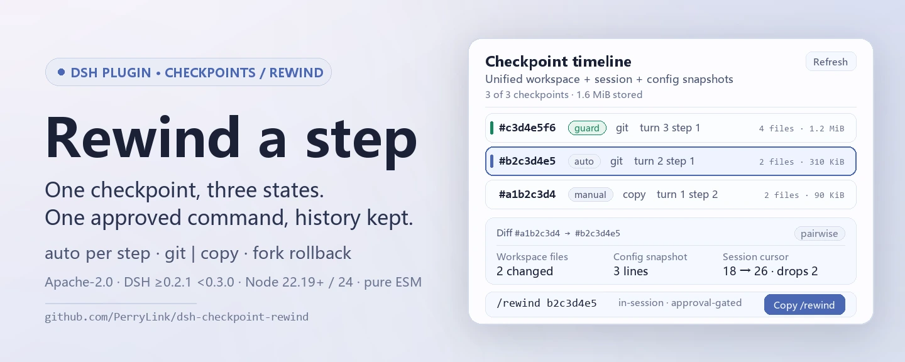
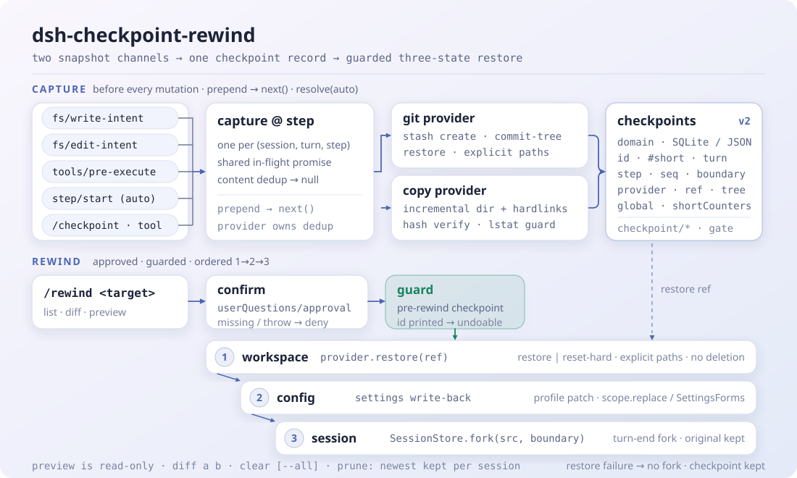

<div align="center">

<picture>
  <source media="(prefers-color-scheme: dark)" srcset="docs/assets/dsh-checkpoint-rewind-hero-en-dark.webp">
  
</picture>

# dsh-checkpoint-rewind

**Transforme “voltar ao passo N” em um único comando: checkpoints de três estados — espaço de trabalho, configuração e sessão — restaurados em uma transação aprovada.**

Um plugin de costura de capacidade (capability-seam) para o DeepSeek Harness: captura o espaço de trabalho com primitivas git sem efeitos colaterais antes de cada mutação e, ao rebobinar, primeiro guarda, depois restaura arquivos, depois a configuração e por fim bifurca a sessão — o histórico da sessão original nunca é truncado.

[Instalar](#instalação-em-três-passos) · [Configuração](#configuração) · [FAQ](#faq) · [简体中文](README.md) · [English](README.en.md) · [Español](README.es.md) · [Português](README.pt.md) · [हिन्दी](README.hi.md)

[](LICENSE)
[](#compatibilidade)
[](https://www.npmjs.com/package/dsh-checkpoint-rewind)
[](https://github.com/PerryLink/dsh-checkpoint-rewind/actions/workflows/ci.yml)
[](#compatibilidade)

[](https://github.com/PerryLink/dsh-checkpoint-rewind/stargazers)
[](https://www.npmjs.com/package/dsh-checkpoint-rewind)
[](https://dshfind.com/plugins/PerryLink/dsh-checkpoint-rewind?ref=badge)
[](https://securityscorecards.dev/viewer/?uri=github.com/PerryLink/dsh-checkpoint-rewind)
[](https://dsh.market/)
[](https://gitee.com/perrylink/dsh-checkpoint-rewind)

```sh
dsh plugin --profile <name> add dsh-checkpoint-rewind
```

</div>

<sub>Plugin da comunidade, sem afiliação com a DeepSeek. Repositório canônico: <https://github.com/PerryLink/dsh-checkpoint-rewind> (o Gitee é um espelho).</sub>

## O que é

O `dsh-checkpoint-rewind` captura um **checkpoint unificado de três estados** — espaço de trabalho, cursor de sessão e configuração do plugin — e restaura um ou os três com um único comando aprovado. As instantâneas do espaço de trabalho preferem primitivas git sem efeitos colaterais (`stash create` / `commit-tree`); diretórios que não são repositórios git (e repositórios com HEAD não nascido) degradam para instantâneas `copy` incrementais com reutilização por hardlinks. A reversão de sessão nunca trunca a sessão original: ela bifurca uma sessão filha nova no limite do checkpoint, deixando o histórico original intacto. A captura acontece antes das ferramentas mutantes, em intervalo automático, manualmente via `/checkpoint` e como guardião antes de cada reversão; a página de configuração adiciona uma linha do tempo de checkpoints com diffs linha a linha aos pares.

<picture>
  <source media="(prefers-color-scheme: dark)" srcset="docs/assets/dsh-checkpoint-rewind-flow-v5-dark.svg">
  
</picture>

## Instalação em três passos

1. **Instale** (escolha um canal):

   ```sh
   # canal git (main mais recente; equivale a git+https://github.com/PerryLink/dsh-checkpoint-rewind.git)
   dsh plugin --profile web add github:PerryLink/dsh-checkpoint-rewind
   # canal npm (versões publicadas)
   dsh plugin --profile web add dsh-checkpoint-rewind
   # canal tarball: npm pack neste repo e depois
   dsh plugin --profile web add ./dsh-checkpoint-rewind-<version>.tgz
   ```

   ESM puro, sem etapa de build: `index.mjs` e `lib/` são os artefatos publicados.

2. **Configuração mínima**: componha a pilha de armazenamento (necessária para persistir checkpoints) e monte a linha do plugin. Sem a pilha de armazenamento o plugin ainda monta e nunca bloqueia a inicialização do perfil; os comandos de checkpoint/rewind retornam um erro estruturado nomeando as linhas exatas que faltam:

   ```yaml
   - insert:
       - id: checkpoint-rewind-storage
         name: '@deepseek-ai/dsh-storage'
       - id: checkpoint-rewind-storage-json
         name: '@deepseek-ai/dsh-storage-json'
         config:
           root: !!js dshHomePath('checkpoint-rewind/storage')
       - id: checkpoint-rewind-storage-domain
         name: '@deepseek-ai/dsh-storage-domain'
         config:
           backend: json
       - id: checkpoint-rewind
         name: dsh-checkpoint-rewind
         config:
           provider: auto
           confirmVia: auto
   ```

3. **Verifique que monta**:

   ```sh
   dsh --profile web --dump-config | grep -A4 'id: checkpoint-rewind'
   ```

   Depois liste os checkpoints; mutações do espaço de trabalho os criam automaticamente:

   ```text
   > /rewind list brief
   rewind: 3 checkpoints (newest last):
   #a1b2c3d4 · (git) · turn 2 step 1 · 2026-08-14 12:00:01 (3 min ago) · trigger: bash · 4 files · 1.2 MiB
   #b2c3d4e5 · (git) · turn 2 step 3 · 2026-08-14 12:00:41 · trigger: str_replace_editor · 2 files · 310 KiB
   #c3d4e5f6 · (copy) · turn 3 step 1 · 2026-08-14 12:01:10 · trigger: write · 1 file · 90 KiB
   run "/rewind <id>" to restore files and fork the session from that checkpoint
   ```

**Desinstalar**: `dsh plugin --profile web remove dsh-checkpoint-rewind` — os arquivos de instantânea permanecem até você apagar `$DSH_HOME/dsh-checkpoint-rewind`; os objetos git são coletados pelo garbage collector.

> Os checkpoints persistem pelo serviço `storageDomain`. Perfis que já compõem a pilha funcionam de imediato; um perfil básico ainda monta e pode capturar manualmente, mas os comandos falham em voz alta quando o domínio não abre — nunca degradam em silêncio para “sem checkpoints”.

## Capacidades principais

O `dsh-checkpoint-rewind` deixa um registro restaurável de três estados antes de cada mutação e transforma a restauração em uma transação de ordem fixa:

1. **Registro de três estados** — cada checkpoint guarda o estado do espaço de trabalho (SHA da árvore git, ou um manifesto de cópia), o cursor de eventos de sessão (`seq` + limite de turno) e uma instantânea de configuração, marcados por origem (`manual` / `auto` / `guard` / `mutation`).
2. **Quatro gatilhos de captura** — antes de cada ferramenta mutante (`fs/write-intent`, `fs/edit-intent`, `tools/pre-execute`), em intervalo automático (`autoCheckpoint`, por padrão a cada passo), manualmente (`/checkpoint` e a ferramenta `checkpoint`) e como guardião antes de cada reversão.
3. **Provedor com git primeiro** — `git stash create` / `commit-tree` produzem objetos de instantânea sem referência que nunca tocam a árvore de trabalho, o índice ou o histórico; a restauração é apenas da árvore de trabalho e explícita por caminhos. Diretórios sem git (e repositórios com HEAD não nascido) degradam para um provedor `copy` incremental com reutilização por hardlinks.
4. **Reversão em um passo** — `/rewind workspace|session|config|all <target>` restaura os estados escolhidos; `preview` é um relatório de impacto somente leitura, `diff <a> <b>` compara dois checkpoints e `clear` os exclui (esta sessão; `clear --all` abrange todas as sessões e espaços de trabalho).
5. **Reversão de sessão por fork** — a reversão de sessão reproduz os eventos até o limite do checkpoint pela primitiva oficial `SessionStore.fork` em uma sessão filha nova (com fallback para o caminho semente `sessions.create` quando o host não tem fork ou o checkpoint não tem limite); a sessão original mantém todo o histórico.
6. **Linha do tempo na página de configuração** — a aba `Plugins → Checkpoints` mostra os checkpoints da sessão com diffs linha a linha aos pares (`diffRenderer`) e restauração seletiva por arquivo (`selectiveRestore`).

### Superfície de comandos e ferramentas

| Superfície | Tipo | Notas |
|---|---|---|
| `/rewind` | comando | `[workspace\|session\|config\|all] <number\|id-prefix\|step <N>\|latest>` · `list [brief]` · `diff <a> <b>` · `preview <target>` · `clear [--all]` |
| `/checkpoint` | comando | `[note <text>\|list\|diff <a> <b>]` — captura um checkpoint manual |
| `checkpoint` | ferramenta | Captura um checkpoint manual com uma nota opcional |
| `fs/write-intent` · `fs/edit-intent` · `tools/pre-execute` | listeners | Captura antes da mutação (prepend pass-through; nunca rouba a vaga de política) |
| `session/event` | listener | Rastreamento de turnos/passos, intervalo automático, preenchimento de limites, poda ao fim do turno |
| projeção `checkpoints` | projeção de sessão | Faixa de linha do tempo dobrada a partir do log da sessão |
| linha do tempo da página de configuração | cliente | Aba `Plugins → Checkpoints` com diffs aos pares e restauração seletiva por arquivo |

### Exemplos

Estes são os pontos de entrada reais do plugin; instale uma vez e chame um.

**Exemplo detalhado** — comando `/rewind preview cp-9`, saída:

~~~text
rewind preview: checkpoint #cp-9 (provider git, turn 2 step 3)
restoring it would overwrite 2 file(s):
  a.txt
  b.txt
5 file(s) already match the checkpoint (not touched).
no files are deleted: 1 file(s) created after the checkpoint would be left in place:
  new.txt
run "/rewind <id>" to confirm and apply (a guard checkpoint is captured first)
~~~

*Observed from `test/checkpoints.test.mjs:289-301; lib/checkpoints.mjs:484-500`*

**Ramo de falha** — entrada `/rewind nope`, saída:

~~~text
rewind: unknown checkpoint id "nope" (run /rewind to list)
~~~

*Observed from `plugins/dsh-checkpoint-rewind/lib/errors.mjs:72; plugins/dsh-checkpoint-rewind/index.mjs:1223; plugins/dsh-checkpoint-rewind/test/index.test.mjs:346-350`*

**Exemplos breves**: `/checkpoint` · `/rewind preview`

### Números de sessão

- **Cada checkpoint recebe um número ao ser criado**, começando em `1`. `/rewind 3` resolve esse número **exatamente** — dígitos nunca são tratados como prefixo de id, então `/rewind 3` jamais pode cair no checkpoint cujo UUID começa com `3`.
- **Escopo: por sessão** (`sessionId`). Cada sessão numera seus próprios checkpoints; um número é único dentro da sua sessão, e `/rewind <number>` resolve apenas contra os checkpoints da sessão (e do espaço de trabalho) atuais.
- **Monotônico e nunca reutilizado.** A poda por cota (`maxSnapshots`) e `/rewind clear` / `/rewind clear --all` excluem registros mas nunca liberam um número: após um clear o próximo checkpoint continua a partir da marca d'água anterior (assim, após `#1 #2 #3` e um `clear`, o próximo é `#4`, não `#1`). O número fica gravado no próprio registro e o contador vive na vaga global do domínio, então excluir registros não pode reiniciá-lo.
- **Checkpoints antigos são numerados na primeira visualização.** Registros gravados antes deste recurso (sem campo de número) são numerados por ordem de criação na primeira vez que a sessão é listada ou rebobinada, e essa numeração é persistida; checkpoints novos continuam depois dela. Nada é pulado ou reatribuído, e o endereçamento por prefixo de id continua funcionando para eles.
- `/rewind list` (a lista detalhada) não muda: ainda imprime o id de 8 caracteres por linha e sua última linha aponta para `/rewind list brief` para ver os números.

`preview` resolve pelo mesmo endereçamento e imprime o impacto sem pedir confirmação nem gravar nada. `--files` restaura apenas os arquivos indicados pela mesma transação com aprovação (caminhos desconhecidos falham em fechado; é incompatível com `workspaceRestore: reset-hard` e desativado quando `selectiveRestore: false`).

### Por que outro plugin de rewind?

| Plugin | O que vende | Restaura arquivos? | Rebobina a sessão? |
|---|---|---|---|
| **dsh-checkpoint-rewind** (este) | instantâneas de objetos git + reversão de três estados + restauração em um passo | ✅ estado completo do espaço de trabalho | ✅ sessão filha com reprodução semente |
| [Anionex/dsh-turn-rewind](https://github.com/Anionex/dsh-turn-rewind) | Change Ledger persistente de deltas por mutação | ✅ reproduzindo deltas inversos | ✅ seu próprio modelo de ledger |
| [LingLambda/dsh-undo](https://github.com/LingLambda/dsh-undo) | reversão pura de contexto ao último passo concluído | ❌ | ✅ apenas contexto |
| [Mongfayi/dsh-recall](https://github.com/Mongfayi/dsh-recall) | retirada de mensagens (remover um turno e tudo depois) | ❌ (explicitamente) | ✅ remoção de turno |

A diferença em uma frase: **o dsh-checkpoint-rewind captura o *estado do espaço de trabalho* com primitivas git sem efeitos colaterais antes de cada mutação, e transforma “voltar ao passo N” em um comando aprovado: primeiro o checkpoint guardião, segundo os arquivos restaurados, terceiro a configuração, quarto a sessão reproduzida, com cada fase registrada.** Sem contabilidade de deltas que se desvie, sem edição em nível de mensagem (isso é outro plugin), sem sincronização entre dispositivos.

### Como funciona

```text
capture ── fs/write-intent · fs/edit-intent · tools/pre-execute (prepend, pass-through)
        ── step/start auto interval ── /checkpoint · checkpoint tool ── pre-rewind guard
             │
             ▼  ProviderRegistry.resolve(auto)  →  git: stash create / commit-tree
             │                                     copy: incremental dir + hardlinks
             ▼
        checkpoints storage domain (SQLite rows / JSON file)  +  checkpoint/* event (adaptive gate)

/rewind <target> ── confirm (userQuestions / approval, fail-closed) ──▶ guard checkpoint
             ├─ workspace: provider.restore(ref)  (restore | reset-hard)
             ├─ config:   settings write-back (persisted on the profile patch)
             └─ session:  SessionStore.fork(source, boundary) → new child session (original untouched)
```

Registro completo de decisões, vocabulário de eventos e contrato da costura de provedores: [ARCHITECTURE.md](ARCHITECTURE.md).

### Eventos de sessão (nota rc.2)

O plugin declara `checkpoint/snapshot`, `checkpoint/bound`, `checkpoint/prune` e `checkpoint/rewind` como membros `SessionEventMap` apenas de log. O Harness rc.2 **não tem superfície de registro de eventos de plugin** e o `Session.append` não estampa o envelope `ignorable` (seu terceiro argumento é intenção de superfície, não opções), então anexar tipos desconhecidos deixaria a sessão ilegível ao recarregar. Por isso o plugin anexa por uma **porta adaptativa**: uma sonda em tempo de execução (em um armazenamento de sessão separado e nunca persistido) detecta se o `append` do host estampa o envelope `ignorable` — no rc.2 a porta fica fechada; em hosts que suportam, os eventos `checkpoint/*` são anexados automaticamente com `ignorable: true`. Até então a cadeia de auditoria autoritativa é `command/run` + `command/done` (conhecidos pelo host) mais o domínio de armazenamento `checkpoints` durável.

### Âncora da Web UI

O plugin devolve o id da nova sessão no resultado do comando (`session: <id>`) e o shell web pode navegar até lá. A **unidade de projeção de sessão `checkpoints` está incluída**: sempre que existe `ctx.sessionProjections`, o plugin registra a unidade via `ctx.inject` (dobra `checkpoint/snapshot|bound|prune|rewind` em uma lista de valor inteiro) — em hosts rc.2 permanece vazia até uma build do harness incluir o vocabulário `checkpoint/*` ou o envelope `ignorable`, e então se preenche sem mudanças no plugin.

### Verificação de integração

Uma execução real de integração headless montada (`npm run test:integration`) percorre o fluxo completo: o agente modifica arquivos em dois turnos, depois `/rewind preview` inspeciona o impacto somente leitura (sem porta de confirmação, sem gravações) e `/rewind <id>` restaura os arquivos e reproduz a sessão em uma sessão filha nova. A execução verifica o conteúdo dos arquivos, o contexto filho reproduzido, o checkpoint guardião e que os arquivos criados após o checkpoint sobrevivam — para os fluxos dos provedores copy e git (o fluxo git também verifica que `HEAD` e o reflog não são tocados). O driver fica em `test/integration/rewind-headless.mjs`.

## Configuração

Todas as opções são campos Schemastery `Config` (alteráveis no cordis.yml); nada é codificado. As opções do provedor (`gitBin`, `snapshotDir`, `excludeGlobs`, `verifyByHash`) são lidas da configuração viva no momento do uso, então mudanças no cordis.yml valem sem reiniciar. Uma sobrescrita por id substitui a linha inteira: repita cada chave de que precisa.

Chaves mais usadas:

| Chave | Padrão | Significado |
|---|---|---|
| `enabled` | `true` | Interruptor mestre; `false` remove comandos, listeners e provedores por completo |
| `provider` | `auto` | Provedor de instantâneas: `auto` (git se disponível, senão copy) · `git` · `copy` |
| `maxSnapshots` | `50` | Checkpoints mantidos por sessão (os mais antigos são podados primeiro) |
| `maxSnapshotBytes` | `536870912` (512 MiB) | Cota flexível global de bytes incrementais (o mais recente por sessão viva sempre é mantido) |
| `confirmVia` | `auto` | Canal de confirmação: `auto` (userQuestions primeiro) · `userQuestions` · `approval` |
| `preRewindCheckpoint` | `warn` | Checkpoint guardião antes de restaurar: `warn` · `require` · `off` |
| `workspaceRestore` | `restore` | Reversão do espaço de trabalho: `restore` (sobrescrita segura) · `reset-hard` (estilo CC, opt-in) |
| `autoCheckpoint.enabled` | `true` | Instantâneas automáticas por intervalo em `step/start` |

<details>
<summary>Tabela de configuração completa (20 chaves)</summary>

| Chave | Padrão | Significado |
|---|---|---|
| `enabled` | `true` | Interruptor mestre; `false` remove comandos, listeners e provedores por completo |
| `provider` | `auto` | Provedor de instantâneas: `auto` (git se disponível, senão copy) · `git` · `copy` |
| `gitBin` | `git` | Caminho do executável git |
| `snapshotDir` | `$DSH_HOME/dsh-checkpoint-rewind` (fallback `~/.dsh/dsh-checkpoint-rewind` quando `$DSH_HOME` não está definido) | Raiz das instantâneas do provedor copy |
| `maxSnapshots` | `50` | Checkpoints mantidos por sessão (os mais antigos são podados primeiro) |
| `maxSnapshotBytes` | `536870912` (512 MiB) | Cota flexível global de bytes incrementais (o mais recente por sessão viva sempre é mantido) |
| `pruneOnTurnEnd` | `true` | Executa a poda por cota ao fim de um turno |
| `mutationTools` | `['bash','write','edit','str_replace_editor','pwsh','terminal_send']` | Ferramentas tratadas como mutantes em `tools/pre-execute` |
| `excludeGlobs` | `['node_modules','.git','.dsh','dist','build']` | Padrões glob ignorados pelo provedor copy |
| `confirmVia` | `auto` | Canal de confirmação: `auto` (userQuestions primeiro) · `userQuestions` · `approval` |
| `listLimit` | `10` | Checkpoints exibidos por `/rewind` sem argumentos |
| `preRewindCheckpoint` | `warn` | Checkpoint guardião antes de restaurar: `warn` · `require` · `off` |
| `verifyByHash` | `false` | Comparação por hash de conteúdo e verificação de restauração do provedor copy |
| `autoCheckpoint.enabled` | `true` | Instantâneas automáticas por intervalo em `step/start` |
| `autoCheckpoint.intervalMinutes` | `0` | Intervalo; `0` = a cada passo |
| `workspaceRestore` | `restore` | Reversão do espaço de trabalho: `restore` (sobrescrita segura) · `reset-hard` (estilo CC, opt-in) |
| `diffRenderer` | `pairwise` | Renderizador de diffs da página de configuração: `pairwise` (texto linha a linha) · `side-by-side` (duas colunas por arquivo) |
| `selectiveRestore` | `true` | Restauração seletiva por arquivo (`/rewind … --files`) e caixa por arquivo + total de tamanho do painel |
| `promptSection` | `true` | Injeta uma seção curta de prompt com declaração de papel |
| `checkpointTool` | `true` | Registra a ferramenta de modelo `checkpoint` |

</details>

Exemplo de sobrescrita no patch do seu perfil:

```yaml
- insert:
    - id: checkpoint-rewind
      name: dsh-checkpoint-rewind
      config:
        provider: auto
        maxSnapshots: 50
        maxSnapshotBytes: 536870912
        pruneOnTurnEnd: true
        confirmVia: auto
        preRewindCheckpoint: warn
```

## FAQ

<details>
<summary>Isso substitui o git?</summary>

Não — ele *usa* o git quando disponível. Em um repositório git você obtém objetos de instantânea byte a byte exatos e deduplicados sem tocar no histórico; em qualquer outro diretório o provedor copy faz o mesmo com arquivos comuns. Commits regulares continuam sendo seu histórico de longo prazo.

</details>

<details>
<summary>Por que não `git reset --hard` por padrão?</summary>

Porque destruir estado não é trabalho de uma rede de segurança. Por padrão o plugin só cria objetos sem referência e faz restaurações apenas da árvore de trabalho e explícitas por caminho, então um rewind errado nunca pode perder histórico, o índice ou arquivos criados depois do checkpoint. `reset-hard` está disponível atrás de `workspaceRestore: 'reset-hard'` para quem quer explicitamente a paridade com o CC.

</details>

<details>
<summary>Por quanto tempo um checkpoint pode ser restaurado?</summary>

Nenhuma ref é mantida sobre as instantâneas do provedor git. Por projeto são objetos `stash create`/`commit-tree` sem referência, e `discard` apaga apenas o registro, deixando o objeto para o `git gc`. Duas coisas independentes limitam por quanto tempo um checkpoint continua restaurável: a poda por cota do próprio plugin (`maxSnapshots`, 50 por sessão por padrão; `maxSnapshotBytes`, uma cota flexível global de 512 MiB por padrão aplicada via `pruneAll()` na captura e varrida ao fim dos turnos) e o git gc do repositório anfitrião. Com os padrões do git, objetos sem referência sobrevivem até um auto-gc rodar, e mesmo então só são podados os objetos mais antigos que `gc.pruneExpire` (2 semanas por padrão). Um `git gc --prune=now` manual, um repack agressivo, `filter-repo` ou um clone novo podem removê-los imediatamente. Objetos podados agora são detectados de antemão: o provedor git sonda o objeto de instantânea antes de restaurar (`git cat-file -e`) e falha em voz alta quando ele falta em vez de restaurar nada em silêncio, e uma passada de doctor percorre cada registro de checkpoint para sondar a existência do objeto e marcar os não restauráveis (`[UNRESTORABLE: object missing]` na lista). A passada de doctor está implementada e testada, mas ainda não está ligada ao caminho de restauração (o restore ainda não consulta a marca `unrestorable`; acompanhamento na discussão #13).

</details>

<details>
<summary>Posso rebobinar para um passo no meio de um turno?</summary>

A restauração de arquivos é precisa por passo (`/rewind step <N>` = instantânea mais próxima ≤ N). A reprodução de sessão, porém, respeita a granularidade de reprodução do harness: a sessão filha é semeada até o limite de turno do checkpoint.

</details>

<details>
<summary>O que acontece se ninguém puder responder à confirmação?</summary>

Nada é tocado — o plugin falha em fechado (`unavailable`/`rejected`), mantém o checkpoint e retorna um erro explicativo. Com `confirmVia: approval` no rc.2 a mensagem diz para montar userQuestions, porque approval exige um turno aberto e os comandos rodam entre turnos.

</details>

<details>
<summary>Posso desfazer um rewind?</summary>

Sim — cada rewind aprovado captura primeiro um checkpoint guardião do estado anterior; o resultado imprime `rewind guard: <id>`, e `/rewind <guard-id>` restaura esse estado.

</details>

<details>
<summary>Como endereço os checkpoints?</summary>

Pelo **número de sessão** (`/rewind 3` — veja `/rewind list brief`; por sessão, monotônico, nunca reutilizado), pelo prefixo de id único (o id curto de 8 caracteres da lista continua funcionando), por `/rewind step <N>` e por `/rewind latest`. `/rewind clear` apaga os checkpoints desta sessão, e `/rewind clear --all` apaga os de todas as sessões e espaços de trabalho (arquivos intactos) — nenhum dos dois reinicia a numeração. `/rewind preview <target>` usa o mesmo endereçamento para mostrar o impacto sem mudar nada.

</details>

<details>
<summary>Por que o número continua subindo depois de um clear?</summary>

Porque um número é um endereço, não uma posição: reutilizar `#1` para outro checkpoint depois de um clear redirecionaria em silêncio qualquer coisa que mencionasse `#1`. O contador persiste no domínio `checkpoints` (vaga global) e cada registro guarda seu próprio número, então podar e limpar apagam instantâneas sem reciclar ids.

</details>

<details>
<summary>O que o `preview` faz — e não faz?</summary>

Ele resolve o checkpoint e então executa uma comparação somente leitura: quais arquivos seriam sobrescritos (ou recriados), quais já coincidem e quais arquivos criados depois do checkpoint ficariam no lugar. Ele nunca pergunta, nunca grava, nunca bifurca e não registra nenhum evento `checkpoint/rewind` — a porta de aprovação só roda em um `/rewind <id>` real.

</details>

### Solução de problemas

| Sintoma | Causa / correção |
|---|---|
| `/rewind <id>` diz `rewind cancelled: no confirmation answerer` | Não há canal userQuestions/approval montado — o plugin falha em fechado. Execute na Web UI (ou monte um provedor de perguntas); `confirmVia` escolhe o canal. |
| `/rewind <id>` diz `approval requires an open turn …` | Os comandos rodam entre turnos e approval precisa de um turno — monte userQuestions ou defina `confirmVia: userQuestions`. |
| `rewind: checkpoint registry unavailable` | O domínio de armazenamento `checkpoints` não abriu. Ou o serviço `storageDomain` não está composto (adicione as linhas da pilha de armazenamento de Instalação em três passos: `@deepseek-ai/dsh-storage` + `@deepseek-ai/dsh-storage-json` com config `root` + `@deepseek-ai/dsh-storage-domain` com config `backend: json`) ou o backend está falhando; verifique os logs do harness. |
| Um checkpoint aparece como `fork: pending (turn not closed)` | O turno ainda não tem `turn/end`; os arquivos ainda podem ser restaurados, mas a reprodução de sessão espera o turno fechar. |
| `files restored … but the session was NOT replayed` | A fase de sessão da transação falhou (sem limite fechado, ou reprodução rejeitada). Os arquivos ficam restaurados; use o `rewind guard: <id>` impresso para desfazer. |
| `rewind: aborted — the pre-rewind guard checkpoint could not be captured` | `preRewindCheckpoint: require` recusou o rewind porque a captura do guardião falhou; corrija o armazenamento (ou defina `warn`/`off`). |
| Um checkpoint aparece como `(copy)` embora o diretório seja um repositório | HEAD não nascido (sem commit inicial): as primitivas de instantânea git exigem HEAD, então o plugin degrada para `copy` até o primeiro commit. |
| `MISSING_CREDENTIAL` em execuções headless | Não tem relação com este plugin: não há `DEEPSEEK_API_KEY` configurada para o provedor de modelo. |
| O armazenamento de instantâneas cresce | A poda roda após cada instantânea e em `turn/end` (`pruneOnTurnEnd`); reduza `maxSnapshots` / `maxSnapshotBytes`, execute `/rewind clear` ou apague `$DSH_HOME/dsh-checkpoint-rewind` após desinstalar. |

## Limites de segurança

- **O histórico git é intocável.** O provedor git só executa primitivas de lista branca sem efeitos colaterais — `stash create`, `commit-tree`, `restore --worktree`, `ls-tree`, `diff-tree`, `ls-files`, `status`, `rev-parse`, `cat-file -e` — forçadas por uma asserção em tempo de execução, e as referências de objeto são validadas como ids hexadecimais antes de irem para o git (um registro adulterado não pode injetar opções git). **Nunca `reset --hard` por padrão, nunca `clean`, nunca mutação de índice ou histórico** (veja `workspaceRestore` abaixo).
- **Reversão por sobrescrita, nunca exclusão.** A restauração só sobrescreve os arquivos capturados, e o provedor git restaura **caminhos explícitos** (`git restore … -- .` apagaria arquivos adicionados com `git add` depois do checkpoint). Arquivos criados depois do checkpoint (não rastreados **ou** no índice) são *relatados* e deixados no lugar.
- **Sem gravações através de links, sem traversal de caminhos.** O provedor copy valida as referências de checkpoint antes de juntá-las a caminhos de diretório de instantâneas, e se recusa a restaurar através de um destino (ou ancestral) que virou link simbólico — então uma restauração nunca segue um link para fora do espaço de trabalho.
- **A restauração exige aprovação.** Sobrescrever arquivos do usuário sempre passa pela costura de confirmação com semântica `ask`; um respondedor ausente, que lança erro ou que diz não **falha em fechado**. `/rewind preview` é a forma somente leitura de inspecionar o impacto primeiro.
- **O rewind é reversível.** Antes de restaurar, um checkpoint guardião captura o estado atual; restaurar o guardião desfaz o rewind. `preRewindCheckpoint: require` aborta o rewind quando o guardião não pode ser capturado.
- **Transação de ordem fixa.** Primeiro guardião, segundo espaço de trabalho, terceiro configuração, quarto reprodução de sessão; cada fase é registrada; uma restauração falha deixa arquivos, checkpoints e sessão intactos.
- **`workspaceRestore: 'reset-hard'` é equivalente ao CC e opt-in.** Executa `git reset --hard <snapshot commit>` (a cabeça do branch vai para o commit da instantânea; o histórico anterior continua recuperável via reflog; arquivos não rastreados não são tocados). Fica desligado por padrão.
- **Visível para o modelo ⟺ registrado.** Tudo o que um usuário ou o modelo vê se reconstrói a partir de `command/run` + `command/done` (e, quando o host os conhece, dos eventos `checkpoint/*`) mais o domínio `checkpoints` durável.
- **Falhas são ruidosas.** Configuração inválida lança no carregamento; domínio indisponível, restauração falha e fork falho retornam texto de erro estruturado — nada é engolido ou truncado em silêncio.

## Permissões e dados

- **Permissões**: o manifesto workshop declara `workspace:read`, `workspace:write`, `git:read`, `git:write`, `snapshot-storage:write`, `session-log:read`, `settings:write` e `network:none`.
- **Dados**: os registros de checkpoint vivem no domínio de armazenamento `checkpoints` (linhas SQLite ou um arquivo JSON); as instantâneas copy ficam em `snapshotDir`. A **vaga global** do domínio guarda os contadores de números curtos por sessão, por isso apagar registros (`prune`, `clear`, `clear --all`) nunca pode reciclar um número. Totalmente local — sem rede, sem credenciais. O domínio é aberto em versão dupla: mídias da era 0.4.x (domínio v1) são abertas em um modo de compatibilidade que mantém os registros antigos legíveis e grava as novas capturas na forma v2, então atualizar o plugin nunca abandona uma mídia existente.
- **Log da sessão**: os eventos `checkpoint/*` são anexados pela porta adaptativa; a cadeia de auditoria autoritativa é `command/run` + `command/done` mais o domínio durável.

## Limitações conhecidas

- No rc.2, os eventos de sessão `checkpoint/*` são suprimidos pela porta adaptativa; a cadeia de auditoria depende de `command/run` + `command/done` mais o domínio de armazenamento até um host incluir o vocabulário ou o envelope `ignorable`.
- `confirmVia: approval` precisa de um turno aberto, e os comandos rodam entre turnos — monte userQuestions (ou defina `confirmVia: userQuestions`) no rc.2.
- A reversão de sessão **bifurca uma sessão filha nova** no limite do checkpoint; ela nunca reescreve ou trunca a sessão original.
- `workspaceRestore: 'reset-hard'` move a cabeça do branch para o commit da instantânea; fica desligado por padrão.
- Um checkpoint capturado antes de qualquer turno fechado não tem limite de reprodução — a reversão de sessão então cria uma sessão filha nova com contexto vazio.

## Interoperabilidade com outros plugins DSH

Verificado contra **DSH `0.2.0-rc.2`** (o runtime para o qual este README aponta) e o conjunto de plugins de muitas estrelas sondado em 2026-10-05.

Este plugin **não interfere** com outros plugins, incluindo os de muitas estrelas amplamente instalados:

- **Sem colisão de nome de ferramenta.** Toda ferramenta tem namespace; nenhum nome nu pertencente a uma ferramenta embutida ou a outro plugin é registrado.
- **Sem colisão de chave de serviço.** Não fornece nenhuma chave de serviço, então não pode colidir em uma.
- **Sem colisão de vaga.** Não registra nenhuma chave de vaga de cliente, então não disputa uma vaga `shadows-shipped-ui`.
- **Sem colisão de rota HTTP.** Não registra nenhum prefixo `webServer`.
- **Sem colisão de camada de patch.** O patch do bundle só faz `insert` da própria linha; nunca sobrescreve a `config` de uma linha embutida.
- **Sem mutação global.** Não altera protótipos, não reescreve `process.env` nem substitui o dispatcher global de fetch.

**Listeners de eventos compartilhados não interferem por construção.** Ele observa os eventos sensíveis à ordem `fs/edit-intent`, `fs/write-intent`, `tools/pre-execute` com `ctx.on()` — o registro de broadcast do Cordis, no qual cada listener roda e nenhum pode matar de fome outro. **Cada listener aqui delega via `next()`**, então a cadeia nunca é curto-circuitada, e uma mutação é aplicada ao valor que `next()` produziu em vez de ser devolvida no lugar dele:

- `tools/pre-execute` — also used by `cc-safety-net` (1576★).

Evidência estática: `dsh-plugin-doctor` K10–K13 reportam `pass` em todas as verificações deste repositório.

## Compatibilidade

| Superfície | Status |
|---|---|
| Harness | DeepSeek Harness `dsh-v0.2.1-alpha.1` (tag do GitHub, verificado em 2026-09-25; pin npm `0.1.7-rc.2`, peers `>=0.1.6-0 <0.2.0 \|\| >=0.1.7-0 <0.2.0`) (adaptado em 2026-10-04): o host removeu `@deepseek-ai/dsh-settings-file` e substituiu a superfície de registro por namespace de `ctx.settings` por `SettingsForms`, que projeta o `Config` de cada entrada do Loader no formulário de configuração e persiste as edições no patch do perfil — os campos de configuração do plugin agora são declarados `volatile()` e lidos ao vivo, codecs estritos de typert carregam apenas sua fábrica `create()`, e o aviso de rewind declara seu próprio `kind` de fonte de mensagem. O caminho legado `settings.register` é mantido para hosts `0.1.5-rc.2`/`0.1.6-alpha.2`. Verificado em 2026-09-22 contra o checkout `dsh-v0.1.7-alpha.1` (typecheck contra a superfície de tipos alpha.1 + suíte unitária completa + integração headless montada). |
| Node | `^22.19.0 \|\| >=24.0.0` |
| Plataformas | Todas (comandos e listeners do host; linha do tempo opcional na página de configuração via a capacidade settings) |
| Modelo | Qualquer (sem chamadas de modelo — instantâneas e restaurações são determinísticas) |

## Ecossistema e qualidade

- [Espelho Gitee](https://gitee.com/perrylink/dsh-checkpoint-rewind) (espelho de sincronização; o GitHub é canônico)
- [Página do plugin no dshfind](https://dshfind.com/plugins/PerryLink/dsh-checkpoint-rewind) (instalações e ranking)
- [Relatório OpenSSF Scorecard](https://securityscorecards.dev/viewer/?uri=github.com/PerryLink/dsh-checkpoint-rewind) (impulsionado por [.github/workflows/scorecard.yml](.github/workflows/scorecard.yml))
- [Relatório de verificação do dsh-plugin-doctor](https://github.com/PerryLink/dsh-plugin-doctor#verified-徽章) (K10–K13 todos `pass`)
- [DSH Market](https://dsh.market/) (listado)
- **Canal da loja 1024**: `npm i -g dsh1024` uma vez e depois `dsh1024 plugin --profile web add dsh-checkpoint-rewind` (conta para o ranking de instalações do [deepseek1024.com](https://deepseek1024.com))
- [Base de conhecimento do ecossistema](https://perrylink.github.io/dsh-plugin-guide/) — dados medidos, não marketing: guia de desenvolvimento de plugins · dados de seleção de plugins · critérios de manutenção

## Desenvolvimento

```sh
npm install                # node ^22.19 || >=24; peers fixados em 0.2.1-rc.2
npm test                   # node --test test/**/*.test.mjs (inclui suítes de provider)
npm run test:integration   # verificação headless montada (test/integration/)
npm run check:readmes      # porta de consistência dos cinco README
npm run verify:self-contained  # specs de dependência resolvem do registry
npm run verify:artifacts   # arquivos enviados presentes + index.mjs importável
npm run lint               # oxlint
```

Sem etapa de build: ESM puro — `index.mjs`/`lib/` são os artefatos publicados. As imagens do README são geradas programaticamente por [`scripts/gen-readme-assets.py`](scripts/gen-readme-assets.py) (Python + Pillow, dois SVGs de fluxo claro/escuro) e podem ser reexecutadas sem risco.

<details>
<summary>Estrutura do repositório</summary>

| Caminho | Propósito |
|---|---|
| `index.mjs` | Entrada do plugin (o único arquivo de face host): registro de provedores, listeners de eventos, o comando `/rewind` |
| `lib/` | Funções puras e provedores sem dependência de DSH (`lib/providers/`); `lib/domain.mjs` é o único módulo que pode usar zod/pacotes DSH |
| `client/` | Linha do tempo da página de configuração (metade do navegador) |
| `cordis.patch.yml` | Declaração do bundle: `insert` da linha checkpoint-rewind |
| `test/` | Testes unitários + verificação headless montada em `test/integration/` |
| `docs/assets/` | Imagens do README (banner hero + diagrama de estrutura claro/escuro) |
| `scripts/` | Portas mecânicas + o gerador de assets do README |
| `ARCHITECTURE.md` | Arquitetura de costuras de três papéis e o registro completo de decisões |

</details>

Topics: `deepseek-harness`, `dsh`, `dsh-plugin`, `rewind`, `checkpoint`, `snapshot`, `session-replay`, `session-fork`, `config-restore`, `workspace-safety`, `undo`, `cordis-plugin`

## Família e agradecimentos

Este projeto faz parte da família de plugins do DeepSeek Harness da [PerryLink](https://github.com/PerryLink) (todos Apache-2.0). Se ele for útil, **uma estrela ajuda a próxima pessoa a encontrá-lo** — nada fica bloqueado por trás dela.

- [@mahirhir](https://github.com/mahirhir) — sonda doctor de existência de objetos (#16), liveConfig para `snapshotDir`/`excludeGlobs`/`verifyByHash` (#17), escopo de poda por sessão viva (#18), limpeza de cota por instantânea ausente (#19), configuração dinâmica do provedor copy (#20).
- [@PerryLink](https://github.com/PerryLink) — criador e mantenedor: o modelo de checkpoint de três estados, a costura de provedores git/copy, a transação de rewind em três fases, a linha do tempo da página de configuração, docs, CI/CD e releases.
- [@tmpdot](https://github.com/tmpdot) (rmUnlucky) — compatibilidade de versão dupla da mídia v1 (#8), resolução preguiçosa de `storageDomain` (#9), dicas de resposta de deduplicação de checkpoints (#10) e o relato do bug do diretório de instantâneas sem `$DSH_HOME` (#4).
- [@shipinliang](https://github.com/shipinliang) — relatos do contrato wire do painel de checkpoints: o `acceptsUndefined` ausente no parâmetro `limit` (#5) e a falha do proxy de campo privado `#deps` (#6).
- [@hwz1456](https://github.com/hwz1456) — relato de captura de checkpoints no perfil web (#3).
- [@Andiii208](https://github.com/Andiii208) — relato de especificação de publicação do `plugin_check` (#2).
- [@alexchenzl](https://github.com/alexchenzl) (Ashu) — convite para o listado do DSH Directory (#7).

<details>
<summary>Expandir todos os plugins</summary>

| Plugin | Estado |
|---|---|
| **[dsh-aqua-input-check](https://github.com/PerryLink/dsh-aqua-input-check)** |  |
| **[dsh-archive-check](https://github.com/PerryLink/dsh-archive-check)** |  |
| **[dsh-auto-review](https://github.com/PerryLink/dsh-auto-review)** |  |
| **[dsh-autotier](https://github.com/PerryLink/dsh-autotier)** | 🧊 CONGELADO — ver o README do repo |
| **[dsh-bid-ca-precheck](https://github.com/PerryLink/dsh-bid-ca-precheck)** |  |
| **[dsh-bid-qual-check](https://github.com/PerryLink/dsh-bid-qual-check)** |  |
| **[dsh-cert-mcp](https://github.com/PerryLink/dsh-cert-mcp)** | 🧊 CONGELADO — ver o README do repo |
| **[dsh-checkpoint-rewind](https://github.com/PerryLink/dsh-checkpoint-rewind)** |  |
| **[dsh-click](https://github.com/PerryLink/dsh-click)** |  |
| **[dsh-composer-history](https://github.com/PerryLink/dsh-composer-history)** |  |
| **[dsh-contract-stance](https://github.com/PerryLink/dsh-contract-stance)** |  |
| **[dsh-customs-doc-check](https://github.com/PerryLink/dsh-customs-doc-check)** |  |
| **[dsh-data-quality](https://github.com/PerryLink/dsh-data-quality)** | 🧊 CONGELADO — ver o README do repo |
| **[dsh-demurrage-ledger](https://github.com/PerryLink/dsh-demurrage-ledger)** |  |
| **[dsh-doublecheck](https://github.com/PerryLink/dsh-doublecheck)** |  |
| **[dsh-drill-script-check](https://github.com/PerryLink/dsh-drill-script-check)** |  |
| **[dsh-eia-guide-check](https://github.com/PerryLink/dsh-eia-guide-check)** |  |
| **[dsh-emergency-plan](https://github.com/PerryLink/dsh-emergency-plan)** |  |
| **[dsh-essay-rubric-check](https://github.com/PerryLink/dsh-essay-rubric-check)** |  |
| **[dsh-evidence-check](https://github.com/PerryLink/dsh-evidence-check)** |  |
| **[dsh-export-ctl-check](https://github.com/PerryLink/dsh-export-ctl-check)** |  |
| **[dsh-fast](https://github.com/PerryLink/dsh-fast)** |  |
| **[dsh-fmea-table-check](https://github.com/PerryLink/dsh-fmea-table-check)** |  |
| **[dsh-forecast-penalty](https://github.com/PerryLink/dsh-forecast-penalty)** |  |
| **[dsh-fund-research](https://github.com/PerryLink/dsh-fund-research)** |  |
| **[dsh-github](https://github.com/PerryLink/dsh-github)** |  |
| **[dsh-gongwen-flow-check](https://github.com/PerryLink/dsh-gongwen-flow-check)** |  |
| **[dsh-gongwen-word-check](https://github.com/PerryLink/dsh-gongwen-word-check)** |  |
| **[dsh-guard-plan-qc](https://github.com/PerryLink/dsh-guard-plan-qc)** |  |
| **[dsh-hazchem-check](https://github.com/PerryLink/dsh-hazchem-check)** |  |
| **[dsh-hazplan-check](https://github.com/PerryLink/dsh-hazplan-check)** |  |
| **[dsh-hidden-risk-map](https://github.com/PerryLink/dsh-hidden-risk-map)** |  |
| **[dsh-hs-classify](https://github.com/PerryLink/dsh-hs-classify)** |  |
| **[dsh-icd-rule-check](https://github.com/PerryLink/dsh-icd-rule-check)** |  |
| **[dsh-industry-research](https://github.com/PerryLink/dsh-industry-research)** |  |
| **[dsh-lawcite-adapter](https://github.com/PerryLink/dsh-lawcite-adapter)** |  |
| **[dsh-laya](https://github.com/PerryLink/dsh-laya)** |  |
| **[dsh-lc-doc-check](https://github.com/PerryLink/dsh-lc-doc-check)** |  |
| **[dsh-learning-gap-check](https://github.com/PerryLink/dsh-learning-gap-check)** |  |
| **[dsh-library](https://github.com/PerryLink/dsh-library)** |  |
| **[dsh-local-ai](https://github.com/PerryLink/dsh-local-ai)** |  |
| **[dsh-lsp-actions](https://github.com/PerryLink/dsh-lsp-actions)** |  |
| **[dsh-mask](https://github.com/PerryLink/dsh-mask)** |  |
| **[dsh-mcp-panel](https://github.com/PerryLink/dsh-mcp-panel)** |  |
| **[dsh-medrec-qc](https://github.com/PerryLink/dsh-medrec-qc)** |  |
| **[dsh-memento](https://github.com/PerryLink/dsh-memento)** | 🧊 CONGELADO — ver o README do repo |
| **[dsh-nsfc-form-check](https://github.com/PerryLink/dsh-nsfc-form-check)** |  |
| **[dsh-nurse-record-check](https://github.com/PerryLink/dsh-nurse-record-check)** |  |
| **[dsh-observe](https://github.com/PerryLink/dsh-observe)** |  |
| **[dsh-origin-rvc-check](https://github.com/PerryLink/dsh-origin-rvc-check)** |  |
| **[dsh-ota-review-check](https://github.com/PerryLink/dsh-ota-review-check)** |  |
| **[dsh-output-styles](https://github.com/PerryLink/dsh-output-styles)** |  |
| **[dsh-paper-doc-adapter](https://github.com/PerryLink/dsh-paper-doc-adapter)** |  |
| **[dsh-permission-rules](https://github.com/PerryLink/dsh-permission-rules)** |  |
| **[dsh-permit-report-check](https://github.com/PerryLink/dsh-permit-report-check)** |  |
| **[dsh-pipeline-check](https://github.com/PerryLink/dsh-pipeline-check)** |  |
| **[dsh-pleading-draft](https://github.com/PerryLink/dsh-pleading-draft)** |  |
| **[dsh-plugin-doctor](https://github.com/PerryLink/dsh-plugin-doctor)** | 🚫 APOSENTADO (repo arquivado) |
| **[dsh-plugin-guide](https://github.com/PerryLink/dsh-plugin-guide)** |  |
| **[dsh-plugin-kit](https://github.com/PerryLink/dsh-plugin-kit)** | 🚫 APOSENTADO (repo arquivado) |
| **[dsh-plugin-upgrade](https://github.com/PerryLink/dsh-plugin-upgrade)** | 🚫 APOSENTADO (repo arquivado) |
| **[dsh-policy-brief-draft](https://github.com/PerryLink/dsh-policy-brief-draft)** |  |
| **[dsh-power-loss-split](https://github.com/PerryLink/dsh-power-loss-split)** |  |
| **[dsh-power-ticket-check](https://github.com/PerryLink/dsh-power-ticket-check)** |  |
| **[dsh-ppap-check](https://github.com/PerryLink/dsh-ppap-check)** |  |
| **[dsh-protest-deadline](https://github.com/PerryLink/dsh-protest-deadline)** |  |
| **[dsh-railway-window](https://github.com/PerryLink/dsh-railway-window)** |  |
| **[dsh-repair-order-qc](https://github.com/PerryLink/dsh-repair-order-qc)** |  |
| **[dsh-research-report](https://github.com/PerryLink/dsh-research-report)** |  |
| **[dsh-review-reply-check](https://github.com/PerryLink/dsh-review-reply-check)** |  |
| **[dsh-rulefile-check](https://github.com/PerryLink/dsh-rulefile-check)** |  |
| **[dsh-safety-brief-check](https://github.com/PerryLink/dsh-safety-brief-check)** |  |
| **[dsh-score](https://github.com/PerryLink/dsh-score)** | 🧊 CONGELADO — ver o README do repo |
| **[dsh-session-sync](https://github.com/PerryLink/dsh-session-sync)** |  |
| **[dsh-site-log-check](https://github.com/PerryLink/dsh-site-log-check)** |  |
| **[dsh-skill-pack-security](https://github.com/PerryLink/dsh-skill-pack-security)** |  |
| **[dsh-soe-decision-check](https://github.com/PerryLink/dsh-soe-decision-check)** |  |
| **[dsh-soilwater-check](https://github.com/PerryLink/dsh-soilwater-check)** |  |
| **[dsh-sop-sync-check](https://github.com/PerryLink/dsh-sop-sync-check)** |  |
| **[dsh-spc-gbt-adapter](https://github.com/PerryLink/dsh-spc-gbt-adapter)** |  |
| **[dsh-talk](https://github.com/PerryLink/dsh-talk)** |  |
| **[dsh-tender-extract](https://github.com/PerryLink/dsh-tender-extract)** |  |
| **[dsh-tender-matrix](https://github.com/PerryLink/dsh-tender-matrix)** |  |
| **[dsh-test-drive](https://github.com/PerryLink/dsh-test-drive)** |  |
| **[dsh-ticktick](https://github.com/PerryLink/dsh-ticktick)** | 🚫 APOSENTADO (repo arquivado) |
| **[dsh-translate](https://github.com/PerryLink/dsh-translate)** |  |
| **[dsh-warranty-calc](https://github.com/PerryLink/dsh-warranty-calc)** |  |
| **[dsh-budget](https://github.com/PerryLink/dsh-budget)** | 🧊 CONGELADO — ver o README do repo |
| **[dsh-claude-move](https://github.com/PerryLink/dsh-claude-move)** | 🧊 CONGELADO — ver o README do repo |
| **[dsh-defend](https://github.com/PerryLink/dsh-defend)** | 🧊 CONGELADO — ver o README do repo |
| **[dsh-draw](https://github.com/PerryLink/dsh-draw)** | 🧊 CONGELADO — ver o README do repo |
| **[dsh-reach](https://github.com/PerryLink/dsh-reach)** | 🧊 CONGELADO — ver o README do repo |
| **[dsh-background-agents](https://github.com/PerryLink/dsh-background-agents)** | 🚫 APOSENTADO (repo arquivado) |
| **[dsh-session-pin](https://github.com/PerryLink/dsh-session-pin)** | 🚫 APOSENTADO (repo arquivado) |
| **[dsh-team-rooms](https://github.com/PerryLink/dsh-team-rooms)** | 🚫 APOSENTADO (repo arquivado) |

</details>

## Licença

[Apache License 2.0](LICENSE) © 2026 dsh-checkpoint-rewind contributors

<p align="center"><sub>Apache-2.0 · Plugin da comunidade, sem afiliação com a DeepSeek.</sub></p>
